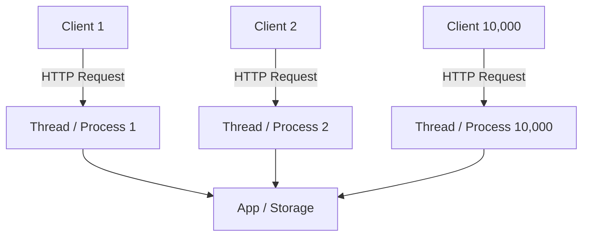
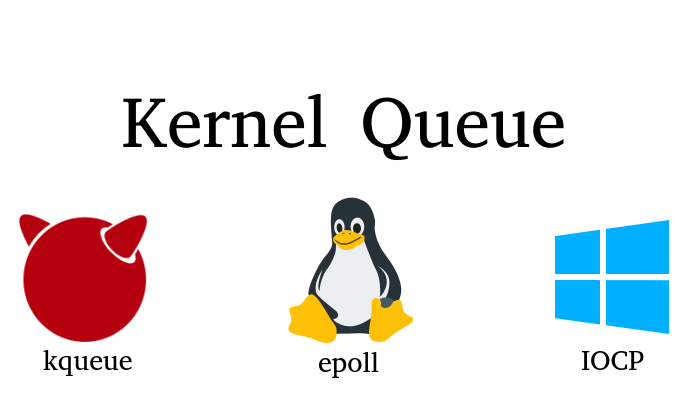

# Bài toán C10K & Bước ngoặt I/O Multiplexing

## Table of Contents

- [1. Bài toán C10K và sự sụp đổ của mô hình truyền thống](#1-bài-toán-c10k-và-sự-sụp-đổ-của-mô-hình-truyền-thống)
- [2. Bước ngoặt lịch sử I/O Multiplexing](#2-bước-ngoặt-lịch-sử-io-multiplexing)

---

## 1. Bài toán C10K và sự sụp đổ của mô hình truyền thống

Thuật ngữ **C10K** (Concurrent 10,000 Connections) được **Dan Kegel** đề xuất vào năm 1999 để chỉ thách thức kỹ thuật: *làm thế nào để một máy chủ web duy nhất xử lý đồng thời 10.000 kết nối active mà không làm cạn kiệt tài nguyên hệ thống (CPU, RAM, file descriptors, sockets)?*

### Mô hình truyền thống (Thread hoặc Process cho mỗi kết nối)

Các máy chủ web thế hệ cũ (như Apache HTTP Server sử dụng MPM Prefork hoặc MPM Worker) gán một tiến trình (Process) hoặc một luồng (Thread) riêng cho từng kết nối HTTP.

| Thành phần/Bước | Vai trò/Mô tả | Chi tiết |
| :--- | :--- | :--- |
| **Client Request** | Yêu cầu kết nối HTTP từ trình duyệt client | Mỗi kết nối yêu cầu giữ 1 thread/process riêng |
| **Worker Thread/Process** | Khối xử lý đồng bộ gán riêng cho từng kết nối | Chiếm 2–4MB RAM |
| **Backend Storage** | Tầng ứng dụng hoặc cơ sở dữ liệu xử lý logic | Bị nghẽn do quá tải Context Switching ở cấp CPU |

Những hạn chế cốt lõi của mô hình đa luồng khi quy mô kết nối tăng vọt bao gồm:

1. **Dung lượng bộ nhớ tăng tuyến tính**: Mỗi luồng/tiến trình tiêu tốn từ 2MB đến 4MB RAM. Với 10.000 kết nối, hệ thống mất từ 20GB đến 40GB RAM chỉ để duy trì trạng thái luồng.
2. **Quá tải chuyển đổi ngữ cảnh (Context Switching)**: Khi số lượng luồng vượt xa số lõi CPU vật lý, CPU phải liên tục hoán đổi ngữ cảnh giữa các luồng. Chi phí overhead này chiếm phần lớn năng lực xử lý, gây tắc nghẽn hệ thống (Thread Thrashing).
3. **Chế độ Blocking I/O**: Các socket mặc định ở chế độ blocking. Khi một luồng gọi `read()` trên socket chưa có dữ liệu, luồng đó bị đẩy vào trạng thái đứng chờ. Hàng nghìn luồng bị kẹt ngủ tiếp tục chiếm dụng RAM, khiến tài nguyên máy chủ nhanh chóng cạn kiệt.

---

## 2. Bước ngoặt lịch sử I/O Multiplexing

Để kiến trúc Event-Driven vận hành hiệu quả và mở rộng tối đa trên CPU đa nhân, các hệ điều hành đã bổ sung các cơ chế **I/O Multiplexing thế hệ mới** trực tiếp ở cấp độ Kernel. Đây chính là bước ngoặt kỹ thuật giải quyết trọn vẹn bài toán C10K (hàng chục nghìn kết nối đồng thời).

### 2.1 Cơ chế I/O Multiplexing từ Kernel

Giai đoạn 2000 đến 2002, các hệ điều hành lớn lần lượt giới thiệu các giao diện theo dõi sự kiện I/O hiệu năng cao:

* **`kqueue`** (FreeBSD năm 2000, dùng trên macOS): Cơ chế theo dõi sự kiện tổng quát (socket, file, signal, timer) với hiệu năng vượt trội.
* **`epoll`** (Linux năm 2002): Cơ chế thông báo sự kiện I/O có khả năng mở rộng cực cao trên nhân Linux, thay thế cho các syscall cũ bị nghẽn cổ chai (như `select()` hay `poll()`).
* **`IOCP`** (Windows): Mô hình Asynchronous I/O dựa trên cơ chế completion notification.

#### Nền tảng cốt lõi của hệ sinh thái phần mềm hiện đại

Sự xuất hiện của các cơ chế này đã định hình lại hoàn toàn cách các web server, runtime và framework xử lý I/O:

* **Web Server và Reverse Proxy:** **NGINX**, **Envoy**, **HAProxy** tận dụng trực tiếp `epoll` (trên Linux) và `kqueue` (trên BSD/macOS) để duy trì hàng trăm nghìn kết nối đồng thời với lượng RAM và CPU tiêu thụ tối thiểu.
* **JavaScript và Node.js:** Thư viện **`libuv`** được xây dựng như một lớp trừu tượng (abstraction layer) bọc quanh `epoll`, `kqueue`, `IOCP` để tạo nên vòng lặp sự kiện (Event Loop) nổi tiếng của Node.js.
* **Java:** Tầng **Java NIO (Non-blocking I/O)** và framework **Netty** (nền tảng của Spring WebFlux, gRPC Java, Cassandra, Kafka client) ánh xạ trực tiếp các selector xuống `epoll` và `kqueue` dưới tầng OS.
* **Go và Rust:** Hệ thống **Netpoller** trong Go runtime và thư viện **Tokio (hoặc Mio)** trong Rust đều trực tiếp ủy thác việc giám sát network socket cho `epoll` và `kqueue`.

> [!NOTE]
> **Phát biểu gây chú ý của Linus Torvalds (7/2025)**
>
> Mới đây (tháng 7/2025), chính **Linus Torvalds** đã đưa ra một tuyên bố rất thẳng thắn về `epoll`. Ông thông báo sẽ **không chấp nhận bất kỳ bản vá lỗi nào cho epoll** trừ khi đó là lỗi hiển nhiên hoặc được chia nhỏ và giải thích cực kỳ cẩn thận. Lý do ông đưa ra (nguyên văn: "epoll needs to die, or at least be seen as a legacy interface that should be cut down, not something to be improved upon"):
>
> **Bối cảnh đằng sau phát biểu này:**
> * **Sự trỗi dậy của `io_uring`:** `io_uring` đang nổi lên như một giải pháp I/O hiệu năng cao và toàn diện hơn nhiều trên Linux. Nó không chỉ vượt trội ở network I/O mà còn xử lý trọn vẹn cả Disk I/O (điểm yếu cố hữu của `epoll`), giúp vượt qua các giới hạn kiến trúc cũ.
> * **Định hướng tiến hóa dài hạn:** Đây là tuyên bố về triết lý thiết kế hệ thống hơn là lệnh cấm dùng ngay lập tức. Khi công nghệ mới ưu việt hơn ra đời, các giao diện cũ cần được xem là legacy để giảm bớt sự phức tạp và nợ kỹ thuật của kernel.
> * **Thực tế hiện tại:** Mặc dù được xếp vào diện kế thừa, `epoll` vẫn là API cốt lõi và là xương sống phục vụ phần lớn Internet ngày nay (gồm cả NGINX). `io_uring` rất mạnh mẽ nhưng đòi hỏi mô hình lập trình bất đồng bộ khác biệt và phức tạp hơn, khiến nó chưa thể là sự thay thế trực tiếp tức thì cho mọi ứng dụng `epoll`.

---

[← Back to README](README.md)
