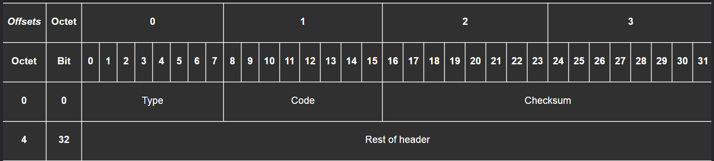

# Cấu trúc Gói tin IP và Giao thức ICMP

Gói tin IP là đơn vị truyền tải cơ bản của tầng Mạng, còn ICMP là giao thức điều khiển và báo lỗi hoạt động song song với nó. Tài liệu này phân tích cấu trúc **Payload** và **Header** của gói tin IP cùng vai trò của địa chỉ IP nguồn/đích và rủi ro **Spoofing**; sau đó chuyển sang **ICMP** với cấu trúc ICMP Header, hai công cụ chẩn đoán **Ping** và **Traceroute**, cùng những hệ quả bảo mật khi firewall chặn các thông điệp ICMP.

## Table of Contents

*   [1. Gói tin IP (IP Packet)](#1-gói-tin-ip-ip-packet)
*   [2. Giao thức ICMP](#2-giao-thức-icmp)
*   [Tóm tắt](#tóm-tắt)
*   [Liên quan](#liên-quan)

---

## 1. Gói tin IP (IP Packet)

Gói tin IP là đơn vị truyền tải cơ bản của tầng Mạng, đóng gói dữ liệu của tầng trên để định tuyến xuyên qua nhiều mạng khác nhau. Phần này mổ xẻ cấu trúc của nó cùng vai trò của địa chỉ nguồn/đích và rủi ro đi kèm.

### 1.1. Payload vs. Header (Dữ Liệu so với Phần Đầu)

-   **Header (Phần Đầu):** Là phần **Metadata** của gói tin. Bạn thường không cần quan tâm đến nó trong lập trình ứng dụng hàng ngày, nhưng nó rất quan trọng để **Debug** hoặc phân tích sâu các vấn đề mạng.
-   **Payload (Dữ Liệu):** Là phần dữ liệu thực tế mà ứng dụng của bạn gửi đi. Đây là phần chúng ta quan tâm nhất.
-   **Overhead (Chi phí):** Header tạo ra một phần **Overhead** cho việc truyền tin. Header IP tiêu chuẩn chỉ chiếm vài chục byte, nhưng khi bật các **Options**, phần phụ trội này có thể phình lên đáng kể. Đây là phần dữ liệu phụ trội, không phải dữ liệu của bạn.

> Khi tính toán kích thước dữ liệu hoặc băng thông, kích thước thực tế truyền đi = `Payload + Header` (nhớ cộng thêm phần header).

---

### 1.2. Địa chỉ IP Nguồn/Đích (Source/Destination IP) và Spoofing

-   **Địa chỉ IP Nguồn & Đích:** Đây là hai trường thông tin **quan trọng nhất** trong IP header. Chúng xác định gói tin từ đâu đến và cần phải đi đến đâu.
-   **Spoofing (Mạo danh IP):**
    -   **Khái niệm:** Là kỹ thuật giả mạo địa chỉ IP nguồn trong header. Về mặt kỹ thuật, một chương trình có thể tự do đặt địa chỉ IP nguồn thành bất kỳ giá trị nào nó muốn.
    -   **Thực tế:** Việc này **không dễ dàng** trên Internet công cộng.
    -   **Lý do:** Nhà cung cấp dịch vụ Internet (ISP) của bạn sử dụng **Egress Filtering** (bộ lọc thoát). Họ kiểm tra và chặn các gói tin có địa chỉ IP nguồn không thuộc về mạng của họ. Vì vậy, bạn không thể giả mạo một địa chỉ IP hợp lệ của người khác và gửi nó ra ngoài Internet.
    -   **Hệ quả:** Ngay cả khi bạn **Spoof** thành công, tất cả các phản hồi sẽ được gửi đến địa chỉ IP đã bị giả mạo, không phải về máy của bạn. Điều này làm cho các cuộc tấn công dạng "one-way" (như DDoS) có thể thực hiện được, nhưng không thể thiết lập một kết nối hai chiều.

> Đừng tin tưởng hoàn toàn vào địa chỉ IP nguồn từ phía client cho các chức năng bảo mật quan trọng, vì spoofing vẫn có thể xảy ra trong các mạng nội bộ được kiểm soát kém.

---

## 2. Giao thức ICMP

ICMP là giao thức điều khiển và báo lỗi của tầng Mạng, hoạt động song song với IP. Phần này phân tích cấu trúc ICMP Header, hai công cụ chẩn đoán **Ping** và **Traceroute**, cùng những hệ quả bảo mật khi firewall chặn các thông điệp ICMP.

### 2.1. Cấu trúc của ICMP Header

ICMP được đóng gói ngay bên trong một gói tin IP. Cấu trúc header của nó khá đơn giản và cung cấp những thông tin cần thiết để chẩn đoán sự cố.

-   **Type (8 bits):** Xác định loại thông điệp. Ví dụ: `8` cho Echo Request (yêu cầu ping), `0` cho Echo Reply (phản hồi ping), `3` cho Destination Unreachable (Không thể đến đích).
-   **Code (8 bits):** Cung cấp thông tin chi tiết hơn cho trường `Type`. Ví dụ, nếu `Type` là `3` (Không thể đến đích), `Code` có thể là `1` (Host Unreachable - Host không thể đến) hoặc `3` (Port Unreachable - Cổng không thể đến).
-   **Checksum (16 bits):** Dùng để kiểm tra lỗi trong header của ICMP, đảm bảo thông điệp không bị hỏng hóc trên đường truyền.
-   **Rest of Header (32 bits):** Nội dung của phần này thay đổi tùy thuộc vào `Type` và `Code`. Ví dụ, đối với thông điệp Echo, nó chứa một **Identifier** và một **Sequence Number** để khớp yêu cầu với phản hồi.

---

### 2.2. Ping

**Ping** được sử dụng để kiểm tra xem một máy chủ có "sống" và có thể kết nối được từ máy của bạn hay không.

**Cách hoạt động:**

1.  Máy của bạn (ví dụ: `192.168.1.3`) gửi một thông điệp ICMP **Echo Request** (`Type 8`) đến máy chủ đích (`192.168.10.3`).
2.  Nếu máy chủ đích nhận được yêu cầu, nó sẽ trả lời bằng một thông điệp ICMP **Echo Reply** (`Type 0`).
3.  Công cụ `ping` sẽ đo thời gian giữa lúc gửi yêu cầu và nhận phản hồi (Round Trip Time - RTT).

Nếu bạn nhận được phản hồi, điều đó có nghĩa là có một đường đi hợp lệ giữa bạn và máy chủ.

---

### 2.3. Traceroute (hoặc `tracert` trên Windows)

**Traceroute** là một công cụ thông minh hơn, giúp bạn xác định toàn bộ đường đi (danh sách các router) mà gói tin của bạn đi qua để đến được đích.

**Cách hoạt động (một cách thông minh sử dụng TTL và ICMP):**
Cơ chế này dựa trên việc gửi các gói tin với giá trị **Time-To-Live (TTL)** tăng dần. TTL là một bộ đếm trong gói tin IP, mỗi khi đi qua một router, giá trị này sẽ giảm đi 1. Khi TTL về 0, router sẽ hủy gói tin và gửi lại một thông điệp ICMP **Time Exceeded** (`Type 11`) cho người gửi.

1.  **Gửi gói tin với TTL=1:** Gói tin đến router đầu tiên. Router này giảm TTL về 0, hủy gói tin và gửi lại thông báo `Time Exceeded`. Máy của bạn ghi lại địa chỉ IP của router đầu tiên này.
2.  **Gửi gói tin với TTL=2:** Gói tin đi qua router đầu tiên (TTL giảm còn 1), đến router thứ hai. Router thứ hai giảm TTL về 0 và gửi lại `Time Exceeded`. Máy của bạn ghi lại địa chỉ IP của router thứ hai.
3.  **Lặp lại:** Quá trình này tiếp tục với TTL=3, 4, 5,... cho đến khi gói tin đến được máy chủ đích cuối cùng.
4.  **Đến đích:** Khi máy chủ đích nhận được gói tin (lúc này TTL đã đủ lớn), nó sẽ không gửi `Time Exceeded` mà gửi lại một thông điệp **Echo Reply** (nếu là `ping`) hoặc **Destination Unreachable** (nếu `traceroute` dùng UDP đến một cổng không mở). Điều này báo hiệu cho `traceroute` biết rằng hành trình đã hoàn tất.

---

### 2.4. Vấn đề bảo mật và Firewall

Vì ICMP có thể được dùng để thu thập thông tin về cấu trúc mạng thông qua **Network Mapping** hoặc **Ping Sweeps**, nhiều quản trị viên mạng cấu hình **firewall để chặn các thông điệp ICMP** vì lý do bảo mật.

#### Hậu quả của việc chặn ICMP

1.  **Ping và Traceroute không hoạt động:** Đây là hậu quả rõ ràng nhất. Bạn không thể chẩn đoán kết nối đến các máy chủ nằm sau firewall đó.
2.  **Gây ra sự cố kết nối nghiêm trọng (Path MTU Discovery):** Đây là một vấn đề tinh vi hơn. Khi một router cần gửi một gói tin lớn hơn mức MTU (Maximum Transmission Unit) của chặng mạng tiếp theo, nó cần phải phân mảnh gói tin. Nếu gói tin đó có cờ "Don't Fragment" (DF), router sẽ không phân mảnh mà thay vào đó gửi lại một thông điệp ICMP `Fragmentation Needed` (`Type 3`, `Code 4`).
    -   Nếu firewall chặn thông điệp ICMP này, máy gửi sẽ không bao giờ biết rằng nó cần phải gửi các gói tin nhỏ hơn.
    -   Kết quả là kết nối có thể bị "treo" hoặc cực kỳ chậm, một lỗi rất khó để chẩn đoán.

---

## Tóm tắt

-   **Gói tin IP** là đơn vị truyền tải cơ bản ở tầng Mạng, gồm **Header** (metadata) và **Payload** (dữ liệu ứng dụng); phần header tạo ra một **Overhead** đáng kể so với dữ liệu thật.
-   **Source/Destination IP** là hai trường quan trọng nhất, nhưng **Spoofing** khiến địa chỉ nguồn không thể tin tưởng tuyệt đối.
-   **ICMP là giao thức điều khiển và báo lỗi** ở tầng Mạng, hoạt động song song với IP, và là nền tảng cho các công cụ thiết yếu như **`ping`** và **`traceroute`**.
-   Việc **chặn hoàn toàn ICMP bởi firewall có thể gây ra các vấn đề kết nối** khó lường, đặc biệt là với **Path MTU Discovery**.

---

## Liên quan

*   [Địa chỉ IP, Subnet và Default Gateway](./the_ip_building_blocks.md) — nền tảng địa chỉ hóa mà gói tin IP dựa vào để định tuyến ra khỏi mạng nội bộ.
*   [MSS, MTU và Path MTU Discovery](../07_others/mss_mtu_path_mtu.md) — thông điệp ICMP `Fragmentation Needed` là mảnh ghép then chốt của cơ chế PMTUD.
*   [Tường lửa (Firewall)](../07_others/what_is_a_firewall.md) — làm rõ hậu quả khi firewall chặn ICMP và cách các quy tắc lọc tác động lên gói tin.
*   [Bộ Giao thức TCP/IP và So sánh với OSI](../00_osi_model/tcp_ip_vs_osi.md) — đặt **IP** và **ICMP** vào đúng tầng của mô hình mạng.

---
[← Back to README](../README.md)
