# Tường lửa (Firewall)

## Table of Contents

-   [1. Tường lửa là gì?](#1-tường-lửa-là-gì)
-   [2. Vì sao cần Tường lửa?](#2-vì-sao-cần-tường-lửa)
-   [3. Các loại Tường lửa](#3-các-loại-tường-lửa)
-   [4. Tường lửa Mạng và Cách Triển khai](#4-tường-lửa-mạng-và-cách-triển-khai)
-   [5. Lịch sử Hình thành](#5-lịch-sử-hình-thành)

---

## 1. Tường lửa là gì?

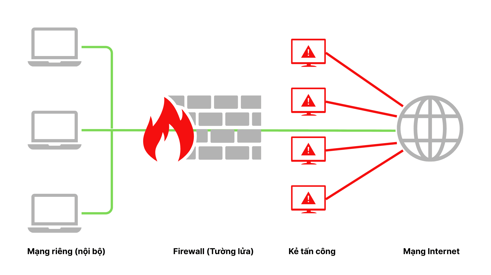

Tường lửa là lớp phòng thủ đầu tiên của gần như mọi hạ tầng mạng: nó đứng giữa mạng tin cậy và mạng không tin cậy (thường là Internet) để giám sát, cho phép hoặc chặn từng luồng dữ liệu đi qua. Cụ thể hơn, tường lửa là một hệ thống bảo mật kiểm soát lưu lượng mạng dựa trên một tập quy tắc định trước, qua đó quyết định luồng dữ liệu nào được phép đi qua và luồng nào bị chặn lại.

> [!NOTE]
> Thuật ngữ "tường lửa" vay mượn từ ngành xây dựng: những bức tường được dựng giữa các tòa nhà để ngăn ngọn lửa lan sang công trình liền kề. Tường lửa mạng hoạt động theo nguyên lý tương tự, chỉ khác là nó ngăn các mối đe dọa số thay vì ngọn lửa vật lý.

Về hình thức triển khai, tường lửa có thể là phần cứng chuyên dụng, phần mềm chạy trên một máy chủ, hoặc kết hợp cả hai. Dù ở dạng nào, chức năng cốt lõi vẫn là một điểm kiểm soát tập trung đối với dòng lưu lượng ra vào mạng được bảo vệ.

---

## 2. Vì sao cần Tường lửa?

Mục đích chính của tường lửa là bảo mật. Nó có thể chặn lưu lượng độc hại ngay từ bên ngoài trước khi lưu lượng đó chạm tới mạng nội bộ, đồng thời ngăn thông tin nhạy cảm bị rò rỉ ra ngoài. Một tường lửa chỉ kiểm tra chiều vào mà bỏ qua chiều ra sẽ để lọt kịch bản máy bị nhiễm mã độc âm thầm gửi dữ liệu ra ngoài, nên cả hai chiều đều phải nằm trong tầm kiểm soát.

Ngoài mục đích bảo mật, tường lửa còn được dùng để lọc nội dung. Một trường học có thể cấu hình tường lửa chặn truy cập vào nội dung không phù hợp với học sinh; ở quy mô lớn hơn, một số quốc gia vận hành tường lửa để giới hạn những phần của Internet mà người dùng trong nước có thể truy cập. Cơ chế đằng sau hai ví dụ này giống hệt nhau: một tập quy tắc quyết định nội dung nào được đi qua.

---

## 3. Các loại Tường lửa

Tường lửa tiến hóa qua nhiều thế hệ, mỗi thế hệ mở rộng mức độ hiểu biết về lưu lượng mà nó kiểm tra. Bảng dưới tóm tắt các nhóm chính trước khi đi vào chi tiết.

| Nhóm tường lửa | Cơ chế cốt lõi | Bảo vệ chủ yếu |
| :--- | :--- | :--- |
| **Proxy-based Firewall** | Ngắt kết nối trực tiếp, kiểm tra rồi mở một kết nối mới | Ẩn danh client, kiểm soát nội dung |
| **Stateful Firewall** | Lưu trạng thái các kết nối đang mở để ra quyết định | Mạng nội bộ, chống quét cổng |
| **NGFW** | Kiểm tra sâu gói tin và ngữ cảnh ứng dụng/người dùng | Phòng thủ đa tầng |
| **WAF** | Lọc lưu lượng HTTP giữa ứng dụng web và Internet | Ứng dụng web |
| **FWaaS** | Cung cấp năng lực tường lửa qua cloud | Hạ tầng cloud và multi-cloud |

### 3.1. Tường lửa dựa trên Proxy

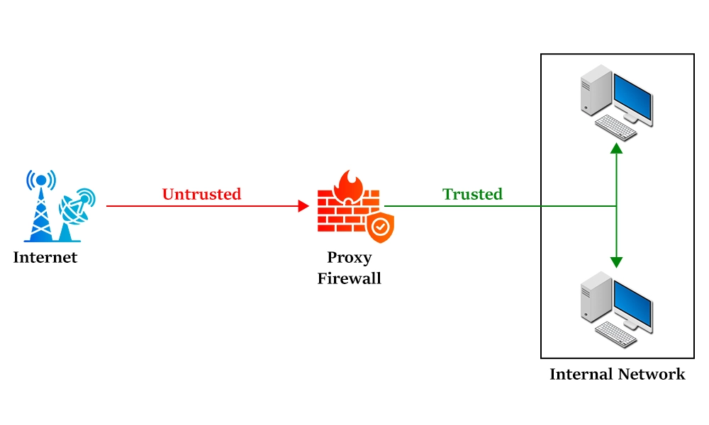

**Proxy-based Firewall** hoạt động như một **Proxy** đứng giữa client và server. Client kết nối tới tường lửa; tường lửa kiểm tra các gói tin đi ra rồi mở một kết nối riêng tới đích đến thật. Chiều ngược lại diễn ra tương tự: phản hồi từ server được tường lửa chặn lại, kiểm tra, rồi chuyển cho client qua một kết nối riêng. Hệ quả là client và server không bao giờ có kết nối trực tiếp với nhau.

> [!TIP]
> Hãy hình dung một nhân viên soát vé đứng trước cửa hộp đêm: anh ta chặn khách lại trước khi họ vào để kiểm tra giấy tờ, và cũng chặn khách trên đường ra để bảo đảm họ về nhà an toàn. Cái giá phải trả là khi dòng người quá đông, hàng chờ sẽ dài và mỗi người đều bị chậm lại.

Hạn chế lớn nhất của nhóm này chính là **latency**, đặc biệt khi lưu lượng tăng cao, do mọi gói tin đều phải đi qua hai lần kết nối thay vì một.

Sơ đồ dưới cho thấy điểm mấu chốt: tường lửa không chuyển tiếp gói tin mà ngắt kết nối rồi mở hai kết nối riêng biệt về hai phía.

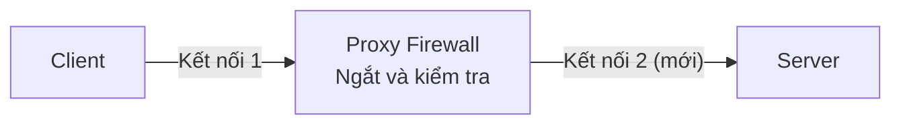

> **Ví dụ thực tế:**
>
> -   **Ở trường:** phòng máy thường cấu hình mọi máy tính trỏ về một proxy server của trường. Muốn ra Internet, request phải đi qua nó, đúng nghĩa "ngắt kết nối rồi mở kết nối mới"; máy tính không nói chuyện trực tiếp với website.
> -   **Ở nhà:** nhiều người cài **Squid** trên một chiếc Raspberry Pi để cả nhà cùng đi qua đó, nhờ vậy chặn được quảng cáo và website xấu ở cấp toàn mạng.

### 3.2. Tường lửa trạng thái

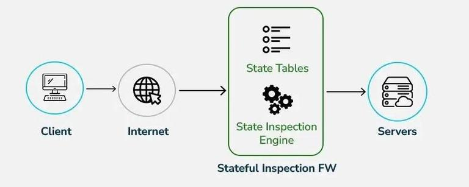

Khác với việc soi từng gói tin riêng lẻ, **Stateful Firewall** lưu lại thông tin về các kết nối đang mở và dùng ngữ cảnh đó để phân tích lưu lượng. Vì không phải kiểm tra lại từng gói, nó xử lý nhanh hơn tường lửa dựa trên proxy.

Kiểu tường lửa này ra quyết định dựa trên nhiều ngữ cảnh. Chẳng hạn, nếu nó ghi nhận rằng một kết nối đi ra đang yêu cầu một loại phản hồi nhất định, thì chỉ những gói tin vào khớp với phản hồi đó mới được phép đi qua. Nhờ giữ mọi cổng ở trạng thái đóng cho tới khi có yêu cầu hợp lệ, nó cũng gây khó khăn cho kỹ thuật **Port Scanning**.

Điểm yếu đã biết của tường lửa trạng thái là nó có thể bị đánh lừa: kẻ tấn công dụ client gửi một yêu cầu hợp lệ, rồi lợi dụng việc tường lửa đã "mở đường" cho loại phản hồi tương ứng để tuồn gói tin độc hại qua. Các trang web không an toàn có thể dùng JavaScript để tạo ra những yêu cầu giả mạo ngay từ trình duyệt của người dùng.

Lưu đồ dưới mô tả cách **State Table** biến mỗi kết nối đang mở thành ngữ cảnh để quyết định phản hồi nào được đi qua.

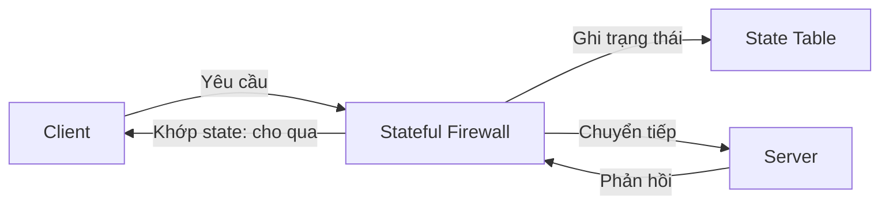

> **Ví dụ thực tế:**
>
> -   **Ở nhà (thiết bị mạng):** chiếc router Wi-Fi do nhà mạng cấp có tường lửa **stateful**. Khi bạn mở một trang web trên điện thoại, router ghi nhớ kết nối đó nên gói phản hồi biết đường quay về đúng điện thoại; ngược lại, một máy lạ từ ngoài gõ cửa vào sẽ bị chặn vì không có kết nối nào do bạn khởi tạo.
> -   **Ở nhà (trên máy tính):** **Windows Defender Firewall** cũng là stateful, nó giám sát toàn bộ lưu lượng mạng và theo dõi trạng thái của từng kết nối.
>
> Cách phân biệt nhanh với proxy: router stateful **chuyển tiếp gói tin** và chỉ ghi nhớ trạng thái, còn proxy **ngắt kết nối rồi mở kết nối mới**. Router nhà bạn xử lý nhanh chính là nhờ vậy.

### 3.3. Tường lửa thế hệ mới (NGFW)

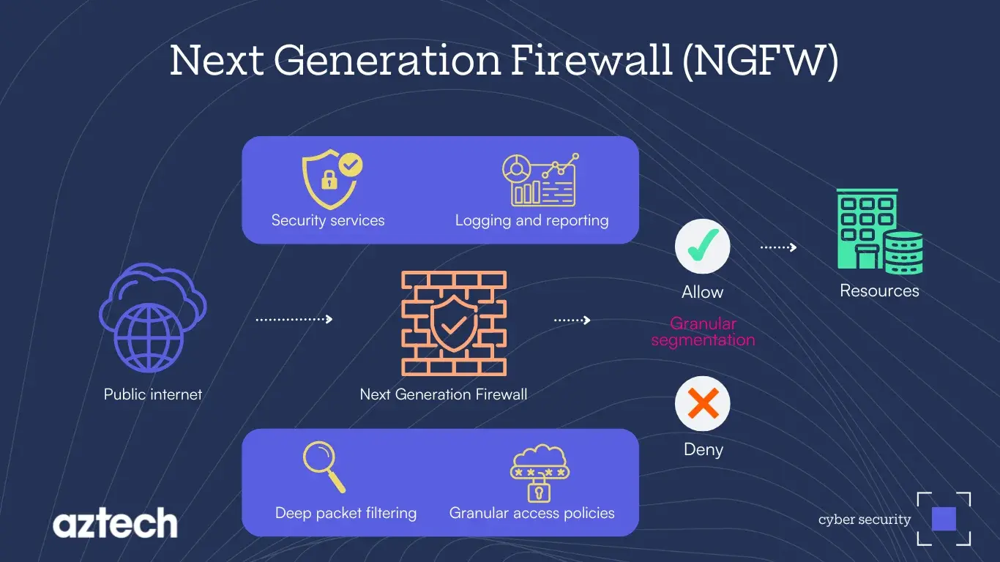

**NGFW** (Next-Generation Firewall) thừa hưởng toàn bộ năng lực của tường lửa truyền thống, đồng thời bổ sung các tính năng kiểm tra ở những tầng cao hơn của mô hình OSI:

-   **Deep Packet Inspection (DPI):** kiểm tra sâu hơn nhiều so với tường lửa truyền thống, có thể đọc cả phần nội dung gói tin và xác định ứng dụng nào đang được truy cập, nhờ đó áp được các quy tắc lọc chi tiết hơn.
-   **Application Awareness:** nhận biết ứng dụng nào đang chạy và dùng cổng nào, qua đó ngăn một số loại **malware** có hành vi kết thúc tiến trình rồi chiếm lấy cổng của nó.
-   **Identity Awareness:** áp quy tắc dựa trên danh tính, chẳng hạn máy tính đang được dùng hoặc người dùng đang đăng nhập.
-   **Sandboxing:** cô lập các đoạn mã gắn với gói tin đến và chạy thử trong môi trường cách ly để xác minh chúng không có hành vi độc hại trước khi cho phép vào mạng.

Sơ đồ dưới gom bốn năng lực trên thành một chuỗi kiểm tra nhiều lớp trước khi ra quyết định.

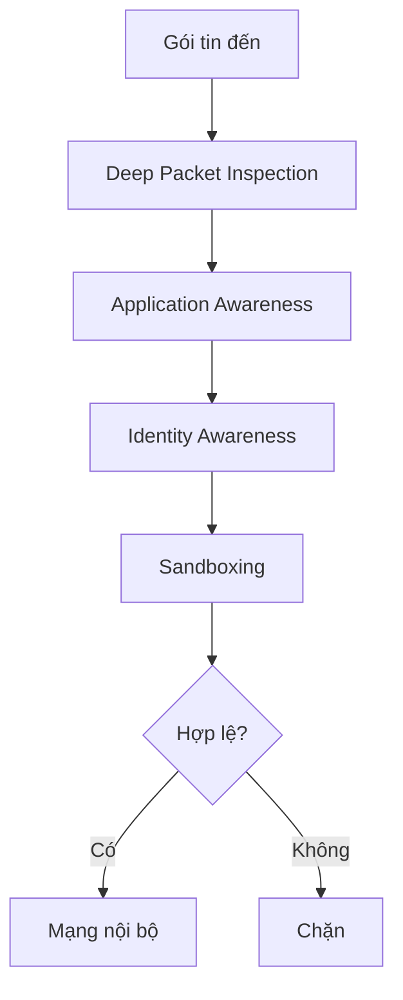

> **Ví dụ thực tế:**
>
> -   **Ở nhà:** tính năng **Parental Controls / HomeShield** trên router mesh TP-Link Deco cho phép chặn theo ứng dụng (Blocked Apps), lọc nội dung độc hại, thậm chí chặn cả proxy/VPN mà con cài để lách. Đây chính là **Application Awareness** kết hợp **DPI** ở quy mô gia đình, một dạng "NGFW tí hon"; **Asus AiProtection** (hợp tác Trend Micro) cũng làm điều tương tự.
> -   **Ở trường:** mạng trường không chặn theo IP hay cổng nữa mà nhận diện ứng dụng để chặn game, mạng xã hội, kể cả khi ứng dụng đổi cổng. Đây là điểm khác biệt cốt lõi so với tường lửa trạng thái.

### 3.4. Tường lửa ứng dụng web (WAF)

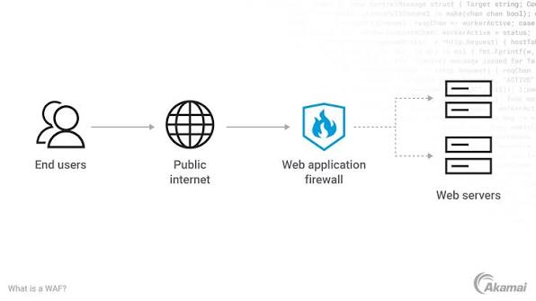

Nếu tường lửa truyền thống bảo vệ mạng riêng khỏi những ứng dụng web độc hại, thì **WAF** (Web Application Firewall) bảo vệ ứng dụng web khỏi người dùng độc hại. WAF lọc và giám sát lưu lượng **HTTP** giữa ứng dụng web và Internet, tập trung ngăn các đòn tấn công nhắm vào tầng ứng dụng như **SQL Injection**, **Cross-Site Scripting (XSS)**, **Cross-Site Request Forgery** hay file inclusion.

Về bản chất, WAF là một dạng **Reverse Proxy** đặt trước ứng dụng web, tạo ra một tấm khiên giữa ứng dụng và Internet: client bắt buộc phải đi qua WAF trước khi chạm tới server. WAF vận hành dựa trên một tập quy tắc thường được gọi là policy; giá trị của nó nằm ở tốc độ và sự dễ dàng khi sửa đổi policy, cho phép phản ứng nhanh với các vector tấn công thay đổi liên tục (ví dụ bật **rate limiting** ngay trong lúc xảy ra tấn công DDoS).

Lưu đồ dưới cho thấy WAF chặn lưu lượng độc hại ngay trước khi nó chạm tới ứng dụng web.

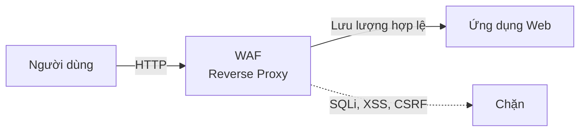

> **Ví dụ thực tế:**
>
> -   **Ở trường (minh họa):** giả sử cổng thông tin sinh viên có một ô đăng nhập. Nếu kẻ xấu nhập `' OR 1=1 --` vào ô mật khẩu để tấn công **SQL Injection**, WAF phát hiện và chặn ngay request đó trước khi nó chạm tới cơ sở dữ liệu, còn sinh viên bình thường không thấy gì khác.
> -   **Ở nhà:** một blog WordPress cá nhân gắn **Cloudflare** gói miễn phí sẽ được Cloudflare WAF đứng trước lọc SQLi/XSS mà không cần tự cấu hình gì.

### 3.5. Tường lửa dưới dạng dịch vụ (FWaaS)

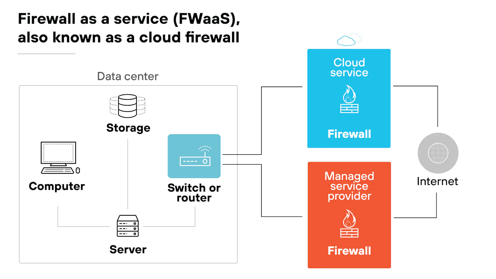

**FWaaS** (Firewall-as-a-Service), còn gọi là cloud firewall, là mô hình phân phối năng lực tường lửa qua cloud. Nó tạo ra một hàng rào ảo bao quanh nền tảng, hạ tầng và ứng dụng cloud, tương tự cách tường lửa truyền thống tạo hàng rào quanh mạng nội bộ của một tổ chức. FWaaS thường phù hợp hơn với môi trường cloud và **multi-cloud** so với tường lửa phần cứng truyền thống.

Sơ đồ dưới cho thấy FWaaS dựng hàng rào ảo bao quanh toàn bộ hạ tầng cloud thay vì một thiết bị vật lý.

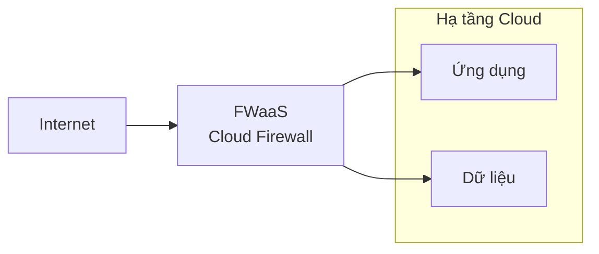

> **Ví dụ thực tế:**
>
> -   **Ở trường:** website trường thay vì đặt trên một máy chủ trong trường thì thuê trên **AWS/Azure/Google Cloud**; khi đó firewall đi kèm cloud (**AWS Network Firewall**, **Azure Firewall**, **Google Cloud NGFW**) thay cho chiếc hộp phần cứng, nên không cần mua thiết bị mà chỉ cần bật dịch vụ.
> -   **Ở nhà:** một số nhà mạng cung cấp gói "Internet an toàn", trong đó bộ lọc và tường lửa nằm trên cloud của nhà cung cấp, áp cho mọi thiết bị trong nhà mà không cần cài gì lên từng máy. Đây là tinh thần FWaaS: năng lực tường lửa được phân phối như một dịch vụ.

---

## 4. Tường lửa Mạng và Cách Triển khai

**Network Firewall** là bất kỳ tường lửa nào bảo vệ một mạng. Theo định nghĩa đó, gần như mọi tường lửa bảo mật đều là tường lửa mạng, mặc dù tường lửa cũng có thể bảo vệ từng máy riêng lẻ.

Xét theo hình thức triển khai, tường lửa ban đầu là những thiết bị phần cứng chuyên dụng. Ngày nay, phần lớn tường lửa là phần mềm, có thể chạy trên nhiều loại phần cứng khác nhau, trong khi FWaaS được vận hành hoàn toàn trên cloud.

> [!IMPORTANT]
> Tường lửa chỉ là một thành phần trong bức tranh bảo mật mạng. Một chiến lược đầy đủ còn bao gồm **Access Control**, xác thực người dùng và **DDoS Mitigation**.

---

## 5. Lịch sử Hình thành

Tường lửa ra đời vào cuối thập niên 1980. Thế hệ đầu tiên hoạt động ở mức gói tin, tức **Packet Filtering**: nó quyết định cho phép hay chặn từng gói dựa trên việc đọc header tầng mạng và tầng giao vận, cụ thể là địa chỉ IP nguồn, IP đích và cổng (có thể hình dung như việc đọc phần "người gửi" và "người nhận" trên một phong bì thư). Cách này ngăn được lưu lượng bất hợp pháp và chặn đứng nhiều cuộc tấn công malware.

Thế hệ kế tiếp bổ sung năng lực trạng thái (**Stateful**), rồi các thế hệ mới hơn như **NGFW** mở rộng khả năng kiểm tra lên tầng ứng dụng. Cách triển khai cũng thay đổi tương ứng: từ thiết bị phần cứng cắm trực tiếp vào hạ tầng, tường lửa dần chuyển sang dạng phần mềm hoặc chạy ảo trên cloud khi các quy trình nghiệp vụ dịch chuyển lên cloud, vì ép toàn bộ lưu lượng đi qua một chiếc hộp vật lý trở nên kém hiệu quả.

---

Tường lửa là điểm kiểm soát trung tâm đối với dòng dữ liệu ra vào một mạng, hoạt động dựa trên một tập quy tắc bảo mật định trước. Nó phải giám sát cả hai chiều, bởi mối đe dọa có thể đến từ ngoài vào lẫn từ bên trong rò rỉ ra. Qua các thế hệ, tường lửa tiến từ **Packet Filtering** đơn giản, qua **Stateful** nhanh và có ngữ cảnh, tới **NGFW** kiểm tra sâu và **WAF** bảo vệ riêng tầng ứng dụng web, cùng **FWaaS** phù hợp cho hạ tầng cloud. Chọn đúng nhóm tường lửa cho đúng tầng cần bảo vệ chính là nguyên tắc cốt lõi của **Defense in Depth**.

---

## Liên quan

*   [Proxy và Reverse Proxy](./the_importance_of_proxy_and_reverse_proxies.md) — cùng nằm trên trục **Intermediary**: **WAF** là một **Reverse Proxy**, còn tường lửa dựa trên proxy cũng ngắt kết nối trực tiếp giữa client và server như một **Proxy**.
*   [Hướng dẫn toàn diện về NAT](../02_routing/nat.md) — làm rõ ranh giới giữa **NAT** và tường lửa: NAT chỉ che giấu địa chỉ nên cung cấp lớp bảo vệ "tình cờ", khác với tường lửa ra quyết định thực sự dựa trên **Rule Set** tường minh.
*   [Bộ Giao thức TCP/IP và So sánh với OSI](../00_osi_model/tcp_ip_vs_osi.md) — cung cấp bản đồ phòng thủ theo tầng, giải thích vì sao **WAF** đặt ở tầng Ứng dụng còn tường lửa mạng đặt ở tầng Mạng và Giao vận.

---
[← Back to README](../README.md)
