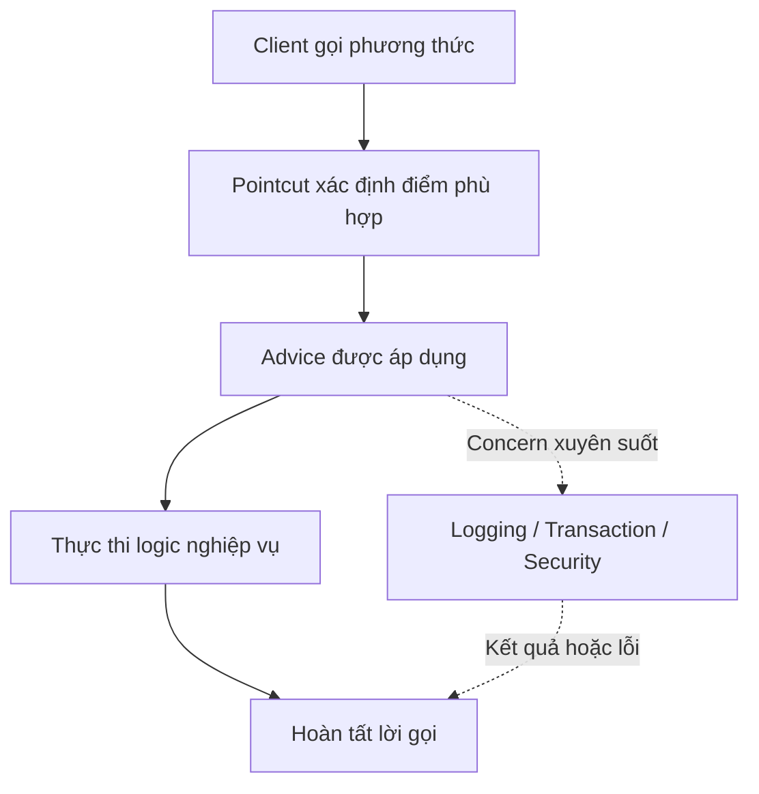

# Tổng quan về Aspect-Oriented Programming (AOP)

## Table of Contents
- [Bối cảnh và vấn đề](#bối-cảnh-và-vấn-đề)
- [AOP là gì?](#aop-là-gì)
- [Sơ đồ khái quát AOP](#sơ-đồ-khái-quát-aop)
- [Lịch sử hình thành](#lịch-sử-hình-thành)
- [Các khái niệm cốt lõi](#các-khái-niệm-cốt-lõi)
- [Khi nào nên tìm hiểu sâu hơn?](#khi-nào-nên-tìm-hiểu-sâu-hơn)
- [Tài liệu tham khảo](#tài-liệu-tham-khảo)
- [Related](#related)

---

## Bối cảnh và vấn đề

Trong một ứng dụng, mỗi lớp thường được tổ chức quanh một trách nhiệm nghiệp vụ. Tuy nhiên, một số chính sách như logging, kiểm tra quyền và quản lý giao dịch lại có thể áp dụng cho nhiều lớp cùng lúc. Nếu từng lớp tự triển khai các chính sách này, mã xử lý dễ bị phân tán và lặp lại; nếu chỉ gom chúng vào lớp tiện ích, nhiều nơi vẫn phải gọi tiện ích một cách tường minh.

AOP xuất phát từ nhu cầu mô-đun hóa những **cross-cutting concerns** (mối quan tâm xuyên suốt) mà cách phân rã theo lớp không phải lúc nào cũng biểu diễn gọn gàng.

---

## AOP là gì?

**Aspect-Oriented Programming (AOP)** là phương pháp tổ chức phần mềm bổ sung cho **Object-Oriented Programming (OOP)**. OOP tổ chức dữ liệu và hành vi quanh class và object; AOP cung cấp một đơn vị mô-đun hóa khác là **aspect**, dùng để gom các chính sách cần tác động đến nhiều thành phần.

AOP không thay thế OOP và cũng không có nghĩa là mọi logic dùng chung đều nên chuyển thành aspect. Nó phù hợp khi một concern cần được áp dụng xuyên qua nhiều thành phần và có thể xác định rõ nơi áp dụng.

Ví dụ, một phương thức tạo đơn hàng nên tập trung vào quy trình nghiệp vụ. Việc ghi nhận thời gian thực thi hoặc áp dụng chính sách giao dịch có thể được xử lý ở một lớp hạ tầng riêng, thay vì lặp lại trong từng phương thức.

---

## Sơ đồ khái quát AOP

Sơ đồ minh họa cách AOP kết hợp logic nghiệp vụ với các concern xuyên suốt như logging, transaction và security.

---

## Lịch sử hình thành

AOP không bắt nguồn riêng từ Spring hoặc Java. Hướng tiếp cận này phát triển từ nghiên cứu về cách mô-đun hóa các concern xuyên suốt, gắn với nhóm nghiên cứu tại Xerox PARC và Gregor Kiczales cùng cộng sự.

- **Trước và trong thập niên 1990:** OOP đã giúp tổ chức phần mềm theo class và object, nhưng một số concern vẫn trải rộng qua nhiều mô-đun.
- **1997:** Công trình *Aspect-Oriented Programming* của Kiczales và cộng sự được trình bày tại ECOOP, góp phần hệ thống hóa tư tưởng AOP.
- **Cuối thập niên 1990 đến đầu những năm 2000:** AspectJ phát triển các khái niệm như aspect, pointcut và advice trong hệ sinh thái Java.
- **Đầu những năm 2000:** Spring tích hợp AOP vào framework, đặc biệt để hỗ trợ các dịch vụ khai báo như quản lý giao dịch.
- **Hiện nay:** AOP tiếp tục được dùng cho các concern hạ tầng; Spring AOP đáp ứng nhiều nhu cầu ở cấp phương thức, trong khi AspectJ có phạm vi join point rộng hơn.

Các mốc này là bản tóm tắt định hướng, không phải lịch sử đầy đủ của mọi nhánh công nghệ AOP.

---

## Các khái niệm cốt lõi

| Khái niệm | Vai trò |
| :--- | :--- |
| **Aspect** | Mô-đun hóa một concern xuyên suốt. |
| **Join point** | Điểm trong quá trình thực thi mà hành vi AOP có thể được gắn vào. |
| **Pointcut** | Chọn các join point phù hợp. |
| **Advice** | Xác định hành vi bổ sung được thực hiện tại join point đã chọn. |
| **Weaving** | Kết hợp aspect với chương trình hoặc đối tượng để áp dụng hành vi. |

Các framework AOP có thể hỗ trợ những loại join point khác nhau. Vì vậy, cần phân biệt mô hình AOP nói chung với phạm vi triển khai cụ thể của Spring AOP.

---

## Khi nào nên tìm hiểu sâu hơn?

Khi đã nắm được mục tiêu mô-đun hóa, bước tiếp theo là hiểu các quyết định thiết kế và Trade-off của AOP so với OOP. Sau đó có thể chuyển sang mô hình Spring AOP để xem framework chọn pointcut, advice và proxy như thế nào.

---

## Tài liệu tham khảo

- [Spring Framework: Aspect-Oriented Programming with Spring](https://docs.spring.io/spring-framework/reference/core/aop.html)
- [AspectJ Programming Guide](https://eclipse.dev/aspectj/doc/latest/progguide/progguide.html)
- [Kiczales và cộng sự, Aspect-Oriented Programming (ECOOP 1997)](https://doi.org/10.1007/BFb0053381)

---

## Related

*   [Ý đồ thiết kế của AOP và quan hệ với OOP](./aop_design_and_oop.md) — cùng phân tích động cơ mô-đun hóa concern xuyên suốt ở góc nhìn thiết kế và Trade-off.

---
[← Back to README](README.md)
