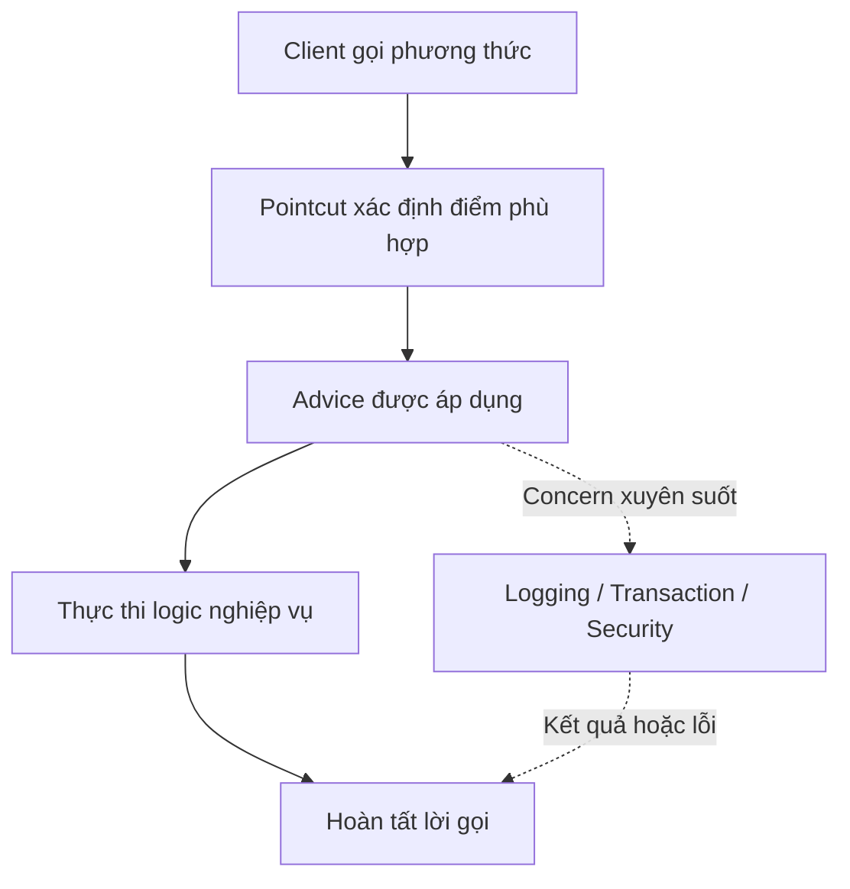

# Tổng quan AOP: động cơ, khái niệm và Trade-off

## Table of Contents
- [Bối cảnh và vấn đề](#bối-cảnh-và-vấn-đề)
- [AOP là gì?](#aop-là-gì)
- [AOP bổ sung cho OOP như thế nào?](#aop-bổ-sung-cho-oop-như-thế-nào)
- [Mục tiêu thiết kế](#mục-tiêu-thiết-kế)
- [Trade-off khi sử dụng AOP](#trade-off-khi-sử-dụng-aop)
- [Sơ đồ khái quát AOP](#sơ-đồ-khái-quát-aop)
- [Lịch sử hình thành](#lịch-sử-hình-thành)
- [Các khái niệm cốt lõi](#các-khái-niệm-cốt-lõi)
- [Khi nào nên tìm hiểu sâu hơn?](#khi-nào-nên-tìm-hiểu-sâu-hơn)
- [Tài liệu tham khảo](#tài-liệu-tham-khảo)
- [Related](#related)

---

## Bối cảnh và vấn đề

Trong một ứng dụng, mỗi lớp thường được tổ chức quanh một trách nhiệm nghiệp vụ. Tuy nhiên, một số chính sách như logging, kiểm tra quyền và quản lý giao dịch lại có thể áp dụng cho nhiều lớp cùng lúc. Nếu từng lớp tự triển khai các chính sách này, mã xử lý dễ bị phân tán và lặp lại; nếu chỉ gom chúng vào lớp tiện ích, nhiều nơi vẫn phải gọi tiện ích một cách tường minh.

OOP tổ chức phần mềm theo các thực thể và trách nhiệm nghiệp vụ. Trong một hệ thống thương mại điện tử, đơn hàng, khách hàng và thanh toán có thể được biểu diễn bằng những thành phần riêng biệt, giúp kiểm soát trạng thái và hành vi của từng đối tượng. Nhưng logging, kiểm tra quyền và quản lý giao dịch có thể ảnh hưởng đến nhiều service cùng lúc và không nhất thiết thuộc riêng về một thực thể nghiệp vụ. Khi bị triển khai lặp lại trong nhiều class, chúng làm tăng duplication và khiến thay đổi chính sách trở nên tốn kém.

AOP xuất phát từ nhu cầu mô-đun hóa những **cross-cutting concerns** (mối quan tâm xuyên suốt) mà cách phân rã theo lớp không phải lúc nào cũng biểu diễn gọn gàng.

---

## AOP là gì?

**Aspect-Oriented Programming (AOP)** là phương pháp tổ chức phần mềm bổ sung cho **Object-Oriented Programming (OOP)**. OOP tổ chức dữ liệu và hành vi quanh class và object; AOP cung cấp một đơn vị mô-đun hóa khác là **aspect**, dùng để gom các chính sách cần tác động đến nhiều thành phần.

AOP không thay thế OOP và cũng không có nghĩa là mọi logic dùng chung đều nên chuyển thành aspect. Nó phù hợp khi một concern cần được áp dụng xuyên qua nhiều thành phần và có thể xác định rõ nơi áp dụng. Ví dụ, một phương thức tạo đơn hàng nên tập trung vào quy trình nghiệp vụ; việc ghi nhận thời gian thực thi hoặc áp dụng chính sách giao dịch có thể được xử lý ở một lớp hạ tầng riêng thay vì lặp lại trong từng phương thức.

---

## AOP bổ sung cho OOP như thế nào?

AOP tạo thêm một trục mô-đun hóa: thay vì chỉ nhóm code theo đối tượng, nó nhóm hành vi theo concern xuyên suốt. **Pointcut** xác định nơi áp dụng; **advice** mô tả hành vi; **aspect** tổ chức các định nghĩa liên quan.

| Tiêu chí | OOP | AOP |
| :--- | :--- | :--- |
| Đơn vị mô-đun hóa | Class và object | Aspect |
| Cách phân rã | Theo đối tượng và trách nhiệm | Theo concern xuyên suốt |
| Ví dụ | Xử lý đơn hàng, thanh toán, người dùng | Logging, quản lý giao dịch, kiểm tra quyền |
| Rủi ro khi dùng không phù hợp | Concern chung có thể phân tán qua nhiều class | Luồng thực thi có thể khó theo dõi nếu aspect quá rộng |

AOP và OOP giải quyết những chiều khác nhau của bài toán thiết kế. Một ứng dụng vẫn cần mô hình đối tượng tốt; AOP chỉ nên bổ sung ở nơi concern xuyên suốt thực sự có lợi khi được mô-đun hóa riêng.

---

## Mục tiêu thiết kế

AOP hướng đến ba mục tiêu chính:

1. **Giảm sự phân tán của concern xuyên suốt.** Chính sách dùng chung được định nghĩa tại một nơi thay vì lặp lại trong nhiều thành phần.
2. **Tách nghiệp vụ khỏi chính sách hạ tầng.** Phương thức nghiệp vụ có thể tập trung vào nhiệm vụ chính, trong khi các hành vi bổ sung được cấu hình độc lập.
3. **Xác định rõ phạm vi áp dụng.** Pointcut giúp diễn đạt những điểm thực thi chịu tác động, thay vì phải gọi thủ công một tiện ích tại từng nơi.

Trong Spring, quản lý giao dịch khai báo là ví dụ tiêu biểu: người phát triển mô tả chính sách giao dịch, còn framework điều phối hành vi quanh lời gọi phương thức.

---

## Trade-off khi sử dụng AOP

AOP không tự động làm hệ thống đơn giản hơn. Nếu pointcut quá rộng, hành vi có thể áp dụng ngoài dự kiến. Nếu advice tạo ra side effect khó quan sát, người đọc có thể khó lần theo luồng thực thi từ code nghiệp vụ. Việc debug cũng đòi hỏi hiểu cơ chế kết hợp hành vi.

Nên dùng AOP khi concern có phạm vi xuyên suốt rõ ràng và quy tắc áp dụng có thể diễn đạt, kiểm thử được. Với logic nghiệp vụ cốt lõi hoặc hành vi chỉ dùng tại một điểm, code tường minh thường dễ hiểu hơn.

---

## Sơ đồ khái quát AOP

Sơ đồ minh họa cách AOP kết hợp logic nghiệp vụ với các concern xuyên suốt như logging, transaction và security.

---

## Lịch sử hình thành

AOP không bắt nguồn riêng từ Spring hoặc Java. Hướng tiếp cận này phát triển từ nghiên cứu về cách mô-đun hóa các concern xuyên suốt, gắn với nhóm nghiên cứu tại Xerox PARC và Gregor Kiczales cùng cộng sự.

- **Trước và trong thập niên 1990:** OOP đã giúp tổ chức phần mềm theo class và object, nhưng một số concern vẫn trải rộng qua nhiều mô-đun.
- **1997:** Công trình *Aspect-Oriented Programming* của Kiczales và cộng sự được trình bày tại ECOOP, góp phần hệ thống hóa tư tưởng AOP.
- **Cuối thập niên 1990 đến đầu những năm 2000:** AspectJ phát triển các khái niệm như aspect, pointcut và advice trong hệ sinh thái Java.
- **Đầu những năm 2000:** Spring tích hợp AOP vào framework, đặc biệt để hỗ trợ các dịch vụ khai báo như quản lý giao dịch.
- **Hiện nay:** AOP tiếp tục được dùng cho các concern hạ tầng; Spring AOP đáp ứng nhiều nhu cầu ở cấp phương thức, trong khi AspectJ có phạm vi join point rộng hơn.

Các mốc này là bản tóm tắt định hướng, không phải lịch sử đầy đủ của mọi nhánh công nghệ AOP.

---

## Các khái niệm cốt lõi

| Khái niệm | Vai trò |
| :--- | :--- |
| **Aspect** | Mô-đun hóa một concern xuyên suốt. |
| **Join point** | Điểm trong quá trình thực thi mà hành vi AOP có thể được gắn vào. |
| **Pointcut** | Chọn các join point phù hợp. |
| **Advice** | Xác định hành vi bổ sung được thực hiện tại join point đã chọn. |
| **Weaving** | Kết hợp aspect với chương trình hoặc đối tượng để áp dụng hành vi. |

Các framework AOP có thể hỗ trợ những loại join point khác nhau. Vì vậy, cần phân biệt mô hình AOP nói chung với phạm vi triển khai cụ thể của Spring AOP.

---

## Khi nào nên tìm hiểu sâu hơn?

Khi đã nắm được mục tiêu mô-đun hóa, bước tiếp theo là xem Spring hiện thực hóa mô hình này như thế nào: aspect, pointcut, advice và proxy. [Mô hình Aspect trong Spring AOP](../02_spring_aop/aspect_model.md) mô tả mô hình đó ở mức khái niệm; phần cơ chế proxy (call path, JDK proxy và CGLIB, self-invocation) thuộc [Spring Proxy Guide](../../spring_proxy_guide/README.md).

---

## Tài liệu tham khảo

- [Spring Framework: Aspect-Oriented Programming with Spring](https://docs.spring.io/spring-framework/reference/core/aop.html)
- [AspectJ Programming Guide](https://eclipse.dev/aspectj/doc/latest/progguide/progguide.html)
- [Kiczales và cộng sự, Aspect-Oriented Programming (ECOOP 1997)](https://doi.org/10.1007/BFb0053381)

---

## Related

*   [Mô hình Aspect trong Spring AOP](../02_spring_aop/aspect_model.md) — cách Spring hiện thực hóa aspect, pointcut và advice.
*   [Spring Proxy Guide](../../spring_proxy_guide/README.md) — phần cơ chế proxy đứng sau mô hình AOP của Spring.
*   [Spring Expression Language (SpEL)](../../spel/spel.md) — cùng hướng tới việc tách logic cấu hình và điều kiện khỏi mã nghiệp vụ tường minh.

---

[← Back to README](README.md)
