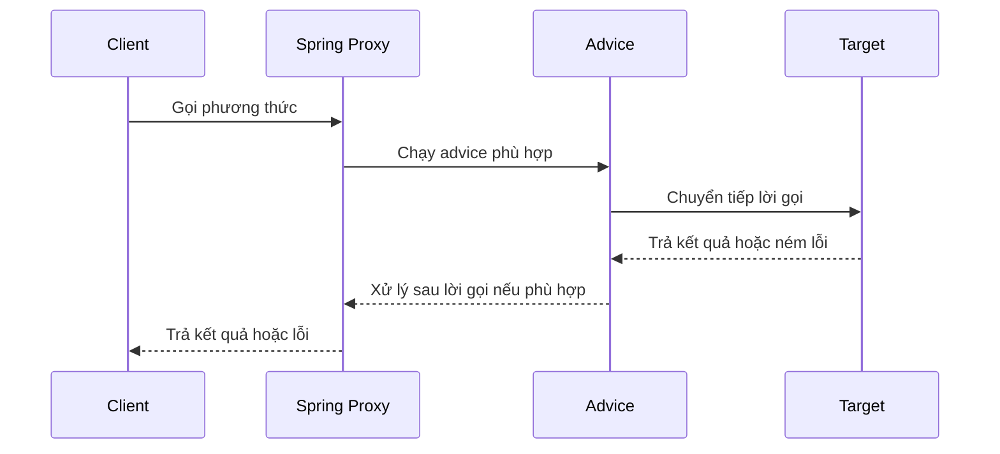

# Mô hình Aspect trong Spring AOP

## Table of Contents
- [Spring AOP là gì?](#spring-aop-là-gì)
- [Aspect và các thành phần cấu thành](#aspect-và-các-thành-phần-cấu-thành)
- [Luồng xử lý qua proxy](#luồng-xử-lý-qua-proxy)
- [Các loại Advice](#các-loại-advice)
- [Đường đi khái quát của một lời gọi](#đường-đi-khái-quát-của-một-lời-gọi)
- [Ý đồ thiết kế của Spring AOP](#ý-đồ-thiết-kế-của-spring-aop)
- [Tài liệu tham khảo](#tài-liệu-tham-khảo)
- [Related](#related)

---

## Spring AOP là gì?

Spring AOP là cơ chế AOP tích hợp với Spring Framework và Spring IoC container. Cơ chế này dùng proxy tại Runtime để áp dụng hành vi bổ sung quanh các lời gọi phương thức phù hợp trên Spring bean.

Spring AOP được viết bằng Java thuần và tập trung vào **method execution join point**. Nó không đại diện cho toàn bộ khả năng của AOP: AspectJ hỗ trợ nhiều loại join point hơn, nên có thể phù hợp khi cần tác động đến các điểm thực thi mà mô hình proxy của Spring không bao phủ.

---

## Aspect và các thành phần cấu thành

Theo tài liệu Spring, **aspect** là cách mô-đun hóa một concern xuyên suốt. Aspect có thể được khai báo bằng cấu hình XML theo schema hoặc bằng lớp Java thông thường sử dụng phong cách annotation `@AspectJ`.

| Thành phần | Câu hỏi cần trả lời | Vai trò |
| :--- | :--- | :--- |
| **Aspect** | Concern được tổ chức ở đâu? | Gom các định nghĩa liên quan đến hành vi xuyên suốt. |
| **Pointcut** | Áp dụng tại đâu? | Chọn các join point khớp điều kiện. |
| **Advice** | Thực hiện hành vi gì và khi nào? | Định nghĩa hành vi bổ sung. |
| **Join point** | Điểm thực thi nào được xét? | Trong Spring AOP, đó là việc thực thi phương thức. |
| **Target object** | Logic nghiệp vụ nằm ở đâu? | Đối tượng đích mà lời gọi được chuyển tiếp đến. |
| **AOP proxy** | Hành vi được điều phối bằng cách nào? | Trung gian hóa lời gọi và chạy advice phù hợp. |
| **Introduction** | Có thể bổ sung gì ngoài advice? | Bổ sung interface và phần triển khai tương ứng cho đối tượng được áp dụng AOP. |
| **Weaving** | Các thành phần được kết hợp như thế nào? | Liên kết aspect với chương trình hoặc đối tượng để áp dụng hành vi. |

Aspect không đồng nghĩa với pointcut, advice hay proxy. Aspect là đơn vị mô-đun hóa ở mức cao hơn; các thành phần còn lại có trách nhiệm riêng trong quá trình chọn điểm thực thi và điều phối hành vi.

Một lớp có `@Aspect` cũng không tự động trở thành Spring bean chỉ vì có annotation này. Lớp aspect phải được đăng ký hoặc được Spring phát hiện bằng cơ chế cấu hình bean phù hợp, đồng thời hỗ trợ AOP phải được kích hoạt.

---

## Luồng xử lý qua proxy

Sơ đồ mô tả luồng gọi điển hình khi client gọi một Spring bean thông qua proxy và advice phù hợp được áp dụng.

Sơ đồ mang tính khái quát về luồng xử lý, không phản ánh chính xác mọi thứ tự thực thi trong mọi cấu hình Spring AOP; thứ tự thực tế phụ thuộc vào loại advice và cách cấu hình aspect.

---

## Các loại Advice

Spring AOP cung cấp năm loại advice chính. Mỗi loại có ngữ nghĩa thực thi riêng.

| Loại | Khi nào chạy? | Lưu ý |
| :--- | :--- | :--- |
| **Before** | Trước join point | Không tự ngăn phương thức tiếp tục, trừ khi advice ném exception. |
| **After returning** | Khi phương thức kết thúc bình thường | Không chạy theo ngữ nghĩa này nếu phương thức kết thúc bằng exception. |
| **After throwing** | Khi phương thức kết thúc bằng exception | Dùng cho hành vi gắn với đường kết thúc lỗi. |
| **After (finally)** | Khi join point kết thúc, bất kể thành công hay lỗi | Phù hợp với hành vi cần chạy ở cả hai trường hợp. |
| **Around** | Bao quanh lời gọi phương thức | Có thể quyết định có tiếp tục gọi phương thức hay không, đồng thời kiểm soát kết quả hoặc exception. |

Nên chọn loại advice có phạm vi năng lực hẹp nhất nhưng vẫn đáp ứng yêu cầu. Ví dụ, nếu chỉ cần xử lý kết quả sau khi phương thức hoàn tất bình thường, `After returning` thường rõ ràng hơn `Around`.

---

## Đường đi khái quát của một lời gọi

Ở mức khái niệm, lời gọi phương thức được gửi đến proxy; proxy xác định advice phù hợp theo cấu hình pointcut; advice được thực thi theo ngữ nghĩa của nó; sau đó lời gọi có thể được chuyển tiếp đến target object. Kết quả hoặc exception được trả về theo đường đi tương ứng.

Đây là mô tả khái quát, không phải thứ tự tuyệt đối cho mọi tổ hợp advice. Spring thiết lập proxy và các interceptor theo cấu hình ứng dụng.

---

## Ý đồ thiết kế của Spring AOP

Spring không đặt mục tiêu hiện thực hóa mọi khả năng AOP. Framework ưu tiên tích hợp chặt chẽ với IoC container và giải quyết những nhu cầu phổ biến của ứng dụng doanh nghiệp.

Các lựa chọn thiết kế chính gồm:

- **Tích hợp với IoC:** aspect và các thành phần liên quan có thể được quản lý theo cơ chế bean.
- **Proxy tại Runtime:** bổ sung hành vi mà không bắt buộc quy trình biên dịch đặc biệt.
- **Non-invasiveness:** tránh buộc domain model phụ thuộc vào các lớp hoặc interface riêng của AOP.
- **Phối hợp với AspectJ:** có thể chọn AspectJ khi cần phạm vi join point phong phú hơn.

---

## Tài liệu tham khảo

- [Spring Framework: AOP Concepts](https://docs.spring.io/spring-framework/reference/core/aop/introduction-defn.html)
- [Spring Framework: Spring AOP Capabilities and Goals](https://docs.spring.io/spring-framework/reference/core/aop/introduction-spring-defn.html)
- [Spring Framework: AOP Proxies](https://docs.spring.io/spring-framework/reference/core/aop/introduction-proxies.html)

---

## Related

*   [Proxy và các giới hạn của Spring AOP](./proxy_constraints.md) — phần tiếp theo đi sâu vào các ràng buộc thực tế khiến luồng proxy này không phải lúc nào cũng kích hoạt advice.

---
[← Back to README](README.md)
