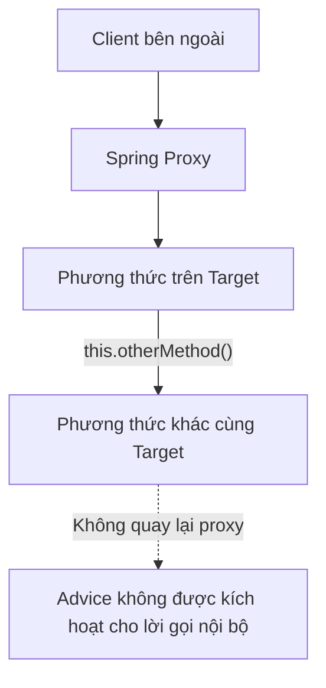

# Proxy và các giới hạn của Spring AOP

## Table of Contents
- [Phạm vi join point](#phạm-vi-join-point)
- [Khai báo và kích hoạt Aspect](#khai-báo-và-kích-hoạt-aspect)
- [JDK dynamic proxy và CGLIB proxy](#jdk-dynamic-proxy-và-cglib-proxy)
- [Self-invocation](#self-invocation)
- [Độ chính xác của Pointcut](#độ-chính-xác-của-pointcut)
- [Chọn Spring AOP hay AspectJ](#chọn-spring-aop-hay-aspectj)
- [Tài liệu tham khảo](#tài-liệu-tham-khảo)
- [Related](#related)

---

## Phạm vi join point

Spring AOP chỉ hỗ trợ join point tại **method execution** trên Spring bean. Nó không trực tiếp hỗ trợ các join point như đọc hoặc ghi field theo cách AspectJ có thể hỗ trợ.

Vì vậy, Spring AOP phù hợp với các concern quanh lời gọi phương thức, chẳng hạn quản lý giao dịch, logging và kiểm tra quyền. Nếu yêu cầu là theo dõi trực tiếp mọi lần đọc hoặc ghi một trường dữ liệu, cần cân nhắc một cơ chế AOP có phạm vi join point rộng hơn.

---

## Khai báo và kích hoạt Aspect

Spring hỗ trợ khai báo aspect bằng schema-based XML hoặc phong cách `@AspectJ`. Trong cả hai trường hợp, aspect cần được đưa vào cấu hình ứng dụng và cơ chế hỗ trợ AOP phải được kích hoạt.

Trong cấu hình annotation, việc kích hoạt thường được thực hiện bằng `@EnableAspectJAutoProxy` hoặc cấu hình XML tương ứng. Đây là chi tiết cấu hình thuộc phạm vi triển khai, nên chỉ cần đi sâu khi tài liệu hoặc bài toán yêu cầu thiết lập ứng dụng cụ thể.

---

## JDK dynamic proxy và CGLIB proxy

Spring AOP sử dụng proxy để trung gian hóa lời gọi. Hai cơ chế phổ biến có đặc điểm khác nhau:

| Cơ chế | Cách hoạt động | Giới hạn đáng chú ý |
| :--- | :--- | :--- |
| **JDK dynamic proxy** | Proxy thông qua interface | Người gọi sử dụng các phương thức được công khai qua interface. |
| **CGLIB proxy** | Tạo lớp con của lớp đích | Không thể override phương thức `final`; không thể tạo proxy theo cơ chế kế thừa cho lớp `final`; phương thức `private` không thể được override để áp dụng advice. |

Việc một phương thức khớp pointcut chưa đủ để đảm bảo advice chạy. Phương thức và đối tượng phải có thể được proxy theo cơ chế đang sử dụng, và lời gọi phải đi qua proxy đó.

---

## Self-invocation

Một giới hạn phổ biến là lời gọi nội bộ giữa các phương thức của cùng một target object thường không đi qua proxy. Nếu phương thức A gọi trực tiếp phương thức B trên cùng đối tượng, lời gọi B không tự động được proxy trung gian hóa; vì vậy advice áp dụng cho B có thể không chạy.

### Sơ đồ giới hạn của self-invocation

Sơ đồ minh họa vì sao lời gọi nội bộ giữa hai phương thức trên cùng đối tượng thường không đi qua Spring AOP proxy.

Điều này đặc biệt quan trọng với quản lý giao dịch khai báo. Không nên mặc định rằng một phương thức được cấu hình có giao dịch sẽ nhận cùng hành vi khi được gọi nội bộ như khi được gọi qua proxy từ bên ngoài bean.

---

## Độ chính xác của Pointcut

Pointcut chỉ chọn các join point khớp biểu thức. Nếu biểu thức không khớp phương thức cần áp dụng, advice không chạy. Ngược lại, biểu thức quá rộng có thể khiến hành vi được áp dụng ngoài dự kiến.

Vì vậy, pointcut là một quyết định thiết kế. Phạm vi cần thể hiện rõ các thành phần chịu tác động và nên được kiểm thử để tránh cả trường hợp bỏ sót lẫn áp dụng thừa.

---

## Chọn Spring AOP hay AspectJ

Spring AOP thường phù hợp khi concern có thể áp dụng quanh lời gọi phương thức của Spring bean và cần tích hợp với IoC container. AspectJ nên được cân nhắc khi cần các loại join point mà Spring AOP không hỗ trợ hoặc khi mô hình proxy không đáp ứng yêu cầu.

Không nên chọn công nghệ chỉ vì một công nghệ có nhiều tính năng hơn. Quyết định cần dựa trên phạm vi join point, cách triển khai, khả năng quan sát luồng thực thi và yêu cầu vận hành của ứng dụng.

---

## Tài liệu tham khảo

- [Spring Framework: Spring AOP Capabilities and Goals](https://docs.spring.io/spring-framework/reference/core/aop/introduction-spring-defn.html)
- [Spring Framework: AOP Proxies](https://docs.spring.io/spring-framework/reference/core/aop/introduction-proxies.html)
- [Spring Framework: @AspectJ support](https://docs.spring.io/spring-framework/reference/core/aop/ataspectj.html)

---

## Related

*   [Mô hình Aspect trong Spring AOP](./aspect_model.md) — mô tả luồng proxy và mô hình advice mà các giới hạn trong tài liệu này bổ sung chi tiết.

---
[← Back to README](README.md)
