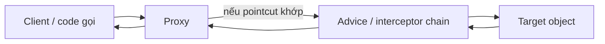
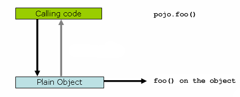
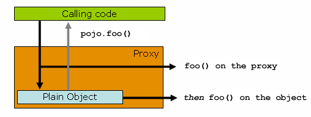

# Mô hình nền tảng: proxy là gì và các actor

## Table of Contents
- [Proxy là gì?](#proxy-là-gì)
- [Các actor](#các-actor)
- [Vì sao proxy là một “wrapper” chứ không phải logic nghiệp vụ?](#vì-sao-proxy-là-một-wrapper-chứ-không-phải-logic-nghiệp-vụ)
- [Cốt lõi cần nhớ](#cốt-lõi-cần-nhớ)
- [Phạm vi của proxy trong Spring](#phạm-vi-của-proxy-trong-spring)
- [Khi nào mô hình này hữu ích?](#khi-nào-mô-hình-này-hữu-ích)
- [Nguồn chính thức](#nguồn-chính-thức)
- [Related](#related)

---

## Proxy là gì?

Trong Spring AOP, hành vi bổ sung như logging, kiểm tra quyền hay quản lý transaction không được viết lặp lại trong từng method nghiệp vụ. Thay vào đó, Spring chèn một **proxy** (object trung gian) đứng trước đối tượng nghiệp vụ để điều phối lời gọi qua các hành vi đó.

Bộ tài liệu này tập trung vào bản thân cơ chế proxy: proxy được tạo bằng cách nào, lời gọi đi qua nó ra sao, và những ràng buộc nào khiến proxy không phải lúc nào cũng kích hoạt hành vi mong muốn. Động cơ mô-đun hóa concern xuyên suốt và bộ khái niệm AOP thuộc [module AOP](../../aop/README.md).

---

## Các actor

- **Client** giữ reference tới proxy thay vì gọi thẳng target.
- **Proxy** nhận lời gọi method, xác định advice nào áp dụng, rồi điều phối lời gọi.
- **Target** chứa logic nghiệp vụ thực.
- **Advice** bổ sung hành vi trước, sau, khi có kết quả, khi có exception, hoặc bao quanh cả lời gọi.
- **Pointcut** mô tả những method execution nào cần được chọn.

---

## Vì sao proxy là một “wrapper” chứ không phải logic nghiệp vụ?

Proxy thực hiện vai trò trung gian. Nó có thể quyết định chạy interceptor, truyền đối số, xử lý giá trị trả về hoặc exception rồi bàn giao cho target. Trong tình huống thông thường, target vẫn là nơi chứa quy tắc nghiệp vụ. Mục tiêu là bổ sung hành vi mà không rải chúng vào tất cả method.

Hình gốc người dùng cung cấp minh họa sự khác nhau giữa lời gọi trực tiếp và lời gọi đi qua proxy:

Hình thứ hai cho thấy điểm mấu chốt: `foo()` trước tiên được gọi trên proxy; proxy có thể thực thi hành vi `foo()` của nó rồi mới gọi `foo()` trên target. Đây không có nghĩa là mọi lần target gọi một method khác trên chính nó đều tự động đi qua proxy.

---

## Cốt lõi cần nhớ

Spring không tự động biến mọi method thành một “điểm móc” toàn cục. Với proxy-based AOP, advice chỉ có cơ hội chạy khi invocation đi qua proxy và khớp điều kiện áp dụng. Đây là khác biệt kiến trúc, không phải một chi tiết tối ưu hóa.

Ví dụ, một bean `OrderService` được Spring quản lý có thể được bọc bởi proxy nhằm áp dụng transaction. Khi bean khác gọi `orderService.placeOrder()`, reference được inject có thể là proxy. Proxy thiết lập ngữ cảnh cần thiết rồi chuyển lời gọi đến target. Nhưng nếu `placeOrder()` gọi `this.recalculate()` ngay trong cùng target, lời gọi nội bộ không quay lại proxy.

---

## Phạm vi của proxy trong Spring

Spring tạo proxy quanh các **method execution** trên object được Spring quản lý. Proxy không mặc định bao phủ mọi loại join point mà AspectJ weaving có thể cung cấp, như field access hoặc constructor join point. Nếu yêu cầu nằm ngoài mô hình proxy, cần cân nhắc AspectJ compile-time/load-time weaving thay vì cố ép proxy làm việc không thuộc phạm vi của nó.

---

## Khi nào mô hình này hữu ích?

- Muốn hiểu proxy được tạo cho bean khi nào và theo cơ chế nào.
- Muốn biết vì sao một lời gọi cụ thể không đi qua proxy.
- Muốn chọn giữa JDK dynamic proxy và CGLIB.
- Muốn kiểm tra tại sao một annotation như `@Transactional` có thể không chạy dù đã có trên method.

---

## Nguồn chính thức

- [AOP Proxies](https://docs.spring.io/spring-framework/reference/core/aop/introduction-proxies.html)
- [Understanding AOP Proxies](https://docs.spring.io/spring-framework/reference/core/aop/proxying.html)
- [Spring AOP Capabilities and Goals](https://docs.spring.io/spring-framework/reference/core/aop/introduction-spring-defn.html)

---

## Related

*   [Luồng gọi và self-invocation](./call_flow_and_self_invocation.md) — tiếp nối mô hình actor ở đây bằng đường đi thực tế của một method call.
*   [Giới hạn proxy và khi nào cần cơ chế khác](../02_techniques/constraints_and_alternatives.md) — hệ thống hóa các ràng buộc khiến proxy không kích hoạt advice.
*   [AOP và Spring AOP](../../aop/README.md) — phần paradigm AOP và mô hình aspect mà cơ chế proxy phục vụ.

---

[← Back to README](README.md)
