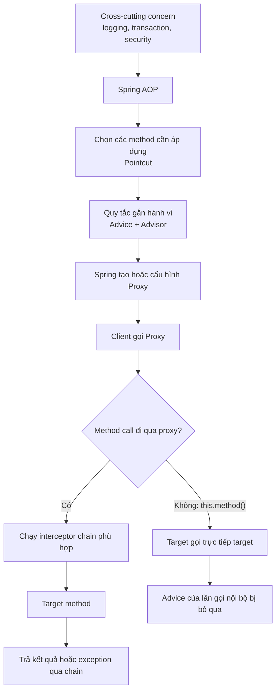

# Lộ trình và bản đồ kiến thức

## Table of Contents
- [Bản đồ tổng thể](#bản-đồ-tổng-thể)
- [Những câu hỏi cần trả lời được](#những-câu-hỏi-cần-trả-lời-được)
- [Ma trận tài liệu](#ma-trận-tài-liệu)
- [Quy ước khi đọc sơ đồ](#quy-ước-khi-đọc-sơ-đồ)

---

## Bản đồ tổng thể

---

## Những câu hỏi cần trả lời được

Sau khi học xong, người đọc cần có thể giải thích bằng lời của mình:

1. Tại sao không đặt logging, authorization hay transaction boilerplate vào mọi method nghiệp vụ?
2. Proxy, target, advice, pointcut, advisor và aspect khác nhau ở đâu?
3. Một lời gọi từ controller/service đi qua proxy như thế nào?
4. Vì sao `this.otherMethod()` không kích hoạt advice trong Spring AOP dựa trên proxy?
5. Khi nào dùng JDK dynamic proxy, khi nào cần CGLIB?
6. `@Aspect` và `@EnableAspectJAutoProxy` làm gì, và vì sao chúng không đồng nghĩa với AspectJ weaving?
7. `ProxyFactory`, `AspectJProxyFactory` và `ProxyFactoryBean` khác nhau thế nào?
8. Cần kiểm tra gì khi `@Transactional`, `@Async`, `@Cacheable` hoặc advice tùy chỉnh không chạy như mong đợi?

---

## Ma trận tài liệu

| Tài liệu | Mức độ | Mục đích |
|---|---|---|
| `mo_hinh_nen_tang.md` | Nền tảng | Hiểu bài toán và mô hình proxy |
| `luong_goi_va_self_invocation.md` | Nền tảng + kỹ thuật | Theo dõi call path và self-invocation |
| `jdk_proxy_va_cglib.md` | Kỹ thuật | Chọn cơ chế proxy |
| `thuat_ngu_aop.md` | Nền tảng + kỹ thuật | Nắm vocabulary, pointcut, advice |
| `annotation_va_auto_proxy.md` | Triển khai | Cấu hình AOP theo kiểu annotation |
| `proxyfactory.md` | API tham chiếu | Tạo proxy bằng Java API tổng quát |
| `aspectj_proxyfactory.md` | API tham chiếu | Dùng aspect viết theo @AspectJ để tạo proxy cụ thể |
| `proxyfactorybean.md` | API/XML tham chiếu | Tạo proxy được Spring IoC quản lý |
| `gioi_han_va_ngoai_le.md` | Kỹ thuật | Hiểu ranh giới của proxy và khi nào cần weaving |
| `chan_doan_loi.md` | Thực hành | Khoanh vùng vấn đề theo triệu chứng |
| `lab.md` | Thực hành | Tự kiểm chứng mô hình bằng log/test |
| `thuat_ngu_va_nguon.md` | Tra cứu | Từ điển nhanh và liên kết chính thức |

---

## Quy ước khi đọc sơ đồ

- **Client**: mã gọi bean, chẳng hạn controller hoặc một service khác.
- **Proxy**: đối tượng được đưa cho client; nhận method call trước target.
- **Target**: đối tượng nghiệp vụ thực hiện logic chính.
- **Advice/interceptor**: hành vi phụ được chạy quanh hoặc tại một thời điểm của lời gọi.
- Mũi tên đi qua proxy là trọng tâm. Không suy ra rằng mọi lời gọi trong object đều đi qua proxy.

---

[← Back to README](README.md)
