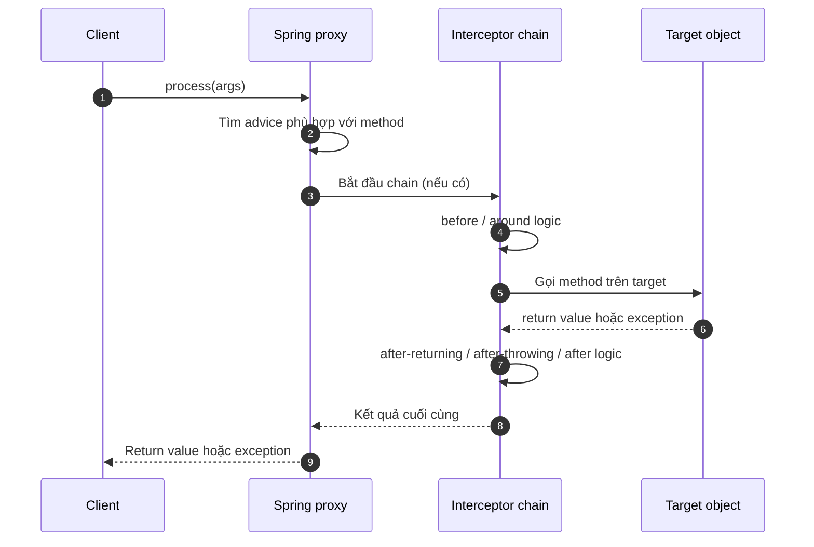
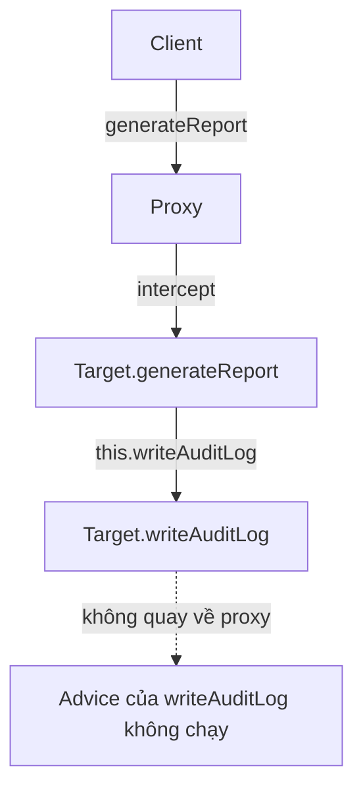

# Luồng lời gọi và self-invocation

## Table of Contents
- [Luồng khi client gọi qua proxy](#luồng-khi-client-gọi-qua-proxy)
- [Đọc đúng hai hình minh họa](#đọc-đúng-hai-hình-minh-họa)
- [Self-invocation: tình huống dễ gây nhầm](#self-invocation-tình-huống-dễ-gây-nhầm)
- [Các cách xử lý, theo thứ tự ưu tiên thực tế](#các-cách-xử-lý-theo-thứ-tự-ưu-tiên-thực-tế)
- [Một phân biệt quan trọng](#một-phân-biệt-quan-trọng)
- [Câu hỏi tự kiểm tra](#câu-hỏi-tự-kiểm-tra)
- [Nguồn chính thức](#nguồn-chính-thức)
- [Related](#related)

---

## Luồng khi client gọi qua proxy

Hãy theo dõi một lời gọi `service.process()`:



Chi tiết thứ tự cụ thể phụ thuộc loại advice và thứ tự interceptor. Sơ đồ thể hiện cấu trúc chung: proxy là cửa ngõ; target xử lý nghiệp vụ; chain có thể chạy logic trước và sau phần target.

---

## Đọc đúng hai hình minh họa

Ở sơ đồ plain object, client gọi `pojo.foo()` trực tiếp trên object. Không có proxy ở giữa nên không có interceptor nào được proxy áp dụng.

Ở sơ đồ có proxy, client gọi `pojo.foo()` nhưng `pojo` là reference tới proxy. Proxy có thể chạy `foo()` trên proxy/interceptor chain rồi ủy quyền đến `foo()` của target. Khi target đã nhận lời gọi, `this` bên trong target trỏ đến chính target, không phải proxy.

---

## Self-invocation: tình huống dễ gây nhầm

```java
public class ReportService {
    public void generateReport() {
        // Lời gọi trực tiếp bên trong target
        this.writeAuditLog();
    }

    public void writeAuditLog() {
        // Có thể được đánh dấu @Transactional hoặc có advice tùy chỉnh
    }
}
```

Nếu client gọi `reportService.generateReport()` qua proxy, advice của `generateReport()` có thể chạy. Nhưng `this.writeAuditLog()` thực hiện trực tiếp trên target, không quay lại proxy. Vì vậy, advice/annotation chỉ gắn với `writeAuditLog()` không được kích hoạt chỉ nhờ lời gọi đó.



---

## Các cách xử lý, theo thứ tự ưu tiên thực tế

1. **Tách trách nhiệm sang bean khác.** Để `ReportService` gọi `AuditService` qua dependency được inject. Lời gọi qua bean khác có cơ hội đi qua proxy của bean đích. Cách này thường làm ranh giới trách nhiệm rõ hơn.
2. **Thiết kế lại để lời gọi cần advice đi từ client qua proxy.** Có thể đưa method ra service riêng hoặc thay đổi luồng orchestration.
3. **Self-injection.** Inject một self-reference đã được proxy hóa và gọi qua reference đó. Cần kiểm tra cách cấu hình bean để tránh vòng phụ thuộc khó hiểu.
4. **`AopContext.currentProxy()`.** Có thể sử dụng khi bật `exposeProxy`, nhưng tạo coupling trực tiếp với Spring AOP và nên coi là phương án cuối.
5. **AspectJ weaving.** Nếu cần bắt cả self-invocation hoặc join point ngoài mô hình proxy, cân nhắc weaving. Đây là mô hình triển khai khác, không phải chỉ đổi loại proxy.

---

## Một phân biệt quan trọng

- `@AspectJ` là **cách khai báo aspect bằng annotation và pointcut expression kiểu AspectJ**.
- Spring AOP dùng proxy để thực thi các aspect kiểu đó.
- AspectJ weaving sửa/đan logic advice vào bytecode khi compile hoặc load class; vì vậy self-invocation không có cùng hạn chế proxy.

Tên `AspectJProxyFactory` cũng không có nghĩa là nó thực hiện weaving. Factory này tạo Spring AOP proxy được áp dụng các aspect khai báo theo kiểu `@AspectJ`.

---

## Câu hỏi tự kiểm tra

- Reference nào được client giữ: target hay proxy?
- Khi target thực thi xong và gọi `this.otherMethod()`, `this` đại diện cho object nào?
- Nếu một lời gọi nội bộ không đi qua proxy, đổi từ JDK proxy sang CGLIB có tự khắc phục được không? **Không**; đây là vấn đề call path, không phải loại proxy.

---

## Nguồn chính thức

- [Understanding AOP Proxies](https://docs.spring.io/spring-framework/reference/core/aop/proxying.html)
- [Programmatic Creation of `@AspectJ` Proxies](https://docs.spring.io/spring-framework/reference/core/aop/aspectj-programmatic.html)
- [Using AspectJ with Spring Applications](https://docs.spring.io/spring-framework/reference/core/aop/using-aspectj.html)

---

## Related

*   [Mô hình nền tảng](./mo_hinh_nen_tang.md) — phần actor và vai trò của proxy mà call path này cụ thể hóa.
*   [Giới hạn proxy và khi nào cần cơ chế khác](../02_ky_thuat/gioi_han_va_ngoai_le.md) — self-invocation là một giới hạn kiến trúc được phân loại đầy đủ ở đó.

---

[← Back to README](README.md)
