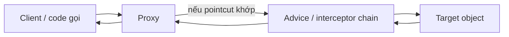

# Mô hình nền tảng: Spring Proxy giải quyết vấn đề gì?

## Table of Contents
- [Bài toán: hành vi phụ xuất hiện ở nhiều nơi](#bài-toán-hành-vi-phụ-xuất-hiện-ở-nhiều-nơi)
- [Các actor](#các-actor)
- [Cốt lõi cần nhớ](#cốt-lõi-cần-nhớ)
- [Vì sao proxy là một “wrapper” chứ không phải logic nghiệp vụ?](#vì-sao-proxy-là-một-wrapper-chứ-không-phải-logic-nghiệp-vụ)
- [Phạm vi của Spring AOP](#phạm-vi-của-spring-aop)
- [Khi nào mô hình này hữu ích?](#khi-nào-mô-hình-này-hữu-ích)
- [Nguồn chính thức](#nguồn-chính-thức)
- [Related](#related)

---

## Bài toán: hành vi phụ xuất hiện ở nhiều nơi

Một ứng dụng có thể cần ghi log thời gian thực thi, kiểm tra quyền, quản lý transaction, retry hoặc cache. Nếu mỗi method nghiệp vụ tự triển khai tất cả các concern này, code bị lặp, chính sách khó thống nhất và thay đổi vận hành làm nhiễu logic nghiệp vụ.

AOP (Aspect-Oriented Programming) gom một nhóm **cross-cutting concerns** ra khỏi logic nghiệp vụ. Trong cách triển khai phổ biến của Spring AOP, một **proxy** đứng trước đối tượng nghiệp vụ và điều phối lời gọi qua các hành vi bổ sung.

---

## Các actor

- **Client** giữ reference tới proxy thay vì gọi thẳng target.
- **Proxy** nhận lời gọi method, xác định advice nào áp dụng, rồi điều phối lời gọi.
- **Target** chứa logic nghiệp vụ thực.
- **Advice** bổ sung hành vi trước, sau, khi có kết quả, khi có exception, hoặc bao quanh cả lời gọi.
- **Pointcut** mô tả những method execution nào cần được chọn.

---

## Cốt lõi cần nhớ

Spring AOP không tự động biến mọi method thành một “điểm móc” toàn cục. Với proxy-based AOP, advice chỉ có cơ hội chạy khi invocation đi qua proxy và khớp điều kiện áp dụng. Đây là khác biệt kiến trúc, không phải một chi tiết tối ưu hóa.

Ví dụ, một bean `OrderService` được Spring quản lý có thể được bọc bởi proxy nhằm áp dụng transaction. Khi bean khác gọi `orderService.placeOrder()`, reference được inject có thể là proxy. Proxy thiết lập ngữ cảnh cần thiết rồi chuyển lời gọi đến target. Nhưng nếu `placeOrder()` gọi `this.recalculate()` ngay trong cùng target, lời gọi nội bộ không quay lại proxy.

---

## Vì sao proxy là một “wrapper” chứ không phải logic nghiệp vụ?

Proxy thực hiện vai trò trung gian. Nó có thể quyết định chạy interceptor, truyền đối số, xử lý giá trị trả về hoặc exception rồi bàn giao cho target. Trong tình huống thông thường, target vẫn là nơi chứa quy tắc nghiệp vụ. Mục tiêu là bổ sung hành vi mà không rải chúng vào tất cả method.

Hình gốc người dùng cung cấp minh họa sự khác nhau giữa lời gọi trực tiếp và lời gọi đi qua proxy:

Hình thứ hai cho thấy điểm mấu chốt: `foo()` trước tiên được gọi trên proxy; proxy có thể thực thi hành vi `foo()` của nó rồi mới gọi `foo()` trên target. Đây không có nghĩa là mọi lần target gọi một method khác trên chính nó đều tự động đi qua proxy.

---

## Phạm vi của Spring AOP

Spring AOP tập trung vào các **method execution** trên object được proxy. Nó không mặc định cung cấp mọi loại join point mà AspectJ weaving có thể cung cấp, như field access hoặc constructor join point. Nếu yêu cầu nằm ngoài mô hình proxy, cần cân nhắc AspectJ compile-time/load-time weaving thay vì cố ép proxy làm việc không thuộc phạm vi của nó.

---

## Khi nào mô hình này hữu ích?

- Muốn tách logging, metrics, authorization hoặc transaction khỏi code nghiệp vụ.
- Muốn cấu hình hành vi theo nhóm method bằng pointcut.
- Muốn chọn một số bean/method để áp dụng hành vi chung.
- Muốn hiểu tại sao một annotation AOP có thể không chạy dù đã có trên method.

---

## Nguồn chính thức

- [AOP Proxies](https://docs.spring.io/spring-framework/reference/core/aop/introduction-proxies.html)
- [Understanding AOP Proxies](https://docs.spring.io/spring-framework/reference/core/aop/proxying.html)
- [Spring AOP Capabilities and Goals](https://docs.spring.io/spring-framework/reference/core/aop/introduction-spring-defn.html)

---

## Related

*   [Luồng gọi và self-invocation](./luong_goi_va_self_invocation.md) — tiếp nối trực tiếp mô hình actor ở đây bằng đường đi thực tế của một method call.
*   [Thuật ngữ AOP](./thuat_ngu_aop.md) — định nghĩa chính xác các actor (Proxy, Target, Advice, Pointcut) mà tài liệu này mô tả ở mức trực giác.

---

[← Back to README](README.md)
