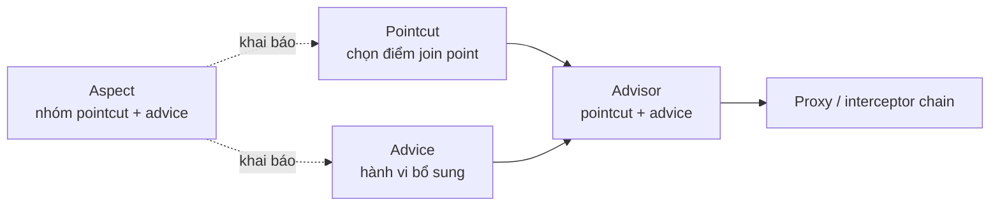

# Thuật ngữ AOP: advice, pointcut, advisor, aspect

## Table of Contents
- [Mô hình thuật ngữ](#mô-hình-thuật-ngữ)
- [Các loại advice theo thời điểm](#các-loại-advice-theo-thời-điểm)
- [Đọc pointcut expression](#đọc-pointcut-expression)
- [Vì sao nên đặt tên pointcut?](#vì-sao-nên-đặt-tên-pointcut)
- [Nguồn chính thức](#nguồn-chính-thức)
- [Related](#related)

---

## Mô hình thuật ngữ



| Thuật ngữ | Nghĩa thực dụng | Câu hỏi trả lời |
|---|---|---|
| **Target** | Đối tượng chứa logic nghiệp vụ được ủy quyền tới | Code nghiệp vụ thực nằm ở đâu? |
| **Proxy** | Đối tượng trung gian nhận method invocation | Ai nhận lời gọi trước target? |
| **Join point** | Điểm thực thi có thể được AOP xét đến | Sự kiện/thời điểm nào có thể được advice áp dụng? |
| **Pointcut** | Biểu thức chọn tập join point phù hợp | Method nào cần áp dụng? |
| **Advice** | Hành vi chạy tại/trước/sau/quanh join point | Cần làm gì khi method được chọn chạy? |
| **Advisor** | Đơn vị ghép pointcut với advice trong Spring AOP API | Hành vi nào gắn với điều kiện chọn nào? |
| **Aspect** | Đơn vị mô-đun hóa pointcut và advice; thường khai báo bằng `@Aspect` | Các quy tắc AOP liên quan được nhóm ở đâu? |
| **Interceptor chain** | Chuỗi interceptor/advice được chạy trong một invocation | Những hành vi nào được chạy, theo thứ tự nào? |
| **Introduction** | Thêm interface/hành vi cho proxy theo cơ chế introduction | Proxy có thể cung cấp thêm contract nào? |

---

## Các loại advice theo thời điểm

| Annotation / loại | Khi chạy | Dùng cho |
|---|---|---|
| `@Before` | Trước method execution | Kiểm tra quyền, log đầu vào |
| `@AfterReturning` | Khi method kết thúc bình thường | Ghi nhận kết quả thành công |
| `@AfterThrowing` | Khi method ném exception | Log lỗi/đếm lỗi |
| `@After` | Sau khi method kết thúc, dù thành công hay ném lỗi (finally semantics) | Cleanup / ghi thời điểm kết thúc |
| `@Around` | Bao quanh lời gọi; advice điều khiển lúc gọi `proceed()` | Đo thời gian, retry, thay đổi luồng trả về nếu chính sách cho phép |

`@Around` là loại linh hoạt nhất nhưng cũng đòi hỏi thận trọng nhất: nếu không gọi `proceed()` thì target có thể không chạy; nếu gọi nhiều lần, target có thể được chạy nhiều lần. Chỉ dùng retry hoặc nhiều lần gọi khi ngữ nghĩa nghiệp vụ và tính idempotent cho phép.

---

## Đọc pointcut expression

Ví dụ:

```java
@Pointcut("execution(public * com.example.service..*(..))")
void servicePublicMethods() {}
```

Đọc từ ngoài vào: chọn method execution; `public` là modifier; `*` là kiểu trả về bất kỳ; package `com.example.service..` và các package con; `*` là tên method bất kỳ; `(..)` là số lượng/kiểu tham số bất kỳ.

Các designator thường gặp trong Spring AOP gồm `execution`, `within`, `this`, `target`, `args`, `@target`, `@args`, `@within`, `@annotation` và phần mở rộng Spring `bean`. Hỗ trợ cụ thể phải theo tài liệu Spring AOP; không phải mọi pointcut designator của AspectJ weaving đều hợp lệ trong Spring AOP.

---

## Vì sao nên đặt tên pointcut?

Các pointcut có tên giúp ý định rõ, tránh lặp biểu thức dài và cho phép kết hợp điều kiện. Ví dụ:

```java
@Pointcut("within(com.example.web..*)")
void inWebLayer() {}

@Pointcut("execution(public * *(..))")
void publicMethod() {}

@Pointcut("inWebLayer() && publicMethod()")
void publicWebMethod() {}
```

---

## Nguồn chính thức

- [Declaring Pointcuts](https://docs.spring.io/spring-framework/reference/core/aop/ataspectj/pointcuts.html)
- [Declaring Advice](https://docs.spring.io/spring-framework/reference/core/aop/ataspectj/advice.html)
- [Declaring an Aspect](https://docs.spring.io/spring-framework/reference/core/aop/ataspectj/at-aspectj.html)

---

## Related

*   [Mô hình nền tảng](./mo_hinh_nen_tang.md) — đặt các thuật ngữ này vào bối cảnh vấn đề và actor cụ thể.
*   [@Aspect và cơ chế tự động tạo proxy](../03_trien_khai/annotation_va_auto_proxy.md) — cách pointcut, advice và aspect được khai báo rồi tự động hóa.
*   [Từ điển nhanh và nguồn tham khảo](../05_tra_cuu/thuat_ngu_va_nguon.md) — bản tra cứu rút gọn của cùng bộ thuật ngữ.

---

[← Back to README](README.md)
