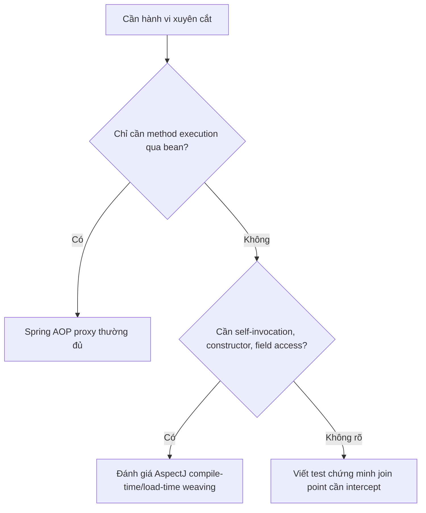

# Giới hạn proxy và khi nào cần cơ chế khác

## Table of Contents
- [Giới hạn mang tính kiến trúc](#giới-hạn-mang-tính-kiến-trúc)
- [Bảng lựa chọn](#bảng-lựa-chọn)
- [AopContext.currentProxy() không phải thuốc chữa mặc định](#aopcontextcurrentproxy-không-phải-thuốc-chữa-mặc-định)
- [Các yếu tố hay bị nhầm](#các-yếu-tố-hay-bị-nhầm)
- [Spring AOP hay AspectJ weaving?](#spring-aop-hay-aspectj-weaving)
- [Nguồn chính thức](#nguồn-chính-thức)
- [Related](#related)

---

## Giới hạn mang tính kiến trúc

### 1. Self-invocation

Lời gọi `this.otherMethod()` xảy ra bên trong target, không qua proxy. Đổi từ JDK proxy sang CGLIB không tự sửa được vấn đề này. Ưu tiên thiết kế ranh giới service rõ hoặc gọi qua proxy reference.

### 2. Method không thể override

CGLIB dựa trên subclassing nên không thể proxy lớp `final`, override method `final` hoặc `private`. Một số method package-private bị giới hạn do visibility, nhất là khi method kế thừa từ package khác. Đừng chọn CGLIB với giả định rằng mọi method của target đều có thể advice.

### 3. Client không gọi qua proxy

Một đối tượng được tạo bằng `new` ngoài container thường không tự được Spring AOP proxy hóa. Thêm `@Transactional` hoặc annotation khác trên lớp đó không tự biến nó thành bean được quản lý.

### 4. Kiểu reference không tương thích

Nếu proxy chỉ đảm bảo interface, việc ép nó sang concrete implementation class có thể thất bại. Ưu tiên inject và sử dụng contract interface ở nơi phù hợp.

### 5. Phạm vi join point

Spring AOP proxy chủ yếu hỗ trợ method execution. Nếu cần intercept field read/write, constructor execution, hoặc call site cụ thể hay những điểm không thể biểu diễn qua proxy, xem xét AspectJ weaving.

---

## Bảng lựa chọn

| Nhu cầu | Hướng ưu tiên |
|---|---|
| Transaction, caching, async và method-based cross-cutting thông thường | Dùng cơ chế Spring tương ứng và kiểm chứng proxy/call path |
| Advice tự viết cho các method của bean Spring | Spring AOP với `@Aspect` hoặc Advisor |
| Bắt self-invocation hoặc join point ngoài method execution | Xem xét AspectJ weaving |
| Muốn kiểm soát tất cả method class | Kiểm tra khả năng override và chọn class-based proxy nếu phù hợp; không bỏ qua `final`/`private` |

---

## `AopContext.currentProxy()` không phải thuốc chữa mặc định

Kỹ thuật này đòi hỏi bật expose-proxy và làm code phụ thuộc Spring AOP. Nó có thể giải quyết call path cụ thể trong trường hợp bắt buộc, nhưng thường kém rõ ràng hơn việc tách trách nhiệm hoặc đi qua dependency được inject.

---

## Các yếu tố hay bị nhầm

- **Proxy type** trả lời “object trung gian được tạo theo cơ chế nào?”.
- **Proxy crossing** trả lời “lời gọi cụ thể có đi qua object trung gian không?”.
- **Pointcut matching** trả lời “điểm thực thi này có được chọn không?”.
- **Advice registration** trả lời “Spring có biết hành vi cần áp dụng không?”.

Để advice chạy, các điều kiện phù hợp phải đồng thời được thỏa mãn. Chỉ kiểm tra một yếu tố là chưa đủ.

---

## Spring AOP hay AspectJ weaving?

Weaving cung cấp phạm vi rộng hơn nhưng đem theo cấu hình build/runtime và quy trình chẩn đoán riêng. Không cần chọn nó nếu proxy giải quyết được yêu cầu.

---

## Nguồn chính thức

- [Proxying Mechanisms](https://docs.spring.io/spring-framework/reference/core/aop/proxying.html)
- [Using AspectJ with Spring Applications](https://docs.spring.io/spring-framework/reference/core/aop/using-aspectj.html)

---

## Related

*   [Luồng gọi và self-invocation](../01_foundations/call_flow_and_self_invocation.md) — phân tích call path làm cơ sở cho giới hạn self-invocation.
*   [JDK dynamic proxy và CGLIB](./jdk_proxy_vs_cglib.md) — các giới hạn cơ chế proxy đứng sau nhiều ngoại lệ được liệt kê.

---

[← Back to README](README.md)
