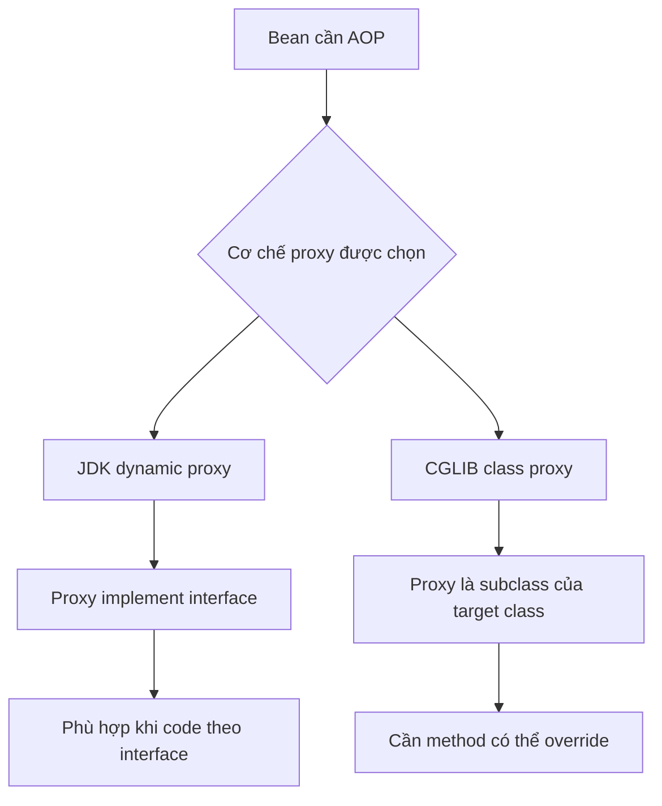

# JDK dynamic proxy và CGLIB

## Table of Contents
- [Hai cơ chế, một mục đích](#hai-cơ-chế-một-mục-đích)
- [So sánh nhanh](#so-sánh-nhanh)
- [Quy tắc chọn](#quy-tắc-chọn)
- [Cấu hình và default](#cấu-hình-và-default)
- [Điều dễ hiểu sai](#điều-dễ-hiểu-sai)
- [Gợi ý chẩn đoán](#gợi-ý-chẩn-đoán)
- [Nguồn chính thức](#nguồn-chính-thức)
- [Related](#related)

---

## Hai cơ chế, một mục đích

Spring cần một object trung gian nhận lời gọi trước target. Có hai hướng phổ biến:

- **JDK dynamic proxy:** tạo proxy dựa trên một hoặc nhiều interface. Caller nhìn proxy thông qua interface.
- **CGLIB class-based proxy:** tạo lớp con của lớp target ở runtime, rồi override các method có thể override để bổ sung hành vi và ủy quyền đến target.

---

## So sánh nhanh

| Tiêu chí | JDK dynamic proxy | CGLIB class-based proxy |
|---|---|---|
| Cấu trúc | Implement interface | Subclass target class |
| Kiểu reference thường dùng | Interface | Có thể là kiểu lớp cụ thể, trong giới hạn kế thừa |
| Method có thể được proxy | Các method thông qua interface được proxy | Các method có thể override trên lớp proxy |
| Target không có interface | Có thể tạo nếu khai báo interface phù hợp; nếu không thường chọn class proxy | Là lựa chọn thường dùng |
| `final` class | Không cần kế thừa target class để proxy interface | Không thể tạo subclass của lớp `final` |
| `final` method | Proxy interface có thể intercept invocation thông qua interface; không dựa vào override method của target | Không thể override nên không thể advice theo cơ chế subclass |
| `private` method | Không phải method của interface nên không được gọi qua proxy interface như join point riêng | Không thể override nên không thể advice |
| Khi phù hợp | API/contract là interface | Cần proxy theo kiểu lớp hoặc method không khai báo trên interface |

---

## Quy tắc chọn

Bắt đầu bằng câu hỏi: **client cần phụ thuộc vào contract nào?** Nếu ứng dụng đã lập trình theo interface, interface proxy thường là lựa chọn dễ kiểm soát. Nếu cần proxy theo class, hoặc cần expose method không thuộc interface, class-based proxy có thể phù hợp khi lớp/method có thể kế thừa/override.

Không nên chọn CGLIB chỉ vì cho rằng nó “mạnh hơn” trong mọi tình huống. Nó vẫn phải tuân theo ngữ nghĩa kế thừa Java; nó không tự giải quyết self-invocation.

---

## Cấu hình và default

Spring Framework có các cấu hình ép class-based proxy, thường thể hiện bằng `proxy-target-class="true"` trong XML hoặc `proxyTargetClass = true` trên cấu hình annotation tương ứng. Tuy nhiên, default thực tế có thể chịu ảnh hưởng bởi cách ứng dụng tích hợp Spring, như cấu hình của Spring Boot, và các cơ chế auto-proxy cùng chia sẻ thiết lập. Không suy ra loại proxy chỉ từ việc thấy có interface; hãy kiểm tra cấu hình và object thực tế khi debug.

Tài liệu Spring Framework hiện hành cũng có tùy chọn chọn proxy cho từng bean ở các phiên bản mới. Đây là chi tiết triển khai phụ thuộc nhánh framework; tham khảo mục cấu hình chính thức tương ứng trước khi sử dụng.

---

## Điều dễ hiểu sai

- **JDK proxy không đồng nghĩa với “chỉ method public mới chạy”.** Vấn đề cốt lõi là method nào có trên interface được proxy và call path đi qua proxy.
- **CGLIB không thể can thiệp mọi method của class.** `final`, `private` và method không thể override là các ranh giới quan trọng.
- **Proxy type không khắc phục self-invocation.** `this.otherMethod()` vẫn gọi trên target.
- **Type mismatch có thể xuất hiện khi ép proxy thành implementation class.** Nếu proxy chỉ đảm bảo interface, hãy inject/nhận bean theo interface thay vì mặc định cast về class triển khai.

---

## Gợi ý chẩn đoán

Kiểm tra `AopUtils.isJdkDynamicProxy(bean)`, `AopUtils.isCglibProxy(bean)` và `AopUtils.getTargetClass(bean)`. Dùng trong debug/test, tránh viết logic nghiệp vụ phụ thuộc vào loại proxy nếu không thực sự cần.

---

## Nguồn chính thức

- [Proxying Mechanisms](https://docs.spring.io/spring-framework/reference/core/aop/proxying.html)
- [AOP Proxies](https://docs.spring.io/spring-framework/reference/core/aop/introduction-proxies.html)

---

## Related

*   [Giới hạn proxy và khi nào cần cơ chế khác](./constraints_and_alternatives.md) — ranh giới `final`/`private` và self-invocation mà việc chọn cơ chế proxy không giải quyết được.

---

[← Back to README](README.md)
