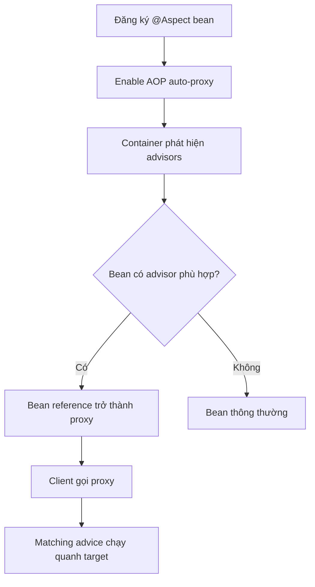

# Cơ chế auto-proxy: khi nào Spring tạo proxy cho bean

## Table of Contents
- [Mục tiêu](#mục-tiêu)
- [Các thành phần](#các-thành-phần)
- [Ví dụ tối thiểu](#ví-dụ-tối-thiểu)
- [Cần hiểu gì sau lớp annotation?](#cần-hiểu-gì-sau-lớp-annotation)
- [Phân biệt proxy và weaving](#phân-biệt-proxy-và-weaving)
- [Tương tác với các tính năng Spring khác](#tương-tác-với-các-tính-năng-spring-khác)
- [Checklist cấu hình](#checklist-cấu-hình)
- [Nguồn chính thức](#nguồn-chính-thức)
- [Related](#related)

---

## Mục tiêu

Trong ứng dụng thông thường, developer muốn khai báo hành vi một lần và để container tự áp dụng cho các bean/method phù hợp, thay vì gọi `new ProxyFactory(...)` ở mỗi nơi. Spring cung cấp cơ chế **auto-proxy**: framework tự phát hiện bean cần bọc và đăng ký một bean proxy vào container.

Tài liệu này tập trung vào **cơ chế tạo proxy** đó. Cách khai báo aspect, pointcut và advice thuộc [module AOP](../../aop/02_spring_aop/aspect_model.md).

---

## Các thành phần

- `@Aspect`: đánh dấu lớp khai báo pointcut/advice theo phong cách annotation của AspectJ. Cú pháp này thuộc [module AOP](../../aop/02_spring_aop/aspect_model.md).
- `@Component` hoặc `@Bean`: đăng ký aspect như một bean Spring. Chỉ có `@Aspect` thường chưa đủ để component scanning tự phát hiện lớp.
- `@EnableAspectJAutoProxy`: bật cơ chế auto-proxy xử lý aspect `@AspectJ` trong cấu hình Java.
- Auto-proxy infrastructure: các bean post-processor xét từng bean và quy tắc advisor để quyết định bọc proxy cho bean nào.

---

## Ví dụ tối thiểu

Kích hoạt auto-proxy trong cấu hình Java:

```java
@Configuration
@EnableAspectJAutoProxy
@ComponentScan("com.example")
class AopConfiguration {
}
```

Đăng ký một aspect như bean để container phát hiện:

```java
@Aspect
@Component
class ServiceTimingAspect {
    @Around("execution(* com.example.service..*(..))")
    Object time(ProceedingJoinPoint pjp) throws Throwable {
        long started = System.nanoTime();
        try {
            return pjp.proceed();
        } finally {
            long elapsed = System.nanoTime() - started;
            System.out.println(pjp.getSignature() + " took " + elapsed + " ns");
        }
    }
}
```

Đây là ví dụ minh họa; đo thời gian ở production thường nên đi qua logging/metrics phù hợp, tránh `System.out` và tránh để dữ liệu nhạy cảm lọt vào log.

---

## Cần hiểu gì sau lớp annotation?

Annotation là cú pháp khai báo, không phải thứ trực tiếp “đi chặn” method. Framework phải nhận diện aspect/advisor, tạo hoặc cấu hình proxy cho bean thích hợp, và invocation phải đi qua proxy. Do đó cần kiểm tra cả ba điều kiện: aspect được đăng ký, pointcut khớp, và call path đi qua proxy.



---

## Phân biệt proxy và weaving

Spring hỗ trợ cú pháp annotation và pointcut của mô hình `@AspectJ`, nhưng trong chế độ Spring AOP, lời gọi được xử lý bằng **proxy**: hành vi được chèn quanh lời gọi mà không đổi bytecode. **Weaving** là cách tích hợp khác, sửa/đan logic advice vào bytecode khi compile hoặc load class, cần cấu hình riêng và cho phạm vi join point rộng hơn.

Chọn cách nào tùy yêu cầu, đặc biệt nếu cần bắt self-invocation, constructor hoặc field access. Tiêu chí chọn được trình bày ở [Giới hạn proxy và khi nào cần cơ chế khác](../02_techniques/constraints_and_alternatives.md).

---

## Tương tác với các tính năng Spring khác

Transaction, caching, async và các hạ tầng khác của Spring cũng sử dụng proxy/interceptor để thực thi hành vi của chúng. Không nhất thiết phải tự tạo `@Aspect` cho từng tính năng. Khi có nhiều cấu hình auto-proxy, hãy đọc tài liệu tính năng và kiểm tra thiết lập proxy được hợp nhất; một cấu hình global có thể ảnh hưởng đến nhiều hạ tầng cùng lúc.

---

## Checklist cấu hình

1. Aspect (hoặc advisor) có thực sự được đăng ký thành bean?
2. Cấu hình bật cơ chế auto-proxy tương ứng chưa?
3. Pointcut có khớp package, method, annotation và argument thực tế không?
4. Bean cần advice có phải bean Spring quản lý không?
5. Client có gọi thông qua reference proxy không?
6. Có self-invocation, method `final`/`private`, hoặc giới hạn proxy type không?
7. Có cấu hình framework/Boot làm thay đổi loại proxy hoặc thứ tự advisor không?

---

## Nguồn chính thức

- [Enabling @AspectJ Support](https://docs.spring.io/spring-framework/reference/core/aop/ataspectj.html)
- [Proxying Mechanisms](https://docs.spring.io/spring-framework/reference/core/aop/proxying.html)

---

## Related

*   [AOP và Spring AOP](../../aop/README.md) — paradigm và mô hình aspect (pointcut, advice) mà auto-proxy dựa vào.
*   [API tham chiếu: ProxyFactory](./proxy_factory.md) — con đường tạo proxy thủ công thay cho cơ chế auto-proxy.
*   [Giới hạn proxy và khi nào cần cơ chế khác](../02_techniques/constraints_and_alternatives.md) — các ràng buộc khiến auto-proxy không kích hoạt advice.

---

[← Back to README](README.md)
