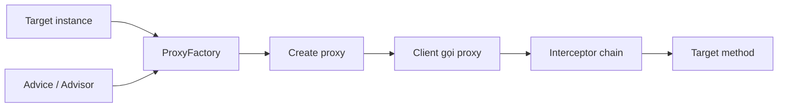

# API tham chiếu: `ProxyFactory`

## Table of Contents
- [Vai trò](#vai-trò)
- [Ví dụ MethodInterceptor](#ví-dụ-methodinterceptor)
- [Gắn advisor và pointcut](#gắn-advisor-và-pointcut)
- [Quy trình](#quy-trình)
- [Những điểm cần cẩn trọng](#những-điểm-cần-cẩn-trọng)
- [Nguồn chính thức](#nguồn-chính-thức)
- [Related](#related)

---

## Vai trò

`org.springframework.aop.framework.ProxyFactory` tạo Spring AOP proxy từ target, cho phép thêm `Advice`/`Advisor` và lấy proxy qua `getProxy()`. Có thể dùng mà không cần Spring IoC, mặc dù ứng dụng thông thường nên để container quản lý các dependency và cấu hình AOP. Dùng `ProxyFactory` trực tiếp khi cần tạo proxy bằng Java code, chẳng hạn trong test, adapter hoặc trường hợp cần điều khiển tường minh.

---

## Ví dụ `MethodInterceptor`

```java
import org.aopalliance.intercept.MethodInterceptor;
import org.springframework.aop.framework.ProxyFactory;

public interface GreetingService {
    String greet(String name);
}

public class GreetingServiceImpl implements GreetingService {
    @Override
    public String greet(String name) {
        return "Hello, " + name;
    }
}

public class ProxyFactoryExample {
    public static void main(String[] args) {
        GreetingService target = new GreetingServiceImpl();
        ProxyFactory factory = new ProxyFactory(target);

        factory.addAdvice((MethodInterceptor) invocation -> {
            System.out.println("before: " + invocation.getMethod().getName());
            try {
                Object result = invocation.proceed();
                System.out.println("after-returning");
                return result;
            } catch (Throwable ex) {
                System.out.println("after-throwing: " + ex.getClass().getSimpleName());
                throw ex;
            }
        });

        GreetingService proxy = (GreetingService) factory.getProxy();
        System.out.println(proxy.greet("Spring"));
    }
}
```

Ví dụ giả định các dependency Spring AOP và AOP Alliance tương ứng có mặt trong classpath. `invocation.proceed()` chuyển tiếp tới interceptor tiếp theo hoặc target. Truyền nguyên exception trở lại thường là hành vi an toàn; chỉ đổi exception khi đó là chính sách được chủ ý thiết kế.

---

## Gắn advisor và pointcut

`Advice` mô tả hành vi. `Advisor` ghép advice với pointcut để giới hạn method nào được áp dụng. Ví dụ, thay vì chạy logging trên mọi invocation, tạo một advisor với pointcut chỉ chọn service method. API có các convenience method cho nhiều loại advice, nhưng cấu trúc cốt lõi vẫn là target + advisors/interceptors + proxy.

---

## Quy trình



---

## Những điểm cần cẩn trọng

- Nếu cần đưa proxy vào dependency graph của ứng dụng, cân nhắc tích hợp với IoC thay vì tự tạo rải rác.
- Nếu target có interface, các interface thích hợp có thể được proxy tự động; khi cần cụ thể hãy khai báo rõ interface/type mong muốn và kiểm tra proxy type.
- Không giữ nhiều proxy khác nhau của cùng target một cách vô tình nếu chúng áp dụng advisor/ordering khác nhau.
- Cân nhắc thứ tự interceptor vì nó quyết định cách logic lồng nhau và xử lý exception.

---

## Nguồn chính thức

- [Creating AOP Proxies Programmatically with `ProxyFactory`](https://docs.spring.io/spring-framework/reference/core/aop-api/prog.html)
- [Proxying Mechanisms](https://docs.spring.io/spring-framework/reference/core/aop/proxying.html)

---

## Related

*   [Cơ chế auto-proxy](./auto_proxy.md) — lựa chọn tự động hóa thay vì tự dựng proxy bằng API.
*   [API tham chiếu: AspectJProxyFactory](./aspectj_proxy_factory.md) — biến thể nhận aspect `@AspectJ` thay vì advice/advisor tường minh.
*   [API/XML tham chiếu: ProxyFactoryBean](./proxy_factory_bean.md) — biến thể để IoC container quản lý proxy.

---

[← Back to README](README.md)
