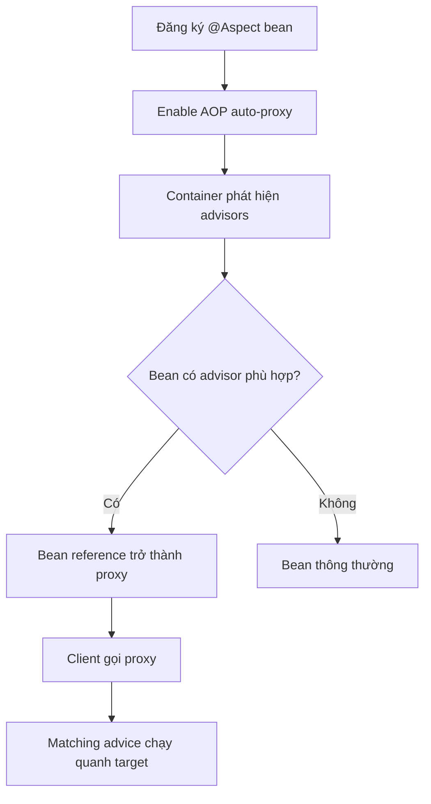

# `@Aspect`, `@EnableAspectJAutoProxy` và cơ chế tự động

## Table of Contents
- [Mục tiêu](#mục-tiêu)
- [Các thành phần](#các-thành-phần)
- [Ví dụ tối thiểu](#ví-dụ-tối-thiểu)
- [Cần hiểu gì sau lớp annotation?](#cần-hiểu-gì-sau-lớp-annotation)
- [Không đánh đồng @AspectJ và AspectJ weaving](#không-đánh-đồng-aspectj-và-aspectj-weaving)
- [Tương tác với các tính năng Spring khác](#tương-tác-với-các-tính-năng-spring-khác)
- [Checklist cấu hình](#checklist-cấu-hình)
- [Nguồn chính thức](#nguồn-chính-thức)
- [Related](#related)

---

## Mục tiêu

Trong ứng dụng thông thường, developer muốn khai báo aspect một lần và để container tự áp dụng cho các bean/method phù hợp, thay vì gọi `new ProxyFactory(...)` ở mỗi nơi. Spring hỗ trợ cơ chế auto-proxy để đăng ký các bean proxy hóa trong container.

---

## Các thành phần

- `@Aspect`: đánh dấu lớp khai báo pointcut/advice theo phong cách annotation của AspectJ.
- `@Component` hoặc `@Bean`: đăng ký aspect như một bean Spring. Chỉ có `@Aspect` thường chưa đủ để component scanning tự phát hiện lớp.
- `@EnableAspectJAutoProxy`: bật hỗ trợ xử lý aspect `@AspectJ` qua Spring AOP proxy trong cấu hình Java.
- Auto-proxy infrastructure: xét các bean và quy tắc advisor để cung cấp proxy phù hợp.

---

## Ví dụ tối thiểu

```java
@Configuration
@EnableAspectJAutoProxy
@ComponentScan("com.example")
class AopConfiguration {
}
```

```java
@Aspect
@Component
class ServiceTimingAspect {
    @Around("execution(* com.example.service..*(..))")
    Object time(ProceedingJoinPoint pjp) throws Throwable {
        long started = System.nanoTime();
        try {
            return pjp.proceed();
        } finally {
            long elapsed = System.nanoTime() - started;
            System.out.println(pjp.getSignature() + " took " + elapsed + " ns");
        }
    }
}
```

Đây là ví dụ minh họa; đo thời gian ở production thường nên đi qua logging/metrics phù hợp, tránh `System.out` và tránh để dữ liệu nhạy cảm lọt vào log.

---

## Cần hiểu gì sau lớp annotation?

Annotation là cú pháp khai báo, không phải thứ trực tiếp “đi chặn” method. Framework phải nhận diện aspect/advisor, tạo hoặc cấu hình proxy cho bean thích hợp, và invocation phải đi qua proxy. Do đó cần kiểm tra cả ba điều kiện: aspect được đăng ký, pointcut khớp, và call path đi qua proxy.



---

## Không đánh đồng `@AspectJ` và AspectJ weaving

Spring hỗ trợ cú pháp annotation và pointcut của mô hình `@AspectJ`, nhưng trong chế độ Spring AOP, lời gọi được xử lý bằng proxy. AspectJ weaving là cách tích hợp khác, cần cấu hình compile-time hoặc load-time weaving, và cho phạm vi join point rộng hơn. Chọn cách nào tùy yêu cầu, đặc biệt nếu cần bắt self-invocation, constructor hoặc field access.

---

## Tương tác với các tính năng Spring khác

Transaction, caching, async và các hạ tầng khác của Spring có thể sử dụng proxy/interceptor để thực thi hành vi của chúng. Không nhất thiết phải tự tạo `@Aspect` cho từng tính năng. Khi có nhiều cấu hình auto-proxy, hãy đọc tài liệu tính năng và kiểm tra thiết lập proxy được hợp nhất; một cấu hình global có thể ảnh hưởng đến nhiều hạ tầng cùng lúc.

---

## Checklist cấu hình

1. Aspect có thực sự được đăng ký thành bean?
2. Cấu hình bật loại AOP tương ứng chưa?
3. Pointcut có khớp package, method, annotation và argument thực tế không?
4. Bean cần advice có phải bean Spring quản lý không?
5. Client có gọi thông qua reference proxy không?
6. Có self-invocation, method `final`/`private`, hoặc giới hạn proxy type không?
7. Có cấu hình framework/Boot làm thay đổi loại proxy hoặc thứ tự advisor không?

---

## Nguồn chính thức

- [Declaring an Aspect](https://docs.spring.io/spring-framework/reference/core/aop/ataspectj/at-aspectj.html)
- [Enabling @AspectJ Support](https://docs.spring.io/spring-framework/reference/core/aop/ataspectj.html)
- [Proxying Mechanisms](https://docs.spring.io/spring-framework/reference/core/aop/proxying.html)

---

## Related

*   [Thuật ngữ AOP](../01_nen_tang/thuat_ngu_aop.md) — vocabulary pointcut/advice/aspect mà lớp annotation dựa vào.
*   [API tham chiếu: ProxyFactory](./proxyfactory.md) — con đường tạo proxy thủ công thay cho cơ chế auto-proxy.

---

[← Back to README](README.md)
