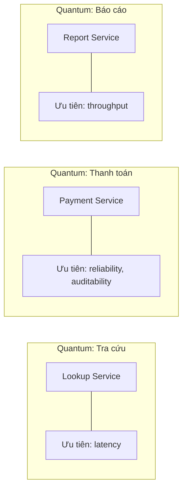

# Phạm vi Áp dụng và Architectural Quantum

## Table of Contents

- [Giới hạn của Giả định Monolithic](#giới-hạn-của-giả-định-monolithic)
- [Architectural Quantum](#architectural-quantum)
- [Hệ quả Thực chiến](#hệ-quả-thực-chiến)
- [Liên quan](#liên-quan)

---

## Giới hạn của Giả định Monolithic

Tư duy cũ giả định một tập đặc tính duy nhất áp dụng đồng nhất cho toàn hệ thống monolithic. Giả định này ngày càng đắt đỏ vì một hệ thống lớn thường chứa nhiều vùng có nhu cầu rất khác nhau về hiệu năng, độ tin cậy và khả năng mở rộng.

Áp một chuẩn chung cho mọi vùng dẫn đến hai hệ quả trái ngược: vùng không cần độ tin cậy cao vẫn gánh chi phí hạ tầng dư thừa, còn vùng thực sự quan trọng lại thiếu đầu tư vì ngân sách đã bị dàn trải.

---

## Architectural Quantum

**Architectural Quantum** là ranh giới xác định phạm vi áp dụng cho một tập đặc tính cụ thể. Dấu hiệu nhận biết một quantum:

- **Triển khai độc lập** được.
- **Độ gắn kết chức năng cao** bên trong.
- **Ghép nối tĩnh bên ngoài thấp**.
- Giao tiếp nội bộ chủ yếu **đồng bộ**.

Trong microservices, mỗi dịch vụ sở hữu cơ sở dữ liệu riêng tạo thành một quantum độc lập, nên mỗi dịch vụ có thể có bộ đặc tính hoàn toàn khác nhau:

---

## Hệ quả Thực chiến

> [!TIP]
> Không cần, và không nên, áp cùng một bộ đặc tính cho toàn hệ thống. Xác định đúng quantum giúp đặt mục tiêu chất lượng đúng chỗ thay vì kéo mọi thành phần về một chuẩn chung đắt đỏ.

Xác định quantum cũng là bước chuẩn bị cho quản trị: mỗi quantum có bộ **Fitness Functions** riêng, phản ánh đúng đặc tính vùng đó cần bảo vệ.

---

## Liên quan

*   [Explicit, Implicit và Composite](03_explicit_implicit_composite.md) — cùng trục **xác định đúng đối tượng**: trước khi giới hạn phạm vi áp dụng, cần biết đặc tính đó là explicit, implicit hay composite.
*   [Trade-off và Quản trị Kiến trúc](05_tradeoffs_and_governance.md) — khi mỗi quantum có mục tiêu riêng, việc **ưu tiên và đánh đổi** giữa các đặc tính trở thành bài toán quản trị trung tâm.
*   [Ma trận Đối chiếu Architecture Styles](../04_architecture_styles/04_comparison.md) — cùng trục **từ phạm vi đến cấu trúc**: số quantum của từng style cho biết hệ thống có thể đặt mục tiêu đặc tính riêng theo bao nhiêu vùng.

---
[← Back to README](README.md)