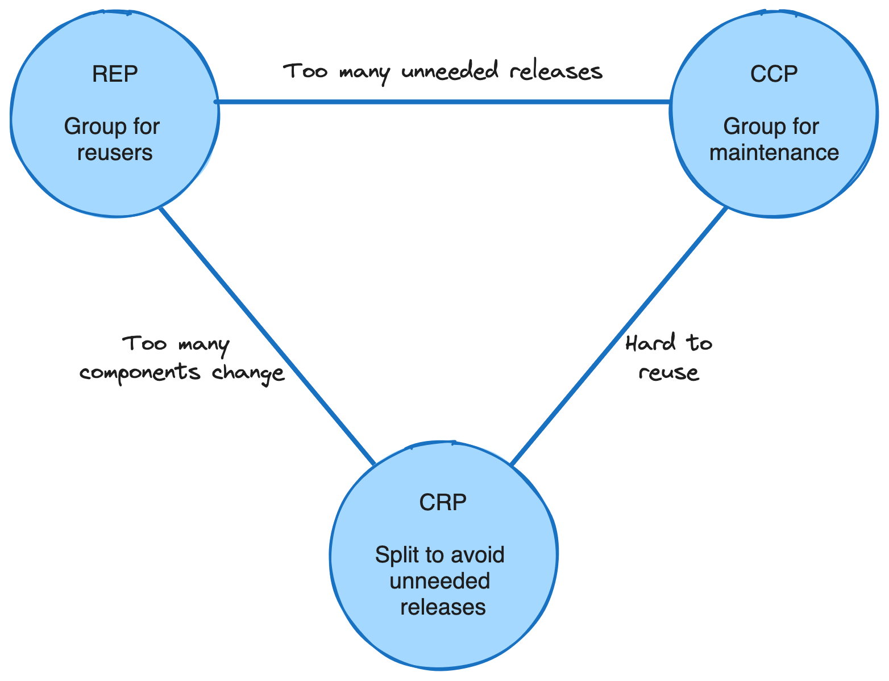
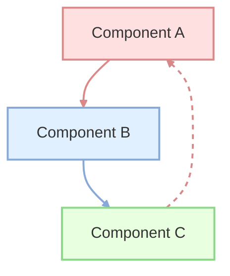

# Vấn đề và Thách thức khi làm việc với Component

## Table of Contents

- [Tam giác Căng thẳng Component Cohesion](#tam-giác-căng-thẳng-component-cohesion)
- [Bài toán Độ mịn](#bài-toán-độ-mịn)
- [Phụ thuộc vòng](#phụ-thuộc-vòng)
- [Layering và Componentization](#layering-và-componentization)
- [Chi phí Vận hành Pipeline](#chi-phí-vận-hành-pipeline)
- [Liên quan](#liên-quan)

---

## Tam giác Căng thẳng Component Cohesion

Ba nguyên tắc gắn kết component luôn đấu tranh lẫn nhau, tạo thành một **tension diagram** không có điểm cân bằng cố định:

| Nguyên tắc | Xu hướng | Lý do |
| :--- | :--- | :--- |
| **Reuse/Release Equivalence Principle (REP)** | Kéo component **to ra** | Thứ được tái sử dụng cùng nhau nên được phát hành cùng nhau như một đơn vị có phiên bản. |
| **Common Closure Principle (CCP)** | Kéo component **to ra** | Thứ thay đổi cùng lúc nên nằm chung để giảm phạm vi ảnh hưởng khi sửa. |
| **Common Reuse Principle (CRP)** | Kéo component **nhỏ lại** | Chỉ gom thứ thực sự dùng chung để tránh phát hành kèm những phần không ai cần. |

Kiến trúc sư phải chấp nhận đánh đổi và chọn điểm cân bằng phù hợp với từng giai đoạn dự án. Giai đoạn đầu thường nghiêng về CCP để dễ thay đổi; khi hệ thống trưởng thành, REP và CRP trở nên quan trọng hơn vì chi phí phát hành và tái sử dụng bắt đầu chi phối.

---

## Bài toán Độ mịn

Component hóa không có nghĩa là càng nhiều component càng tốt. Hai thái cực đều tạo ra phản mẫu:

- **Component Everywhere (quá mịn)**: tách quá nhiều component nhỏ khiến chi phí quản lý build script, pipeline và phụ thuộc tăng vọt. Đồ thị phụ thuộc trở thành mạng nhện, và lợi ích cô lập thay đổi bị bù trừ bởi chi phí phối hợp.
- **One Component to Rule Them All (quá to)**: không chia ranh giới rõ ràng, tạo ra những khối mã nguồn ghép nối chặt chẽ và thiếu đóng gói. Đây là con đường dẫn tới **Big Ball of Mud** hoặc **Spaghetti Architecture**.

Độ mịn đúng là độ mịn mà chi phí quản lý vẫn thấp hơn lợi ích cô lập thay đổi. Ngưỡng này phụ thuộc vào quy mô đội ngũ và tần suất thay đổi, không phải một con số kỹ thuật cố định.

---

## Phụ thuộc vòng

Vi phạm **Acyclic Dependencies Principle (ADP)** tạo ra các vòng lặp phụ thuộc giữa các component. Khi A phụ thuộc B, B phụ thuộc C và C quay lại phụ thuộc A, không component nào có thể được biên dịch, kiểm thử hay phát hành độc lập.

Hệ quả thực tế rất nặng: mọi thay đổi trong một mắt của vòng lặp đều lan tới toàn bộ vòng, pipeline mất khả năng chạy song song, và việc thay thế một triển khai trở nên bất khả thi. Phát hiện sớm vòng lặp phụ thuộc là một trong những **Fitness Functions** hữu ích nhất của kiến trúc.

---

## Layering và Componentization

Một sai lầm phổ biến là xây dựng cấu trúc theo kiểu "mỗi layer là một component", chẳng hạn tách thành component giao diện, component cơ sở dữ liệu và component xử lý nghiệp vụ. Cách chia này nhầm lẫn giữa **tầng kỹ thuật** và **ranh giới chức năng**.

Kiến trúc theo component là **trực giao** với các tầng kỹ thuật. Một component đúng nghĩa nên chứa trọn vẹn logic của một miền chức năng, bao gồm cả giao diện, xử lý và lưu trữ cần thiết cho miền đó. Chia theo tầng ngang khiến mọi thay đổi nghiệp vụ đều phải sửa nhiều component cùng lúc, tái tạo lại đúng vấn đề mà component hóa muốn giải quyết.

---

## Chi phí Vận hành Pipeline

Mỗi component được tách ra phải có thư mục, tệp cấu hình, bài kiểm thử và pipeline riêng. Chi phí này không hiển thị trong sơ đồ kiến trúc nhưng tích lũy nhanh theo số lượng component.

Nguyên tắc thực dụng là chỉ tách pipeline riêng khi quy mô ứng dụng và đội ngũ thực sự vượt quá ngưỡng quản lý của một pipeline đơn lẻ. Tách quá sớm biến lợi ích fast feedback thành gánh nặng bảo trì hạ tầng.

> [!WARNING]
> Component hóa là một trade-off, không phải một mục tiêu. Khi chi phí quản lý vượt quá lợi ích cô lập thay đổi, việc gộp lại là quyết định kiến trúc đúng đắn chứ không phải bước lùi.

---

## Liên quan

*   [Component Giải quyết Vấn đề gì](03_benefits.md) — cùng trục **chi phí và lợi ích**: bài trước nêu giá trị của component hóa, bài này chỉ ra điều kiện để giá trị đó không bị chi phí quản lý nuốt mất.
*   [Trade-off và Quản trị Kiến trúc](../02_architectural_characteristics/05_tradeoffs_and_governance.md) — tension diagram và bài toán độ mịn là biểu hiện cụ thể của nguyên lý **Least Worst Architecture** và cách quản trị bằng **Fitness Functions**.

---
[← Back to README](README.md)
