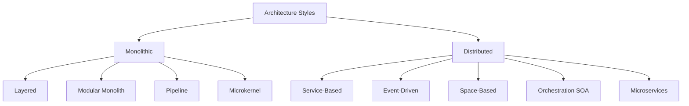

# Architecture Styles Trong Kiến Trúc Phần Mềm

## Table of Contents

- [Định nghĩa và Vai trò](#định-nghĩa-và-vai-trò)
- [Thuật ngữ Nền](#thuật-ngữ-nền)
- [Hai Trục Phân loại](#hai-trục-phân-loại)
- [Bản đồ Tổng quan](#bản-đồ-tổng-quan)
- [Liên quan](#liên-quan)

---

## Định nghĩa và Vai trò

Một **Architecture Style** mô tả hình dáng tổng thể của hệ thống: **topology của component**, **kiến trúc vật lý** (monolithic hay distributed), **mô hình triển khai**, **phương thức giao tiếp** và **topology dữ liệu**.

Đặc tính kiến trúc trả lời câu hỏi *hệ thống phải đạt phẩm chất gì*, còn style trả lời câu hỏi *cấu trúc nào đạt được những phẩm chất đó với chi phí chấp nhận được*. Vì vậy style là khung sườn ban đầu để kiến trúc sư hiện thực hóa các đặc tính hệ thống.

---

## Thuật ngữ Nền

**Architectural Quantum** là đơn vị triển khai độc lập, gắn kết chức năng cao và mang theo dữ liệu mà nó cần để chạy. Số quantum của một style cho biết hệ thống có thể mở rộng, triển khai và chịu lỗi theo bao nhiêu phần tách biệt: monolith luôn là một quantum, còn style càng phân tán thì càng có nhiều quanta.

---

## Hai Trục Phân loại

Mọi style đều được định vị trên hai trục:

| Trục | Lựa chọn | Hệ quả |
| :--- | :--- | :--- |
| **Cấp độ Triển khai** | Monolithic và Distributed | Quyết định chi phí vận hành, độ trễ giao tiếp và khả năng mở rộng vật lý. |
| **Top-Level Partitioning** | Technical và Domain | Quyết định cách tổ chức thành phần cấp cao nhất: theo năng lực kỹ thuật hay theo miền nghiệp vụ. |

**Monolithic** đóng gói toàn bộ mã nguồn vào một đơn vị triển khai. Giao tiếp bằng lời gọi hàm trong bộ nhớ nên rẻ và nhanh, nhưng khả năng mở rộng bị giới hạn bởi một tiến trình.

**Distributed** chia hệ thống thành nhiều đơn vị triển khai độc lập, giao tiếp qua mạng hoặc message broker. Đổi lại khả năng mở rộng và chịu lỗi cao, hệ thống phải trả giá bằng độ trễ mạng, băng thông hữu hạn, an ninh đường truyền và các cạm bẫy của tính toán phân tán.

**Technical Partitioning** sắp xếp thành phần theo năng lực kỹ thuật (presentation, business, persistence). **Domain Partitioning** sắp xếp theo luồng nghiệp vụ hoặc **Bounded Context** (OrderPlacement, Payment, Inventory). Lựa chọn này quyết định một thay đổi nghiệp vụ chạm vào một vùng hay lan qua nhiều tầng kỹ thuật.

---

## Bản đồ Tổng quan

Chín style phổ biến chia thành hai nhóm theo cấp độ triển khai:

Monolithic phù hợp khi chi phí vận hành và độ đơn giản là ưu tiên hàng đầu. Distributed phù hợp khi cần mở rộng, cô lập lỗi hoặc triển khai độc lập ở quy mô lớn, đổi lại độ phức tạp vận hành tăng mạnh.

---

## Liên quan

*   [Các Monolithic Architecture Styles](02_monolithic_styles.md) — bước tiếp theo là đi vào nhóm **monolithic**, nơi chi phí thấp nhưng khả năng mở rộng vật lý bị giới hạn.
*   [Ma trận Đối chiếu Architecture Styles](04_comparison.md) — cùng trục **chọn theo bối cảnh**: bảng đối chiếu đặt chín style cạnh nhau để so sánh điểm mạnh và thách thức.
*   [Phân loại Đặc tính Kiến trúc](../02_architectural_characteristics/02_classification.md) — cùng trục **từ đặc tính đến cấu trúc**: đặc tính là tiêu chí để chọn style, còn style là cách hiện thực hóa chúng.

---
[← Back to README](README.md)