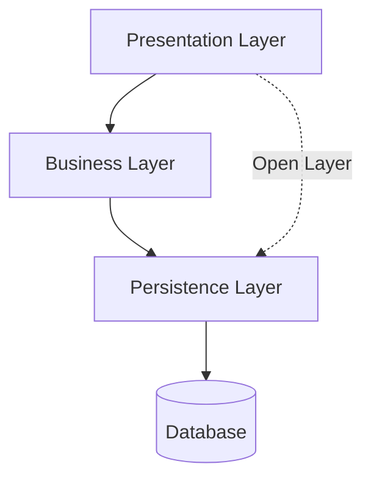
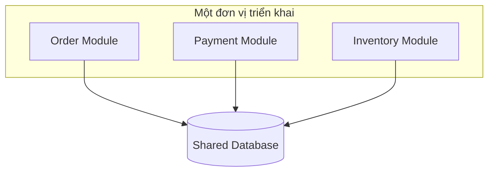
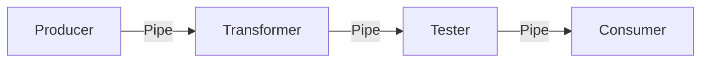
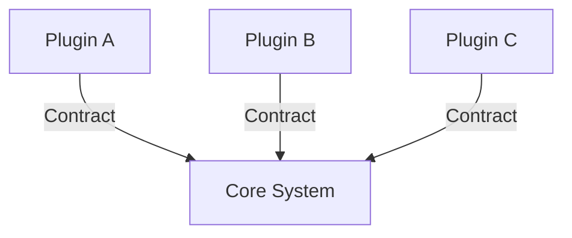

# Các Monolithic Architecture Styles

## Table of Contents

- [Đặc điểm Chung](#đặc-điểm-chung)
- [Layered Architecture](#layered-architecture)
- [Modular Monolith](#modular-monolith)
- [Pipeline Architecture](#pipeline-architecture)
- [Microkernel Architecture](#microkernel-architecture)
- [Liên quan](#liên-quan)

---

## Đặc điểm Chung

Cả bốn style đều là **một đơn vị triển khai, một quantum**: chi phí vận hành gọn, nhưng mở rộng, co giãn và chịu lỗi bị giới hạn bởi một đơn vị vật lý. Điểm khác biệt nằm ở **cách chia bên trong**: theo tầng kỹ thuật, theo miền nghiệp vụ, theo luồng xử lý, hoặc theo lõi và plugin.

---

## Layered Architecture

**Bài toán**: cần một cách tổ chức đơn giản, quen thuộc để đội nhỏ xây nhanh. **Layered Architecture** (N-Tier) giải quyết bằng cách chia mã nguồn theo tầng trách nhiệm kỹ thuật: Presentation, Business, Persistence và Database.

Mỗi tầng là **Closed Layer** hoặc **Open Layer**. Closed Layer bắt luồng xử lý đi qua tầng ngay bên dưới, không nhảy tầng. Open Layer cho phép bỏ qua tầng để tối ưu hiệu năng, đổi lại mất tính nhất quán của luồng xử lý.

Style này theo **Technical Partitioning**. Điểm mạnh là đơn giản và chi phí ban đầu thấp. Điểm yếu lộ ra khi codebase phình to: maintainability, testability, deployability và agility giảm mạnh, trong khi scalability và fault tolerance vốn đã hạn chế.

---

## Modular Monolith

**Bài toán**: giữ chi phí thấp của monolith nhưng không để thay đổi nghiệp vụ lan khắp các tầng. **Modular Monolith** vẫn là một đơn vị triển khai, nhưng mã nguồn theo **Domain Partitioning**: mỗi miền nghiệp vụ là một module cô lập (package riêng hoặc artifact tự trị) và được gom lại khi build.

Ranh giới module phải được bảo vệ bằng kiểm tra tự động, chẳng hạn phân tích phụ thuộc tĩnh để bắt lời gọi chéo không hợp lệ. Thiếu cơ chế này, lập trình viên sẽ dần gọi xuyên module và hệ thống quay lại thành **Big Ball of Mud**.

Điểm mạnh là **Modularity** cao với chi phí thấp, hợp với đội đa chức năng và định hướng DDD. Điểm yếu là scalability, elasticity và fault tolerance vẫn bị giới hạn vật lý.

---

## Pipeline Architecture

**Bài toán**: xử lý dữ liệu qua chuỗi bước có thứ tự xác định, mỗi bước độc lập và tái sử dụng được. **Pipeline Architecture** (Pipes and Filters) nối các bước bằng kênh truyền một chiều. Style này quen thuộc trong Unix terminal, công cụ ETL và mọi luồng biến đổi dữ liệu tuần tự.

**Filters** là các khối chức năng không lưu trạng thái, gồm bốn loại: **Producer** tạo dữ liệu, **Transformer** biến đổi, **Tester** kiểm tra hoặc sàng lọc, **Consumer** tiêu thụ hoặc ghi dữ liệu ra ngoài. **Pipes** là kênh một chiều truyền payload giữa các filter.

Điểm mạnh là tính mô-đun kỹ thuật cao: filter dễ tái sử dụng, dễ kiểm thử, chèn thêm bước mà không sửa bước khác. Điểm yếu là không phù hợp với giao tiếp hai chiều tương tác hoặc quy trình nghiệp vụ không xác định.

---

## Microkernel Architecture

**Bài toán**: phần lõi cần ổn định, nhưng quy tắc nghiệp vụ lại thay đổi theo khách hàng hoặc khu vực. **Microkernel Architecture** (Plug-in Architecture) tách hệ thống thành **Core System** chứa luồng xử lý tối thiểu và các **Plugin Components** chứa phần mở rộng hoặc tùy biến.

Core vận hành độc lập với plugin, còn plugin kết nối với core qua hợp đồng giao diện minh bạch. Style này hợp với sản phẩm đóng gói có hệ sinh thái plugin, hoặc ứng dụng nghiệp vụ có quy tắc đổi theo địa phương (ví dụ cách tính thuế hay bảo hiểm).

Đây là style duy nhất có thể vừa **Technical Partitioning** vừa **Domain Partitioning**. Điểm mạnh là extensibility, evolvability và khả năng thử nghiệm cao. Điểm yếu là quản lý hợp đồng plugin, dữ liệu dùng chung phức tạp và giới hạn mở rộng tiến trình.

---

## Liên quan

*   [Architecture Styles Trong Kiến Trúc Phần Mềm](01_introduction.md) — cùng trục **phân loại theo cấp độ triển khai**: bài trước đặt ra hai trục và bản đồ tổng quan, bài này đi vào nhóm monolithic.
*   [Các Distributed Architecture Styles](03_distributed_styles.md) — bước chuyển sang nhóm **distributed**, nơi khả năng mở rộng và chịu lỗi tăng lên cùng với độ phức tạp vận hành.

---
[← Back to README](README.md)