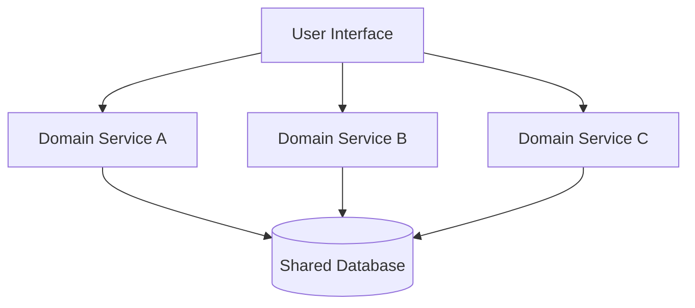
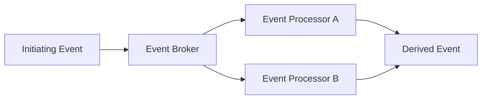
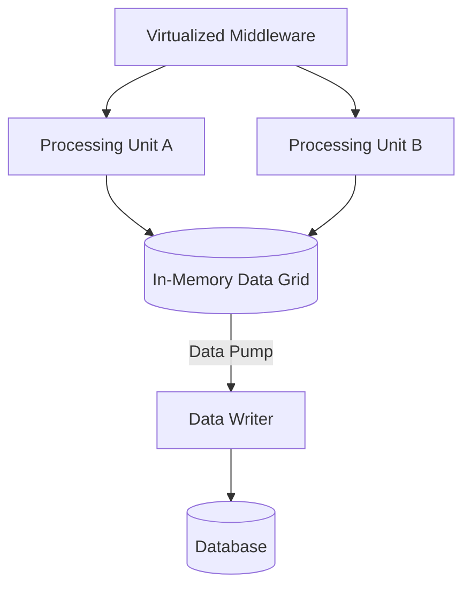
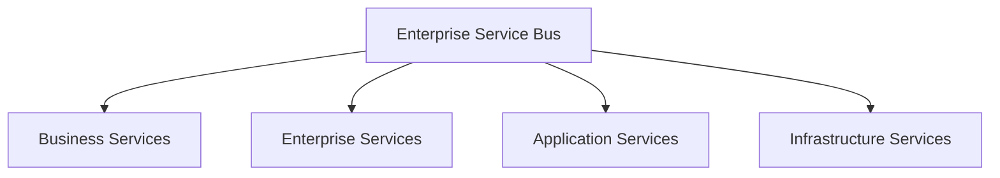
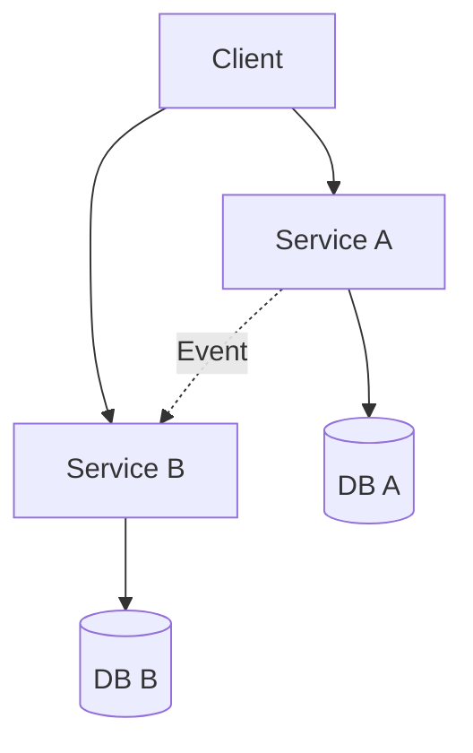

# Các Distributed Architecture Styles

## Table of Contents

- [Đặc điểm Chung](#đặc-điểm-chung)
- [Service-Based Architecture](#service-based-architecture)
- [Event-Driven Architecture](#event-driven-architecture)
- [Space-Based Architecture](#space-based-architecture)
- [Orchestration SOA](#orchestration-soa)
- [Microservices Architecture](#microservices-architecture)
- [Liên quan](#liên-quan)

---

## Đặc điểm Chung

Cả năm style đều có **nhiều đơn vị triển khai độc lập**, nên mở rộng, sẵn sàng và chịu lỗi tốt hơn, nhưng phải đối mặt với tính toán phân tán: độ trễ mạng, băng thông hữu hạn, an ninh đường truyền và nhất quán dữ liệu.

Mức độ phân tán khác nhau tạo ra một dải phổ: **Service-Based** (ít dịch vụ thô, giao dịch vẫn nhất quán) ở đầu này, **Microservices** (nhiều dịch vụ nhỏ, mỗi dịch vụ sở hữu dữ liệu riêng) ở đầu kia.

---

## Service-Based Architecture

**Bài toán**: cần agility và deployability hơn monolith nhưng chưa đủ sức gánh độ phức tạp của microservices. **Service-Based Architecture** là style lai thực tế nhất: một user interface riêng kết nối với một số ít **domain service thô**.

Số dịch vụ thường chỉ từ vài đến hơn chục, dùng chung một cơ sở dữ liệu monolithic hoặc vài cơ sở dữ liệu miền. Vì dịch vụ còn thô, giao dịch giữ được tính chất **ACID** truyền thống thay vì phải chuyển sang **BASE**.

Điểm mạnh là agility, testability, deployability cao hơn nhiều so với monolith với chi phí vừa phải. Điểm yếu là scalability ở mức trung bình do dịch vụ còn thô.

---

## Event-Driven Architecture

**Bài toán**: xử lý lượng lớn tác vụ bất đồng bộ mà các thành phần không phải chờ nhau. **Event-Driven Architecture** (EDA) giải quyết bằng cơ chế phát và phản hồi sự kiện theo mô hình **fire-and-forget**.

Luồng cơ bản: **Initiating Event** đi qua **Event Broker** (queue hoặc topic) tới các **Event Processor**, rồi sinh ra **Derived Events**. Có hai topology chính:

- **Broker Topology**: không có bộ điều phối trung tâm, các dịch vụ phản hồi sự kiện tự do (**Choreography**).
- **Mediator Topology**: một **Event Mediator** quản lý luồng quy trình phức tạp (**Orchestration**).

Điểm mạnh là responsiveness, performance, scalability và elasticity ở mức cao nhất. Điểm yếu là độ phức tạp lớn, rất khó debug, rủi ro mất dữ liệu nếu thiếu cơ chế xác nhận, và **Stamp Coupling** khi sự kiện mang quá nhiều dữ liệu.

---

## Space-Based Architecture

**Bài toán**: cơ sở dữ liệu trung tâm là điểm nghẽn lớn nhất của ứng dụng lưu lượng cao. **Space-Based Architecture** loại bỏ điểm nghẽn đó bằng cách chuyển dữ liệu giao dịch vào bộ nhớ.

**Processing Units** lưu dữ liệu giao dịch trên **Replicated In-Memory Data Grid** thay vì truy cập cơ sở dữ liệu trực tiếp. **Virtualized Middleware** quản lý messaging, dữ liệu, xử lý và triển khai. **Data Pumps** cùng **Data Writers/Readers** đồng bộ bất đồng bộ dữ liệu từ bộ nhớ xuống cơ sở dữ liệu phía sau.

Điểm mạnh là scalability, elasticity và performance tiệm cận giới hạn vật lý, hỗ trợ tốt hybrid cloud. Điểm yếu là chi phí hạ tầng rất cao, độ phức tạp lớn và nguy cơ **Data Collisions** khi đồng bộ bộ nhớ.

---

## Orchestration SOA

**Bài toán** (của giai đoạn 1990-2000): tái sử dụng dịch vụ ở cấp toàn doanh nghiệp. **Orchestration-Driven Service-Oriented Architecture** giải quyết bằng cách phân tầng dịch vụ nghiêm ngặt và để một bus trung tâm điều phối tất cả.

Bốn tầng dịch vụ (Business, Enterprise, Application, Infrastructure) nối với nhau qua **Enterprise Service Bus** hoặc **Orchestration Engine**.

Style này suy thoái vì cố chia nhỏ giao dịch thành các thành phần tái sử dụng chung và đẩy toàn bộ logic vào ESB. Kết quả là một chốt chặn giao tiếp khổng lồ, ghép nối quá chặt, chi phí cao và thiếu linh hoạt. Bài học: tái sử dụng cấp doanh nghiệp chỉ có giá trị khi ranh giới miền nghiệp vụ được tôn trọng.

---

## Microservices Architecture

**Bài toán**: các đội cần triển khai và mở rộng độc lập mà không giẫm chân nhau. **Microservices** lấy cảm hứng từ **Bounded Context** trong DDD và theo triết lý cô lập tuyệt đối, **Share Nothing**.

Đặc điểm cấu trúc chính:

- **Kích thước dịch vụ**: nhỏ, đơn mục đích, chạy trong tiến trình riêng (container hoặc VM).
- **Database-per-Service**: mỗi dịch vụ sở hữu cơ sở dữ liệu riêng, tuyệt đối không dùng chung, để giữ ranh giới Bounded Context.
- **Ưu tiên duplication hơn coupling**: chấp nhận lặp mã hoặc dữ liệu để triệt tiêu phụ thuộc tĩnh giữa các dịch vụ.
- **Giao tiếp**: đồng bộ qua gọi hàm từ xa hoặc bất đồng bộ qua event/messaging, điều phối theo Choreography hoặc Orchestration.

Điểm mạnh là testability, deployability, evolvability, scalability và fault tolerance cao nhất trong các style. Điểm yếu là độ trễ mạng cao, truy vấn liên dịch vụ kém hiệu quả, giao dịch phân tán (**Saga** hoặc **BASE**) phức tạp và chi phí vận hành/DevOps rất đắt.

> [!WARNING]
> Microservices không phải đích đến mặc định. Khi ranh giới miền chưa rõ hoặc đội ngũ chưa đủ năng lực vận hành phân tán, chi phí hạ tầng sẽ nặng hơn nhiều so với giá trị mở rộng mang lại.

---

## Liên quan

*   [Các Monolithic Architecture Styles](02_monolithic_styles.md) — cùng trục **cấp độ triển khai**: bài trước mô tả nhóm monolithic với chi phí thấp, bài này mô tả nhóm distributed với khả năng mở rộng cao hơn.
*   [Ma trận Đối chiếu Architecture Styles](04_comparison.md) — sau khi nắm từng style, bước tiếp theo là **so sánh trực tiếp** để chọn theo bối cảnh.

---
[← Back to README](README.md)