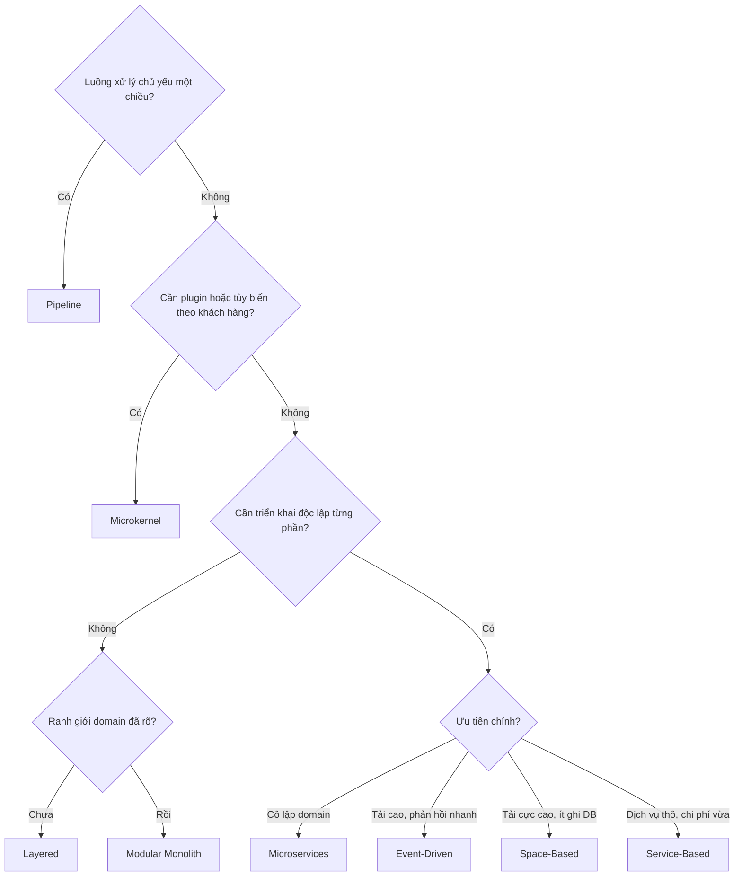

# Ma trận Đối chiếu Architecture Styles

## Table of Contents

- [Bảng Đối chiếu](#bảng-đối-chiếu)
- [Nguyên tắc Lựa chọn](#nguyên-tắc-lựa-chọn)
- [Liên quan](#liên-quan)

---

## Bảng Đối chiếu

Chín style đặt cạnh nhau theo bốn tiêu chí: loại phân chia, số **Architectural Quantum**, điểm mạnh cốt lõi và thách thức chính.

| Style | Loại Phân chia | Architectural Quanta | Điểm mạnh Cốt lõi | Thách thức Chính |
| :--- | :--- | :--- | :--- | :--- |
| **Layered (N-Tier)** | Technical | 1 | Đơn giản, chi phí ban đầu rất thấp | Khó thay đổi, rủi ro triển khai cao khi codebase phình to |
| **Modular Monolith** | Domain | 1 | Tính mô-đun cao, cấu trúc rõ ràng, chi phí thấp | Scalability và fault tolerance vật lý bị giới hạn |
| **Pipeline** | Technical | 1 | Tái sử dụng tốt, dễ chèn hoặc bỏ bước xử lý | Không phù hợp luồng giao tiếp hai chiều tương tác |
| **Microkernel** | Technical hoặc Domain | 1 | Mở rộng qua plugin, dễ tùy biến | Quản lý hợp đồng plugin và dữ liệu dùng chung phức tạp |
| **Service-Based** | Domain | 1 đến nhiều | Bảo trì, kiểm thử, phát hành tốt với chi phí vừa phải | Mở rộng kém chi tiết hơn Microservices |
| **Event-Driven** | Technical | Nhiều | Hiệu năng, responsiveness, scalability, elasticity rất cao | Phức tạp, khó debug, rủi ro mất dữ liệu và stamp coupling |
| **Space-Based** | Technical | 1 đến nhiều | Scalability, elasticity, performance tiệm cận giới hạn vật lý | Chi phí hạ tầng rất cao, rủi ro xung đột bộ nhớ |
| **Orchestration SOA** | Technical | 1 | Tái sử dụng cấp doanh nghiệp, quản trị tập trung | ESB thành chốt chặn, cồng kềnh, thiếu linh hoạt |
| **Microservices** | Domain | Nhiều | Deployability, testability, evolvability, scalability rất cao | Chi phí vận hành đắt, độ trễ mạng, dữ liệu phân tán phức tạp |

---

## Nguyên tắc Lựa chọn

Không có style nào tối ưu cho mọi bối cảnh. Chọn style là bài toán **trade-off analysis** dựa trên miền nghiệp vụ, năng lực vận hành của đội và ưu tiên chiến lược. Cây quyết định dưới đây chỉ là điểm khởi đầu để thu hẹp lựa chọn:

**Orchestration SOA** hiếm khi được chọn cho hệ thống mới. Giá trị của nó là giúp hiểu vì sao tái sử dụng cấp doanh nghiệp qua ESB thất bại.

Cây quyết định chỉ là heuristic. Ba yếu tố thực tế thường lật ngược kết quả:

- **Năng lực đội ngũ**: microservices đòi hỏi DevOps, observability và quản lý giao dịch phân tán. Thiếu những năng lực này, distributed chỉ tạo ra một monolith phân tán đắt đỏ.
- **Ranh giới miền nghiệp vụ**: khi Bounded Context chưa rõ, mọi ranh giới dịch vụ đều là phỏng đoán và sẽ phải tách gộp nhiều lần.
- **Chi phí chuyển đổi**: cấu trúc hiện tại càng ghép nối chặt, di chuyển sang style khác càng tốn. Đôi khi nâng cấp dần từ Modular Monolith là con đường ít tệ nhất.

> [!IMPORTANT]
> Không có kiến trúc hoàn hảo nhất, chỉ có kiến trúc ít tệ nhất. Quyết định đúng là quyết định nêu rõ đặc tính nào được ưu tiên, đặc tính nào bị hy sinh và chi phí vận hành tương ứng.

---

## Liên quan

*   [Các Distributed Architecture Styles](03_distributed_styles.md) — cùng trục **so sánh và lựa chọn**: bài trước mô tả từng style phân tán, bài này đặt chúng cạnh nhau để đánh đổi theo bối cảnh.
*   [Architecture Styles Trong Kiến Trúc Phần Mềm](01_introduction.md) — cùng trục **khung phân loại**: hai trục triển khai và phân chia là nền tảng để đọc bảng đối chiếu này.

---
[← Back to README](README.md)