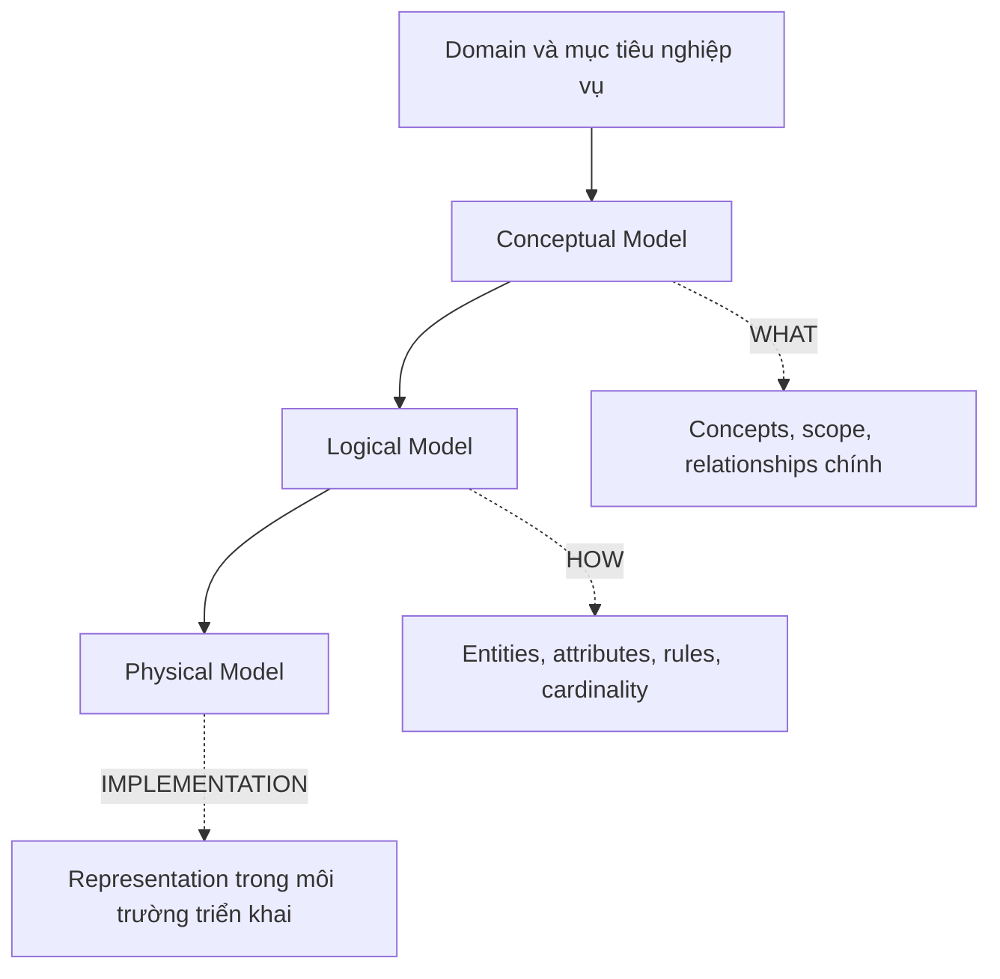

# Foundations of Data Modelling

## Table of Contents

- [1. Vì sao cần Data Model](#1-vì-sao-cần-data-model)
- [2. Data Model là gì](#2-data-model-là-gì)
- [3. Ba mức độ mô hình hóa](#3-ba-mức-độ-mô-hình-hóa)
- [4. Thành phần cốt lõi](#4-thành-phần-cốt-lõi)
- [5. Business Rules và Domain Semantics](#5-business-rules-và-domain-semantics)
- [6. Identity, State và History](#6-identity-state-và-history)
- [7. Data Quality và các nguyên tắc nền tảng](#7-data-quality-và-các-nguyên-tắc-nền-tảng)
- [8. Sai lầm thường gặp](#8-sai-lầm-thường-gặp)
- [Related](#related)

---

## 1. Vì sao cần Data Model

Một hệ thống có thể lưu được dữ liệu nhưng vẫn mô hình hóa sai. Ví dụ, hệ thống bán hàng lưu được `order`, `customer` và `address`, nhưng không xác định địa chỉ trên đơn hàng là địa chỉ hiện tại của khách hàng hay địa chỉ tại thời điểm giao dịch. Khi khách hàng đổi địa chỉ, dữ liệu lịch sử có thể bị diễn giải sai dù mọi bản ghi vẫn hợp lệ về mặt cấu trúc.

**Data Model** làm rõ ý nghĩa của dữ liệu, các đối tượng nghiệp vụ, mối quan hệ, quy tắc hợp lệ và cách dữ liệu thay đổi theo thời gian. Nó là hợp đồng chung giữa business, analyst, architect và developer. Mục tiêu không chỉ là lưu dữ liệu mà còn giữ cho dữ liệu có thể được hiểu, truy vấn, cập nhật và duy trì đúng trong suốt vòng đời hệ thống.

Một data model tốt cần đạt bốn mục tiêu:

1. **Completeness:** mô tả đủ dữ liệu cần thiết để thực hiện nghiệp vụ.
2. **Correctness:** biểu diễn đúng ý nghĩa và business rules.
3. **Usability:** hỗ trợ những cách đọc, ghi và khai thác dữ liệu thực tế.
4. **Changeability:** cho phép nghiệp vụ và cấu trúc dữ liệu phát triển mà không tạo ra thay đổi dây chuyền không kiểm soát.

---

## 2. Data Model là gì

**Data Modelling** là quá trình khám phá, trừu tượng hóa và tổ chức thông tin của một domain thành một mô hình có cấu trúc. Quá trình này xác định:

- Hệ thống cần ghi nhận những khái niệm nghiệp vụ nào.
- Mỗi khái niệm có những thuộc tính và identity nào.
- Các khái niệm liên kết với nhau bằng quy tắc gì.
- Dữ liệu được tạo, đọc, sửa, xóa, lưu giữ và thay đổi ra sao.
- Điều kiện nào phải luôn đúng và điều kiện nào chỉ đúng tại một thời điểm.

Phân biệt ba khái niệm:

| Khái niệm | Trả lời câu hỏi | Ví dụ |
| :--- | :--- | :--- |
| **Domain Concept** | Nghiệp vụ đang nói về điều gì? | Customer, Order, Product |
| **Data Model** | Những khái niệm đó được định nghĩa và liên kết thế nào? | Order thuộc về Customer; Order gồm các Order Line |
| **Data Representation** | Mô hình được biểu diễn cụ thể ra sao trong một môi trường triển khai? | Object, record, document, event hoặc bảng |

Data model không đồng nghĩa với schema của một DBMS. Schema vật lý là một cách hiện thực hóa model, không phải bản thân toàn bộ tư duy mô hình hóa.

---

## 3. Ba mức độ mô hình hóa

Ba mức độ này giúp tách câu hỏi nghiệp vụ khỏi quyết định cấu trúc và triển khai.

| Mức | Trọng tâm | Người tham gia chính | Nội dung |
| :--- | :--- | :--- | :--- |
| **Conceptual Model** | WHAT: domain có những gì? | Business stakeholder, product owner, architect | Khái niệm, phạm vi, quan hệ chính, thuật ngữ nghiệp vụ |
| **Logical Model** | HOW: các quy tắc và cấu trúc logic ra sao? | Analyst, data architect, engineer | Entity, attribute, cardinality, constraints, lifecycle |
| **Physical Model** | IMPLEMENTATION: mô hình được hiện thực hóa thế nào? | Engineer, DBA, platform team | Cấu trúc lưu trữ, key, index, partition, kiểu dữ liệu và cấu hình cụ thể |

Ví dụ với **Library System**:

- **Conceptual:** thư viện quản lý Book, Reader, Author và Borrowing.
- **Logical:** một Reader có thể có tối đa 5 Borrowing đang hoạt động; mỗi Borrowing gắn với một Book và có due date; một Book có thể được viết bởi nhiều Author.
- **Physical:** chọn cách biểu diễn các entity, identifier và relationship trong công nghệ lưu trữ được triển khai.

Trong bộ tài liệu này, trọng tâm nằm ở Conceptual và Logical Model. Physical Model chỉ được đề cập để phân định ranh giới, không đi vào cấu hình của từng database.

Sơ đồ nhấn mạnh thứ tự trừu tượng hóa: hiểu domain trước, xác định cấu trúc logic sau, rồi mới ánh xạ sang một môi trường triển khai cụ thể.

---

## 4. Thành phần cốt lõi

| Thành phần | Ý nghĩa | Câu hỏi kiểm tra |
| :--- | :--- | :--- |
| **Entity** | Một đối tượng hoặc sự kiện cần được nhận diện và quản lý | Ta cần theo dõi một cá thể nào? |
| **Entity Type** | Phân loại các entity cùng bản chất | Có những loại đối tượng nào? |
| **Attribute** | Thuộc tính mô tả entity | Cần biết những thông tin nào về đối tượng? |
| **Relationship** | Liên hệ có ý nghĩa giữa các entity | Hai đối tượng liên quan theo quy tắc gì? |
| **Identifier** | Thuộc tính hoặc tập thuộc tính phân biệt một entity | Làm sao nhận ra đúng một cá thể? |
| **Constraint** | Điều kiện dữ liệu phải thỏa mãn | Trạng thái nào hợp lệ, trạng thái nào bị cấm? |
| **Lifecycle** | Các trạng thái và chuyển đổi trong đời sống entity | Dữ liệu được tạo, thay đổi, kết thúc khi nào? |

Ví dụ, `Borrowing` không chỉ là một thuộc tính của Reader. Nó có identity, trạng thái, thời điểm mượn, due date và quan hệ với Book. Khi một quan hệ mang thuộc tính hoặc lifecycle riêng, cần xem xét mô hình nó thành entity độc lập.

---

## 5. Business Rules và Domain Semantics

**Business Rule** định nghĩa điều gì được phép, bắt buộc hoặc bị cấm trong nghiệp vụ. Data model cần biểu đạt được các quy tắc này, không chỉ ghi nhận các field.

Ví dụ với Library:

- Một Reader không được có quá 5 lượt mượn đang hoạt động.
- Một Borrowing phải thuộc về đúng một Reader.
- Một Borrowing phải tham chiếu đến một Book hợp lệ.
- `due_date` không được sớm hơn `borrowed_at`.
- Một lượt mượn đã trả không còn được tính vào số lượt mượn đang hoạt động.

Phân biệt:

- **Structural Rule:** quy tắc về cấu trúc, như một Borrowing phải có Reader.
- **Domain Rule:** quy tắc nghiệp vụ, như Reader chỉ được mượn tối đa 5 quyển cùng lúc.
- **Temporal Rule:** quy tắc phụ thuộc thời gian, như phí phạt được tính theo chính sách có hiệu lực vào ngày trả.
- **Authorization Rule:** quy tắc ai được xem hoặc sửa một loại dữ liệu. Đây là phần giao giữa data model, security model và application behavior.

Một lỗi phổ biến là biến business rule thành một ghi chú ngoài model. Khi rule ảnh hưởng đến tính hợp lệ của dữ liệu, nó cần xuất hiện trong đặc tả logic và có cách kiểm chứng.

---

## 6. Identity, State và History

### Identity

**Identity** là khái niệm trả lời “đây có phải cùng một đối tượng hay không?”. Tên, email, số điện thoại hoặc địa chỉ có thể thay đổi, vì vậy chúng không mặc nhiên là identity ổn định.

Cần phân biệt:

- **Natural Identifier:** định danh xuất phát từ domain, ví dụ ISBN của một ấn bản sách.
- **Surrogate Identifier:** định danh do hệ thống cấp, không mang ý nghĩa nghiệp vụ trực tiếp.
- **Composite Identifier:** identity được xác định bởi nhiều thành phần kết hợp.

Điều quan trọng ở mức nền tảng là identity phải ổn định trong phạm vi nghiệp vụ và có quy tắc uniqueness rõ ràng.

### State

**State** là trạng thái hiện tại của entity. Ví dụ Order có thể đi qua `Draft`, `Placed`, `Paid`, `Shipped`, `Completed` hoặc `Cancelled`. Không nên dùng một tập trạng thái mơ hồ nếu mỗi trạng thái không có ý nghĩa và điều kiện chuyển đổi rõ ràng.

### History và Snapshot

**Current State** trả lời “hiện tại điều gì đúng?”. **History** trả lời “điều gì đã xảy ra?”. **Snapshot** giữ lại giá trị có ý nghĩa tại một thời điểm cụ thể.

Ví dụ, Order cần giữ tên sản phẩm, đơn giá và địa chỉ giao hàng tại thời điểm đặt hàng. Nếu chỉ tra cứu thông tin hiện tại từ Product hoặc Customer, lịch sử giao dịch có thể thay đổi theo các lần chỉnh sửa sau này.

Không phải mọi dữ liệu đều cần lưu lịch sử đầy đủ. Hãy xác định business requirement: cần biết trạng thái hiện tại, các mốc thay đổi, hay toàn bộ chuỗi sự kiện.

---

## 7. Data Quality và các nguyên tắc nền tảng

Một mô hình dữ liệu tốt cần bảo đảm các thuộc tính sau:

- **Accuracy:** giá trị phản ánh đúng thực tế hoặc sự kiện nghiệp vụ.
- **Completeness:** các thông tin bắt buộc không bị thiếu.
- **Consistency:** cùng một quy tắc hoặc ý nghĩa không bị diễn giải mâu thuẫn giữa các phần hệ thống.
- **Uniqueness:** không tồn tại nhiều bản ghi đại diện cho cùng một identity nếu nghiệp vụ yêu cầu duy nhất.
- **Validity:** giá trị thỏa mãn kiểu, miền giá trị và business rules.
- **Timeliness:** dữ liệu đủ mới so với yêu cầu nghiệp vụ.
- **Traceability:** có thể truy vết nguồn gốc hoặc lý do hình thành dữ liệu khi cần.

Cẩn trọng với ba cách biểu diễn thường gây nhầm lẫn:

| Trạng thái dữ liệu | Ý nghĩa |
| :--- | :--- |
| **Unknown** | Giá trị tồn tại nhưng chưa biết |
| **Not Applicable** | Thuộc tính không áp dụng cho trường hợp này |
| **Not Provided** | Nguồn gửi không cung cấp thông tin |

Không nên gộp cả ba thành một giá trị rỗng nếu ứng dụng cần phân biệt chúng.

---

## 8. Sai lầm thường gặp

1. **Start with storage:** chọn bảng, document hay collection trước khi hiểu domain và use case.
2. **Over-modeling:** tách entity cho mọi danh từ mà không xác định identity, lifecycle hoặc trách nhiệm riêng.
3. **Under-modeling:** gộp nhiều khái niệm khác nghĩa vào một cấu trúc chỉ vì chúng có vài thuộc tính giống nhau.
4. **Missing temporal meaning:** không phân biệt giá trị hiện tại với giá trị tại thời điểm giao dịch.
5. **Hidden business rules:** rule chỉ nằm trong code hoặc tài liệu rời rạc, không được kiểm tra ở cấp model.
6. **Unstable identity:** dùng thuộc tính có thể thay đổi làm khóa nhận diện mà không có chính sách xử lý.

---

## Related

- [Workload Analysis](./02_workload_analysis.md) — **Business Rules** cần được đặt trong bối cảnh thao tác và tần suất truy cập thực tế.

---
[← Back to README](README.md)
