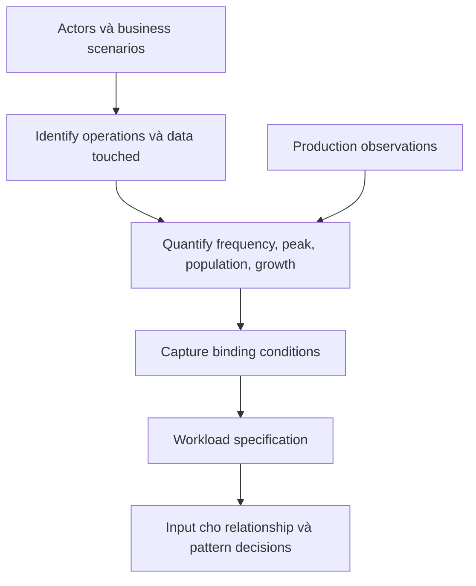

# Workload Analysis

## Table of Contents

- [1. Workload là gì](#1-workload-là-gì)
- [2. Vì sao workload phải đi trước cấu trúc dữ liệu](#2-vì-sao-workload-phải-đi-trước-cấu-trúc-dữ-liệu)
- [3. Phân loại workload](#3-phân-loại-workload)
- [4. Quy trình phân tích workload](#4-quy-trình-phân-tích-workload)
- [5. Xây dựng Workload Table](#5-xây-dựng-workload-table)
- [6. Định lượng dữ liệu và thao tác](#6-định-lượng-dữ-liệu-và-thao-tác)
- [7. Binding Conditions](#7-binding-conditions)
- [8. Từ workload đến quyết định mô hình hóa](#8-từ-workload-đến-quyết-định-mô-hình-hóa)
- [9. Anti-patterns khi phân tích](#9-anti-patterns-khi-phân-tích)
- [10. Checklist](#10-checklist)
- [Related](#related)

---

## 1. Workload là gì

Một data model không phục vụ cho dữ liệu đứng yên. Nó phục vụ cho những người và process tạo, đọc, cập nhật, chia sẻ, tổng hợp và lưu giữ dữ liệu. Nếu chỉ liệt kê entity mà không biết ứng dụng sử dụng chúng thế nào, ta chưa có đủ cơ sở để đưa ra quyết định mô hình hóa.

**Workload** là tập hợp các hoạt động và đặc tính nghiệp vụ mà hệ thống thực hiện trên dữ liệu. Workload không chỉ là tỷ lệ read/write. Nó bao gồm:

- Actor và mục tiêu nghiệp vụ.
- Use case, command và query.
- Dữ liệu mỗi hoạt động cần đọc hoặc thay đổi.
- Tần suất trung bình, peak và độ đồng thời.
- Quy mô dữ liệu, growth rate và cardinality.
- Latency, freshness, consistency, durability và retention requirements.
- Mức độ quan trọng khi hoạt động thành công hoặc thất bại.

Nói cách khác, **Workload mô tả cách dữ liệu được sử dụng**, không phải database đang chạy như thế nào.

---

## 2. Vì sao workload phải đi trước cấu trúc dữ liệu

Cùng một domain có thể có nhiều workload khác nhau. Một hệ thống thương mại điện tử có thể cần:

- Mở trang chi tiết sản phẩm nhanh.
- Tạo đơn hàng với trạng thái và giá tại thời điểm mua.
- Tra cứu toàn bộ đơn hàng của khách hàng.
- Tổng hợp doanh thu theo ngày.
- Kiểm tra tồn kho gần như tức thời.

Nếu chỉ nhìn danh sách `Product`, `Customer`, `Order`, `Inventory`, ta chưa biết dữ liệu nào thường được đọc cùng nhau, dữ liệu nào thay đổi độc lập, thao tác nào ở critical path và báo cáo nào có thể chấp nhận độ trễ.

Workload định hướng các câu hỏi quan trọng:

1. Dữ liệu nào thường được truy cập cùng nhau?
2. Những thao tác nào xuất hiện nhiều nhất hoặc có mức độ quan trọng cao nhất?
3. Dữ liệu nào được cập nhật độc lập?
4. Dữ liệu nào tăng trưởng không giới hạn?
5. Giá trị nào phải chính xác ngay lập tức, giá trị nào chấp nhận trễ?
6. Có thể tái sử dụng kết quả tính toán hay phải tính lại mỗi lần?

Một model đẹp về mặt khái niệm nhưng buộc ứng dụng thực hiện nhiều bước phối hợp cho một thao tác thường xuyên có thể không phù hợp với workload. Ngược lại, một model tối ưu cho một truy vấn hiếm nhưng làm phức tạp mọi thao tác ghi cũng có thể là lựa chọn tệ.

---

## 3. Phân loại workload

Các nhóm sau là profile để định hướng suy nghĩ, không phải nhãn cố định cho toàn hệ thống. Một ứng dụng thường có nhiều workload cùng tồn tại.

| Nhóm | Đặc điểm | Hướng ưu tiên ở cấp data model |
| :--- | :--- | :--- |
| **Read-heavy** | Nhiều truy vấn, ít thay đổi | Tổ chức dữ liệu gần với nhu cầu đọc; cân nhắc projection, denormalization hoặc cacheable read model |
| **Write-heavy** | Nhiều event, insert hoặc update | Tránh cập nhật lan rộng; giảm dữ liệu phải thay đổi cho mỗi operation; xác định dữ liệu nào có thể xử lý theo lô |
| **Balanced** | Read và write đều quan trọng | Không tối ưu cực đoan theo một phía; tìm ranh giới consistency và ownership phù hợp |
| **Analytical** | Đọc khối lượng lớn, tổng hợp trên nhiều record | Tách câu hỏi phân tích khỏi transaction path; cân nhắc pre-aggregation và summary data |

Cần phân biệt hai trục khác nhau:

- **Volume profile:** có bao nhiêu thao tác hoặc bao nhiêu dữ liệu.
- **Criticality profile:** hậu quả nếu thao tác chậm, sai hoặc mất dữ liệu.

Một thao tác có thể có volume thấp nhưng criticality rất cao (ví dụ xác nhận thanh toán). Một loại event có volume rất cao nhưng mỗi event riêng lẻ có thể chịu được việc mất một phần dữ liệu (ví dụ telemetry không trọng yếu). Không được suy ra mức ưu tiên chỉ từ số lượng.

---

## 4. Quy trình phân tích workload

Quy trình có ba bước chính: **Identify → Quantify → Binding Conditions**.

Workload specification là đầu ra của bước phân tích, không phải danh sách query API. Khi có telemetry thực tế, quay lại hiệu chỉnh phần định lượng thay vì xem các giả định ban đầu là bất biến.

### 4.1 Identify the Work

Bắt đầu từ actor, goal và scenario. Không bắt đầu từ danh sách endpoint hoặc câu lệnh database.

Nguồn thông tin có thể gồm:

- Business requirements và user stories.
- Quy trình vận hành hiện tại.
- Prototype hoặc màn hình nghiệp vụ.
- Domain experts và stakeholder interviews.
- Application logs, analytics hoặc quan sát hệ thống đang chạy.
- Support tickets và các tình huống lỗi thực tế.

Với mỗi scenario, ghi nhận:

1. Actor nào thực hiện?
2. Mục tiêu nghiệp vụ là gì?
3. Khi nào thao tác xảy ra?
4. Cần đọc những thông tin nào?
5. Cần tạo hoặc thay đổi những thông tin nào?
6. Kết quả nào được trả về hoặc phát sinh side effect nào?
7. Điều kiện nào khiến thao tác không hợp lệ?

### 4.2 Quantify the Work

Chuyển mô tả định tính thành ước lượng có thể kiểm tra:

- Số actor, tenant, store, device hoặc entity.
- Số operation trên mỗi đơn vị thời gian.
- Average rate và peak rate.
- Số lượng liên kết trên mỗi parent (min/typical/max).
- Tốc độ tăng dữ liệu theo ngày, tháng, năm.
- Tỷ lệ read/write và tỷ lệ update/delete.
- Thời gian dữ liệu cần được giữ lại.
- Mức độ đồng thời hoặc số request cùng lúc.

Không cần tạo ra độ chính xác giả. Hãy ghi rõ giả định, khoảng ước lượng và nguồn của con số.

### 4.3 Apply Binding Conditions

Một con số chưa đủ để đưa ra quyết định. Cần biết chất lượng mà nghiệp vụ yêu cầu:

- Latency tối đa bao nhiêu?
- Dữ liệu cần mới đến mức nào?
- Có được phép mất một event không?
- Hai thay đổi liên quan có cần được nhìn thấy cùng lúc không?
- Nếu một phần của thao tác thất bại, hệ thống được phép ở trạng thái nào?
- Dữ liệu được giữ bao lâu và xóa theo chính sách nào?
- Có giới hạn về quyền truy cập, privacy hoặc data residency không?

Kết quả của bước này là workload specification có thể dùng để đánh giá các phương án model.

---

## 5. Xây dựng Workload Table

**Workload Table** gom các thao tác quan trọng vào một nơi để so sánh. Một bảng thực dụng nên có actor, action, query type, data touched, frequency, priority và requirements.

| Actor | Action | Type | Data touched | Frequency | Priority | Requirement |
| :--- | :--- | :--- | :--- | :--- | :--- | :--- |
| Customer | Xem chi tiết sản phẩm | Read | Product, price, availability | Rất thường xuyên | High | Latency thấp, thông tin đủ mới |
| Customer | Tạo đơn hàng | Write | Order, Order Line, price snapshot, inventory | Theo nhu cầu | Critical | Không tạo đơn trùng, giá phải đúng tại thời điểm mua |
| Staff | Tra cứu lịch sử đơn | Read | Order, shipment, payment status | Thường xuyên | High | Hỗ trợ lọc theo khách và thời gian |
| Finance | Tổng hợp doanh thu | Analytical read | Orders, refunds, payment events | Theo giờ/ngày | Medium | Có thể chấp nhận dữ liệu trễ theo kỳ |
| Support | Tra cứu lỗi giao dịch | Read | Order, status history, external event IDs | Khi có sự cố | High | Truy vết được nguồn và thời điểm |

Một operation có thể vừa đọc vừa ghi. Ví dụ tạo đơn hàng có thể đọc giá và tồn kho, đồng thời tạo Order, Order Line và các reservation. Hãy mô tả đúng hành vi nghiệp vụ thay vì ép mọi scenario vào một nhãn CRUD đơn giản.

### Priority không đồng nghĩa với Frequency

Có thể dùng ba mức:

- **Critical:** sai hoặc thất bại gây hậu quả nghiệp vụ nghiêm trọng.
- **High:** ảnh hưởng trực tiếp đến hoạt động chính hoặc trải nghiệm quan trọng.
- **Medium/Low:** có thể trì hoãn, retry hoặc xử lý sau mà không làm sai nghiệp vụ cốt lõi.

Trong thực tế, cần thêm owner chịu trách nhiệm xác nhận priority. Tránh để nhóm kỹ thuật tự suy ra criticality chỉ từ tần suất.

---

## 6. Định lượng dữ liệu và thao tác

Phân tích định lượng không đồng nghĩa với tính kích thước vật lý của DB. Trong phạm vi Data Modelling, cần biết quy mô logic và hành vi tăng trưởng trước.

| Đại lượng | Câu hỏi | Ví dụ cách ghi |
| :--- | :--- | :--- |
| **Population** | Có bao nhiêu entity hoặc actor? | 10.000 stores, 3 machines/store |
| **Frequency** | Operation xảy ra bao nhiêu lần? | 1 event/s trung bình; peak 800 events/s |
| **Cardinality** | Một entity liên kết bao nhiêu entity khác? | 1 store có 5 shelves; một user có thể có hàng nghìn events |
| **Growth** | Dữ liệu tăng với tốc độ nào? | 10 triệu events/ngày |
| **Retention** | Bao lâu cần giữ dữ liệu? | 1 năm vận hành, 10 năm phục vụ audit |
| **Concurrency** | Bao nhiêu thao tác có thể diễn ra đồng thời? | Hàng trăm user cập nhật cùng thời điểm |
| **Read/Write ratio** | Tương quan đọc và ghi? | 90% writes, 10% reads |
| **Peak factor** | Peak cao hơn trung bình bao nhiêu? | Peak gấp 4 lần average |

Công thức ước lượng cơ bản:

- `daily_operations = average_operations_per_second × 86,400`.
- `average_rate = total_operations_in_period / seconds_in_period`.
- `peak_rate` phải được ước lượng riêng từ giờ cao điểm, batch hoặc sự kiện đặc biệt.
- `projected_population = current_population × (1 + growth_rate)^periods` chỉ phù hợp khi growth rate gần ổn định.

Ví dụ: chuỗi cửa hàng có 10 triệu lượt pha cà phê mỗi ngày. Trung bình ngày là khoảng 116 lượt/giây. Nếu giả định 30% số lượt xảy ra trong một giờ cao điểm, peak xấp xỉ 833 lượt/giây. Con số này chỉ là ước lượng workload, không phải sizing cho bất kỳ database nào.

### Đừng chỉ dùng giá trị trung bình

Average có thể che khuất peak. Ngoài average, nên hỏi:

- Peak theo giờ, ngày hoặc mùa vụ là gì?
- Có bulk import hoặc batch job không?
- Một tenant lớn có thể tạo workload vượt xa tenant thông thường không?
- Một quan hệ có thể tăng đột biến không?
- Khi retry, operation có thể bị gửi lặp lại không?

Nếu chưa có dữ liệu production, ghi giả định và xác định cách thu thập số liệu sau khi hệ thống vận hành.

---

## 7. Binding Conditions

**Binding Conditions** là các điều kiện có khả năng quyết định hoặc loại bỏ một phương án thiết kế.

| Điều kiện | Câu hỏi cần làm rõ | Hệ quả ở cấp model |
| :--- | :--- | :--- |
| **Latency** | Người dùng phải nhận kết quả trong bao lâu? | Định hình data access path và mức độ tổng hợp trước |
| **Freshness** | Dữ liệu trễ bao lâu còn chấp nhận được? | Quyết định có thể dùng projection hoặc asynchronous update hay không |
| **Consistency** | Các dữ liệu liên quan cần đồng bộ tức thời đến mức nào? | Xác định consistency boundary và nơi sở hữu dữ liệu |
| **Durability** | Mất một thay đổi đã xác nhận gây hậu quả gì? | Xác định chính sách retry, event capture và audit |
| **Availability** | Một phần hệ thống ngừng hoạt động thì nghiệp vụ nào vẫn phải chạy? | Xác định ranh giới phụ thuộc và dữ liệu tối thiểu cần có |
| **Retention** | Giữ dữ liệu bao lâu, vì mục đích gì? | Quyết định lifecycle, archival và deletion semantics |
| **Privacy/Security** | Ai được xem, sửa hoặc xóa dữ liệu nào? | Có thể cần tách ownership và access boundary |
| **Regulation** | Có yêu cầu audit, residency hoặc erasure không? | Ràng buộc snapshot, history và deletion policy |

Cần tránh nhầm **consistency** với “mọi bản sao luôn giống nhau từng mili giây”. Nghiệp vụ cần định nghĩa rõ dữ liệu nào phải đồng bộ ngay, dữ liệu nào chấp nhận staleness có giới hạn.

---

## 8. Từ workload đến quyết định mô hình hóa

| Quan sát từ workload | Câu hỏi mô hình hóa | Hướng cần cân nhắc |
| :--- | :--- | :--- |
| Hai nhóm dữ liệu hầu như luôn được đọc cùng nhau | Chúng có cùng lifecycle và ownership không? | Co-location hoặc projection |
| Một tập con nhỏ được đọc thường xuyên | Có cần tải toàn bộ lịch sử không? | Subset / hot-cold separation |
| Một phép tính tốn kém lặp lại | Có thể chấp nhận dữ liệu tính sẵn trễ bao lâu? | Computed / materialized result |
| Số lượng child tăng liên tục | Có giới hạn tự nhiên không? | Tách child thành đơn vị độc lập, tránh danh sách không giới hạn |
| Một thuộc tính được chia sẻ nhưng ít thay đổi | Có lợi ích khi đưa bản sao gần nơi đọc không? | Extended reference / controlled duplication |
| Dữ liệu phát sinh theo thời gian với số lượng lớn | Cần truy vấn theo khoảng thời gian nào? | Bucket / time grouping |
| Báo cáo quét lượng dữ liệu lớn | Báo cáo có cần nằm trên critical path không? | Summary model hoặc analytical read model |
| Nhiều biến thể có chung phần lõi | Có thực sự cùng một domain type không? | Polymorphic representation hoặc model tách riêng |

Đây chưa phải quyết định cuối cùng. Phải đi tiếp qua cardinality, ownership, lifecycle và consistency để chọn cấu trúc.

---

## 9. Anti-patterns khi phân tích

- **Endpoint-driven modelling:** xem URL/API là model; endpoint có thể thay đổi trong khi domain semantics không đổi.
- **CRUD-only analysis:** ghi Create/Read/Update/Delete nhưng không nói mục tiêu, fields, frequency hoặc constraints.
- **Average-only planning:** bỏ qua peak và long-tail behavior.
- **Volume equals priority:** coi operation nhiều nhất là operation quan trọng nhất.
- **Assumption without owner:** con số ước lượng không có nguồn hoặc người xác nhận.
- **Premature physical sizing:** bàn về byte, RAM, index và node trước khi biết business volume, growth, cardinality và access pattern.
- **Missing lifecycle:** chỉ biết record được tạo nhưng không biết khi nào cập nhật, archive hoặc xóa.

---

## 10. Checklist

- [ ] Đã xác định actor và mục tiêu của từng scenario quan trọng.
- [ ] Đã liệt kê query, command và dữ liệu bị tác động.
- [ ] Đã ghi frequency, peak, priority và data touched.
- [ ] Đã ước lượng population, cardinality, growth và retention.
- [ ] Đã phân biệt volume với criticality.
- [ ] Đã xác định latency, freshness, consistency và durability expectations.
- [ ] Đã đánh dấu giả định chưa được kiểm chứng.
- [ ] Đã liên kết mỗi quyết định model với ít nhất một workload cụ thể.

---

## Related

- [Foundations of Data Modelling](./01_foundations.md) — **Business Rules** cần được hiểu trước khi đánh giá operation nào là quan trọng.
- [Relationships and Cardinality](./03_relationships_and_cardinality.md) — workload xác định dữ liệu thường được dùng cùng nhau, còn cardinality giới hạn cách biểu diễn quan hệ.
- [Coffee Franchise Case Study](./09_case_study_coffee_franchise.md) — case study cung cấp dữ liệu để luyện cách định lượng frequency, peak và priority.

---
[← Back to README](README.md)
