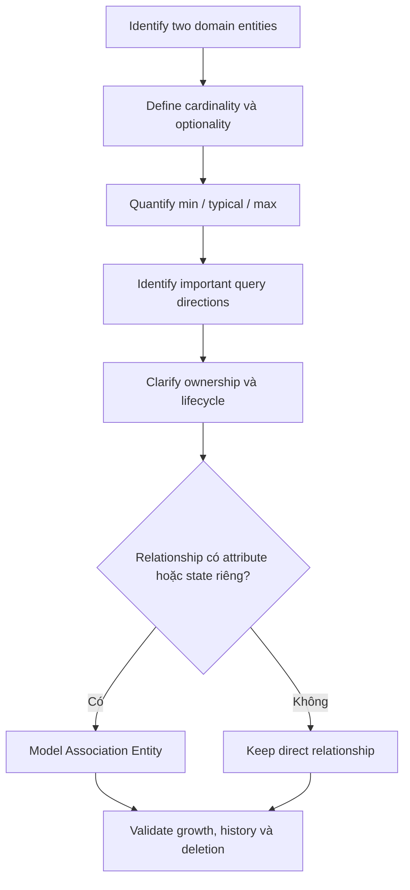

# Relationships and Cardinality

## Table of Contents

- [1. Quan hệ trong domain](#1-quan-hệ-trong-domain)
- [2. Cardinality và Optionality](#2-cardinality-và-optionality)
- [3. Các dạng quan hệ phổ biến](#3-các-dạng-quan-hệ-phổ-biến)
- [4. Association Entity](#4-association-entity)
- [5. Ownership và Lifecycle](#5-ownership-và-lifecycle)
- [6. Quy trình phân tích một relationship](#6-quy-trình-phân-tích-một-relationship)
- [7. Anti-patterns](#7-anti-patterns)
- [Related](#related)

---

## 1. Quan hệ trong domain

Sau khi xác định entity và workload, bước tiếp theo là mô tả các entity liên hệ với nhau như thế nào. Relationship không chỉ là việc một record chứa ID của record khác. Nó biểu đạt một quy tắc nghiệp vụ: ai sở hữu cái gì, ai tham gia sự kiện nào, một đối tượng có thể liên quan đến bao nhiêu đối tượng khác và quan hệ đó tồn tại trong bao lâu.

Ví dụ trong Library:

- Một Reader có thể có nhiều Borrowing.
- Mỗi Borrowing thuộc về một Reader.
- Mỗi Borrowing liên quan đến một Book.
- Một Book có thể có nhiều Author và một Author có thể viết nhiều Book.

Cần phân biệt **relationship trong domain** với **cách biểu diễn relationship**. Domain relationship vẫn tồn tại dù ứng dụng dùng object reference, foreign key, embedded object, event hoặc một mô hình khác.

---

## 2. Cardinality và Optionality

**Cardinality** mô tả số lượng entity ở một phía có thể liên kết với entity ở phía còn lại. **Optionality** mô tả quan hệ có bắt buộc tồn tại hay không.

Ví dụ, một Order phải có đúng một Customer, nhưng Customer có thể chưa từng có Order nào. Hai phía của cùng relationship có thể có cardinality và optionality khác nhau.

| Ký hiệu | Ý nghĩa | Ví dụ |
| :--- | :--- | :--- |
| **1:1** | Một A liên kết tối đa một B và ngược lại | User và hồ sơ cá nhân riêng |
| **1:Few** | Một A liên kết với một số lượng nhỏ, có giới hạn tự nhiên B | Reader có tối đa 5 lượt mượn đang hoạt động |
| **1:Many** | Một A liên kết với nhiều B, nhưng tập hợp cần được định lượng | Customer có nhiều Orders |
| **1:Zillion** | Một A liên kết với tập B rất lớn hoặc tăng không có giới hạn thực tế | Device phát sinh telemetry liên tục |
| **N:M** | Nhiều A liên kết với nhiều B | Movie và Actor; Student và Course |
| **Tree/Hierarchy** | Quan hệ cha-con có cấu trúc phân cấp | Category, Organization, Folder |

“Few”, “Many” và “Zillion” không phải ngưỡng số học cố định. Chúng phụ thuộc vào growth, access pattern, lifecycle và mức độ có thể quản lý tập hợp con.

### Định lượng cardinality

Không nên chỉ ghi “một store có nhiều events”. Hãy ghi:

- Minimum: số event ít nhất có thể phát sinh.
- Typical: số thường gặp trong điều kiện vận hành bình thường.
- Maximum: số tối đa có thể xuất hiện trong vòng đời hoặc cửa sổ thời gian xác định.

Maximum và growth pattern thường quan trọng hơn giá trị trung bình vì chúng phơi bày nguy cơ một quan hệ tăng không giới hạn.

---

## 3. Các dạng quan hệ phổ biến

### 3.1 One-to-One (1:1)

Mỗi phía liên kết tối đa một entity ở phía kia. Nếu hai phần dữ liệu luôn được sử dụng cùng nhau, có cùng lifecycle và cùng ownership, có thể xem chúng là một aggregate hoặc một entity có nhóm thuộc tính. Nếu chúng có quyền truy cập, bảo mật, lifecycle hoặc thay đổi độc lập, cần giữ ranh giới riêng.

Ví dụ: User và UserProfile. Profile có thể được gắn vào User nếu nó chỉ là phần mô tả của User; nhưng thông tin nhạy cảm hoặc có lifecycle khác có thể cần ownership riêng.

### 3.2 One-to-Few (1:Few)

Một parent có số lượng child nhỏ và bị giới hạn bởi business rule. Đây thường là ứng viên tốt để quản lý cùng nhau vì tập child đủ nhỏ và các thao tác thường liên quan đến parent.

Ví dụ: Reader có tối đa 5 lượt mượn đang hoạt động. Cần nhấn mạnh giới hạn này thuộc về nghiệp vụ; nếu hệ thống còn cần lịch sử mượn vô hạn, lịch sử không nên bị đánh đồng với danh sách active borrowings.

### 3.3 One-to-Many (1:Many)

Một parent liên kết với nhiều child. Cần xác định query direction: ứng dụng thường xem parent cùng toàn bộ child, xem từng child riêng lẻ, hay tìm parent từ một child?

Ví dụ Customer và Order:

- Nếu trang Customer thường hiển thị một số thông tin Order gần đây, có thể tạo một read projection giới hạn.
- Nếu Order được tra cứu, xử lý và lưu giữ độc lập, Order nên có identity và lifecycle riêng.
- Nếu cần tìm tất cả Order của Customer, relationship phải hỗ trợ chiều truy vấn này.

Không nên giả định 1:Many mặc nhiên nên được gộp vào một phía.

### 3.4 One-to-Zillion (1:Zillion)

Đây là trường hợp đặc biệt của 1:Many, khi số child rất lớn hoặc liên tục tăng. Không nên quản lý toàn bộ child như một tập hợp không giới hạn bên trong parent.

Ví dụ Device và SensorReading: Device có thể phát sinh hàng triệu reading trong thời gian dài. Device và mỗi reading có thể có lifecycle, retention và workload khác nhau. Cần phân tách identity của thiết bị với các sự kiện đo đạc.

Câu hỏi bắt buộc:

1. Một parent có thể có bao nhiêu child tối đa?
2. Child có cần được truy cập độc lập không?
3. Có cần xóa hoặc archive child theo thời gian không?
4. Truy vấn thường cần toàn bộ child hay chỉ một cửa sổ gần đây?
5. Có cần thống kê trên nhiều parent không?

### 3.5 Many-to-Many (N:M)

Một entity ở phía A có thể liên kết với nhiều entity ở phía B và ngược lại. Ví dụ Movie và Actor, hoặc Student và Course.

Có thể biểu diễn N:M trực tiếp về mặt logic, nhưng khi mối quan hệ có thuộc tính riêng, hãy cân nhắc **Association Entity**. Ví dụ `Enrollment` giữa Student và Course có `enrolled_at`, `grade`, `status` và `completion_date`.

Association Entity giúp quản lý lifecycle của mối quan hệ như một đối tượng nghiệp vụ thực thụ. Nó không chỉ là kỹ thuật nối hai danh sách ID.

### 3.6 Hierarchical / Tree Relationship

Một entity có thể có parent, children, ancestors hoặc descendants. Cần xác định hệ thống thường thực hiện truy vấn nào:

- Tìm parent trực tiếp.
- Liệt kê direct children.
- Tìm tất cả descendants.
- Tìm toàn bộ ancestors.
- Tính đường đi từ root đến node.
- Di chuyển một node sang nhánh khác.

Không có một cách biểu diễn cây tối ưu cho mọi truy vấn. Cách tổ chức nên ưu tiên các thao tác quan trọng nhất, nhưng phải tính cả chi phí khi chuyển node và duy trì tính đúng đắn của cây.

---

## 4. Association Entity

Khi quan hệ có dữ liệu hoặc hành vi riêng, mô hình hóa quan hệ thành một entity độc lập.

Ví dụ `Student ↔ Course`:

| Entity | Thuộc tính tiêu biểu |
| :--- | :--- |
| Student | student_id, name |
| Course | course_id, title |
| Enrollment | student_id, course_id, enrolled_at, status, grade |

`Enrollment` biểu diễn việc một Student tham gia một Course. Nó có thể được tạo, cập nhật, hủy hoặc hoàn tất độc lập. Một cặp Student-Course có thể có quy tắc uniqueness hoặc cho phép học lại tùy nghiệp vụ.

Dùng Association Entity khi:

- Relationship có attribute riêng.
- Relationship có lifecycle hoặc state transition riêng.
- Cần audit ai tạo hoặc cập nhật quan hệ.
- Có thể cần nhiều lần tham gia giữa cùng hai entity.
- Relationship có thể được truy vấn như một đối tượng nghiệp vụ.

---

## 5. Ownership và Lifecycle

Cardinality chưa trả lời đầy đủ câu hỏi “dữ liệu thuộc về ai?”. Hãy bổ sung:

- **Ownership:** ai chịu trách nhiệm về tính đúng đắn của dữ liệu?
- **Lifecycle dependency:** child có thể tồn tại nếu parent bị xóa không?
- **Independent lifecycle:** child có cần tồn tại hoặc được truy cập độc lập không?
- **Sharing:** nhiều parent có thể tham chiếu cùng một child không?
- **Mutability:** dữ liệu có thay đổi thường xuyên không?
- **Deletion semantics:** xóa parent thì child bị cascade, detach, archive hay giữ lại?

Ví dụ, Order Line thuộc về Order trong khi Product là catalog entity có thể tồn tại độc lập. Khi sản phẩm bị ngừng bán, Order lịch sử không được mất ý nghĩa. Vì vậy, Order Line cần giữ snapshot của những thuộc tính có ý nghĩa tại thời điểm mua.

---

## 6. Quy trình phân tích một relationship

Với mỗi quan hệ, lần lượt trả lời:

1. Hai entity đại diện cho hai khái niệm riêng hay một khái niệm có nhóm thuộc tính?
2. Cardinality và optionality ở cả hai phía là gì?
3. Minimum, typical và maximum cardinality là bao nhiêu?
4. Query direction nào quan trọng nhất?
5. Hai phía có cùng lifecycle và ownership không?
6. Dữ liệu có được chia sẻ bởi nhiều parent không?
7. Relationship có attribute hoặc state riêng không?
8. Có nhu cầu snapshot, audit hoặc temporal history không?
9. Tăng trưởng có bị giới hạn hay không?
10. Nếu một phía bị xóa, dữ liệu phía kia phải được xử lý thế nào?

Kết quả cần là một mô tả logic có thể review, ví dụ: “Một Customer có nhiều Order; mỗi Order thuộc đúng một Customer tại thời điểm đặt; Order giữ snapshot thông tin người nhận và địa chỉ giao hàng; Customer có thể cập nhật địa chỉ hiện tại mà không làm thay đổi đơn hàng lịch sử.”

Cardinality cho biết quy mô liên kết; ownership và lifecycle cho biết trách nhiệm quản lý. Chỉ khi xem đồng thời các trục này mới có đủ cơ sở để quyết định cách biểu diễn.

---

## 7. Anti-patterns

- **Unbounded child collection:** coi tập child có thể lớn vô hạn như một thuộc tính nhỏ của parent.
- **Over-referencing:** tách mọi quan hệ thành những bước lookup độc lập dù workload luôn cần chúng cùng nhau.
- **Over-embedding:** gộp các entity khác ownership/lifecycle chỉ để giảm số lần truy cập.
- **Ignoring query direction:** chỉ tối ưu chiều parent → child trong khi nghiệp vụ cần tìm child → parent.
- **Missing association entity:** nhét trạng thái và metadata của quan hệ vào một nơi không rõ ownership.
- **Accidental cascade delete:** xóa dữ liệu lịch sử hoặc dữ liệu được chia sẻ do giả định sai về ownership.
- **Cardinality without bound:** ghi “many” nhưng không biết upper bound, growth hoặc retention.

---

## Related

- [Workload Analysis](./02_workload_analysis.md) — **Access Pattern** và **Frequency** quyết định relationship nào cần được tối ưu trước.
- [Data Placement and Consistency](./04_data_placement_and_consistency.md) — sau khi xác định cardinality và ownership, mới chọn cách co-locate hoặc reference dữ liệu.
- [Time, Hierarchy and Evolution Patterns](./07_time_hierarchy_and_evolution_patterns.md) — **Tree Relationship** và dữ liệu tăng theo thời gian cần các cách tổ chức riêng.

---
[← Back to README](README.md)
