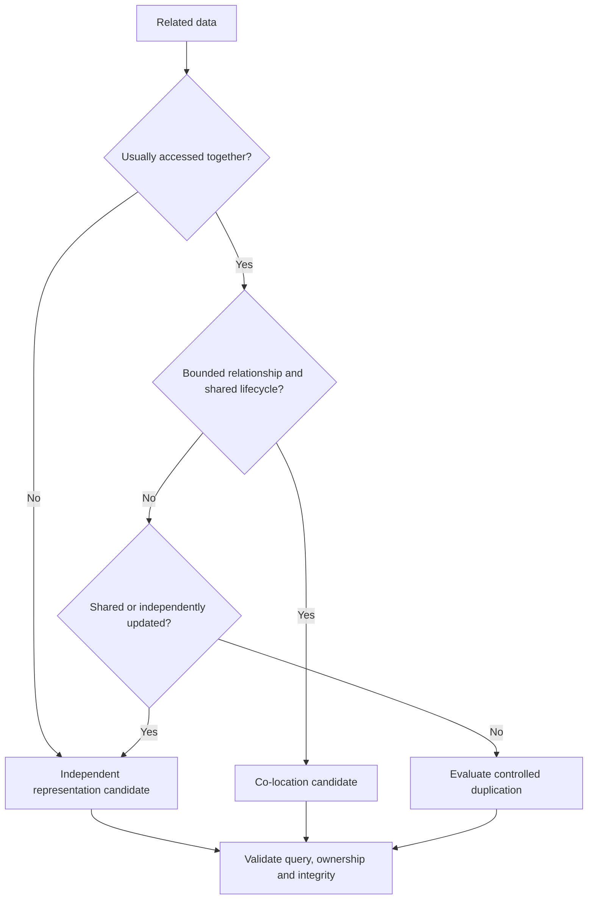
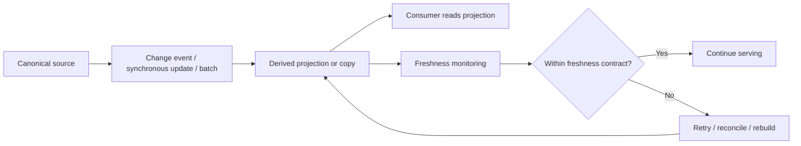

# Data Placement and Consistency

## Table of Contents

- [1. Vấn đề đặt dữ liệu](#1-vấn-đề-đặt-dữ-liệu)
- [2. Co-location và Independent Representation](#2-co-location-và-independent-representation)
- [3. Normalization và Denormalization](#3-normalization-và-denormalization)
- [4. Duplication có chủ đích](#4-duplication-có-chủ-đích)
- [5. Consistency và Staleness](#5-consistency-và-staleness)
- [6. Referential Integrity](#6-referential-integrity)
- [7. Snapshot, Projection và Derived Data](#7-snapshot-projection-và-derived-data)
- [8. Data Ownership và Deletion Semantics](#8-data-ownership-và-deletion-semantics)
- [9. Khung ra quyết định](#9-khung-ra-quyết-định)
- [Related](#related)

---

## 1. Vấn đề đặt dữ liệu

Sau khi phân tích workload và relationships, cần quyết định các phần dữ liệu nên được quản lý cùng nhau hay tách thành các đơn vị độc lập. Đây là quyết định về **data placement** và **ownership**, không đơn thuần là chọn một cú pháp lưu trữ.

Ví dụ Order cần hiển thị thông tin Customer, các Order Line và địa chỉ giao hàng. Có nhiều cách tổ chức hợp lý:

- Quản lý mọi dữ liệu cùng nhau vì thao tác đọc Order thường cần tất cả.
- Quản lý Customer, Product và Order độc lập, rồi kết hợp thông tin khi cần.
- Giữ Order độc lập nhưng tạo một số bản sao hoặc projection của dữ liệu Customer/Product thường dùng.

Mỗi phương án có ảnh hưởng khác nhau đến read path, write path, consistency, lịch sử và complexity.

---

## 2. Co-location và Independent Representation

### Co-location

**Co-location** là đặt các dữ liệu thường được truy cập hoặc thay đổi cùng nhau trong một đơn vị quản lý gần nhau về mặt logic. Trong document-oriented systems, khái niệm này thường được minh họa bằng **Embedding**.

Cân nhắc co-location khi:

- Các phần dữ liệu thường được đọc cùng nhau.
- Quan hệ có cardinality nhỏ và có giới hạn.
- Các phần có cùng ownership và lifecycle.
- Nghiệp vụ cần cập nhật chúng như một đơn vị.
- Việc chia tách tạo thêm nhiều bước phối hợp không cần thiết.

### Independent Representation

**Independent Representation** giữ các entity như các đơn vị độc lập và liên kết chúng bằng identity hoặc relationship. Trong document-oriented systems, cách này thường được gọi là **Referencing**.

Cân nhắc tách khi:

- Dữ liệu có lifecycle hoặc owner riêng.
- Child tăng trưởng lớn hoặc không giới hạn.
- Một entity được chia sẻ bởi nhiều parent.
- Các phần được cập nhật độc lập và thường xuyên.
- Có yêu cầu truy cập, bảo mật hoặc retention khác nhau.

### Hai câu hỏi không thể bỏ qua

1. Data có được truy cập cùng nhau không?
2. Data có được quản lý cùng nhau không?

Câu trả lời cho câu thứ nhất thiên về workload; câu trả lời cho câu thứ hai thiên về ownership, lifecycle và consistency. Hai câu hỏi có liên quan nhưng không đồng nhất.

Đây là luồng sàng lọc phương án, không phải quy tắc tự động. Kết quả cuối cùng vẫn phải được kiểm tra với workload, access direction, security và consistency boundary.

---

## 3. Normalization và Denormalization

**Normalization** giảm việc lưu lặp dữ liệu, làm rõ ownership và giúp cập nhật một nguồn dữ liệu có thẩm quyền. Nó hữu ích khi dữ liệu được chia sẻ, thay đổi độc lập hoặc cần duy trì tính đúng đắn ở một nguồn chuẩn.

**Denormalization** chủ động lặp lại hoặc tái tổ chức một phần dữ liệu để phục vụ access pattern, giảm công việc kết hợp hoặc tính toán lúc đọc.

Đây không phải cuộc chiến giữa “đúng” và “sai”. Cả hai đều là công cụ.

| Góc nhìn | Normalization | Denormalization |
| :--- | :--- | :--- |
| Mục tiêu chính | Giảm duplication, làm rõ nguồn chuẩn | Tối ưu cách dữ liệu được tiêu thụ |
| Read path | Có thể cần kết hợp nhiều nguồn | Có thể đọc trực tiếp một projection đã chuẩn bị |
| Write path | Thay đổi nguồn dữ liệu chính | Có thể phải cập nhật nhiều bản sao hoặc projection |
| Consistency | Tập trung vào canonical source | Cần chính sách đồng bộ và staleness |
| Phù hợp khi | Dữ liệu chia sẻ, thay đổi độc lập, cần integrity rõ | Workload đọc lặp lại, dữ liệu snapshot hoặc summary có ý nghĩa |

Không nên denormalize chỉ vì nghe nói “đọc sẽ nhanh hơn”. Cần nêu rõ query nào được cải thiện, tần suất của query đó, write amplification phát sinh và ai chịu trách nhiệm đồng bộ.

---

## 4. Duplication có chủ đích

Duplication không luôn là lỗi. Nó có thể là yêu cầu nghiệp vụ.

### Ví dụ: địa chỉ giao hàng

Customer đổi địa chỉ sau khi Order đã được giao. Nếu Order chỉ trỏ đến địa chỉ hiện tại của Customer, lịch sử đơn hàng có thể hiển thị sai địa chỉ đã dùng. Giải pháp đúng là giữ **snapshot** địa chỉ tại thời điểm đặt hoặc giao hàng.

Ở đây, dữ liệu được lặp lại vì hai field có semantics khác nhau:

- `customer.current_address`: địa chỉ hiện tại.
- `order.shipping_address_snapshot`: địa chỉ đã được dùng cho giao dịch cụ thể.

Chúng có giá trị giống nhau tại thời điểm tạo Order nhưng không còn đồng nghĩa sau này.

### Phân loại duplication

| Loại | Mục đích | Chính sách cập nhật |
| :--- | :--- | :--- |
| **Snapshot** | Giữ sự thật tại một thời điểm | Không cập nhật theo nguồn hiện tại, trừ khi nghiệp vụ cho phép hiệu chỉnh có audit |
| **Read Projection** | Phục vụ một query hoặc màn hình cụ thể | Đồng bộ theo event hoặc job; chấp nhận freshness window rõ ràng |
| **Extended Reference** | Sao chép một số field ít đổi để giảm lookup | Có owner nguồn và quy tắc refresh khi field nguồn thay đổi |
| **Computed Result** | Lưu kết quả tính toán tốn kém | Có source of truth và khả năng rebuild |

Với mọi duplication, phải trả lời: bản gốc nằm ở đâu, bản sao dùng để làm gì, ai đồng bộ, bao lâu được phép trễ, và khôi phục bằng cách nào khi bản sao sai.

---

## 5. Consistency và Staleness

**Consistency** là mức độ các quan sát dữ liệu tuân thủ những quy tắc nghiệp vụ đã xác định. **Staleness** là tình trạng một projection hoặc bản sao chưa phản ánh thay đổi mới nhất ở nguồn.

Không phải mọi dữ liệu đều cần freshness tuyệt đối. Ví dụ:

- Số dư tài khoản trước khi hoàn tất giao dịch cần chính xác theo quy tắc giao dịch.
- Dashboard tổng hợp doanh thu có thể trễ vài phút.
- Số lượt xem một nội dung có thể được cập nhật theo lô.
- Trạng thái tồn kho hiển thị có thể là gần đúng, nhưng bước xác nhận đơn hàng phải kiểm tra lại theo quy tắc an toàn nghiệp vụ.

### Định nghĩa freshness contract

Với mỗi projection hoặc bản sao, ghi rõ:

1. **Source:** nguồn nào là authoritative?
2. **Trigger:** thay đổi được đồng bộ bằng event, request hay batch?
3. **Target freshness:** trễ tối đa bao lâu?
4. **Conflict handling:** nếu hai thay đổi cạnh tranh, quy tắc nào thắng?
5. **Failure handling:** retry, dead-letter, reconcile hay rebuild?
6. **Visibility:** người dùng có được thông báo dữ liệu có thể trễ không?

### Các hình thức cập nhật

- **Synchronous update:** nguồn và bản sao được cập nhật trong cùng một nghiệp vụ đồng bộ. Dễ hiểu về freshness nhưng có thể làm tăng coupling và latency.
- **Asynchronous propagation:** thay đổi ở nguồn được phát ra và consumer cập nhật projection sau. Giảm phụ thuộc trực tiếp nhưng tạo khoảng staleness và cần retry/reconciliation.
- **Batch update:** nhiều thay đổi được gom lại rồi xử lý theo chu kỳ. Phù hợp khi freshness có thể trễ và thao tác riêng lẻ không cần phản ánh ngay.

Sơ đồ mô tả vòng đời của dữ liệu dẫn xuất. Projection không trở thành nguồn chuẩn chỉ vì nó được đọc thường xuyên; cần giữ khả năng đối chiếu và tái tạo từ authoritative source.

---

## 6. Referential Integrity

**Referential Integrity** bảo đảm các relationship tham chiếu đến entity hợp lệ và không tạo ra trạng thái mồ côi ngoài ý muốn.

Các câu hỏi cần thiết:

- Một Order có được tồn tại nếu Customer bị vô hiệu hóa không?
- Một Product bị ngừng bán có còn được tham chiếu bởi Order cũ không?
- Khi xóa User, nội dung do User tạo sẽ bị xóa, ẩn danh hay giữ lại?
- Nếu một phần quy trình xóa lỗi, trạng thái trung gian nào được phép tồn tại?

Các cách quản lý integrity ở mức khái niệm:

- Giữ những dữ liệu cần tính nguyên tử trong cùng một consistency boundary.
- Kiểm tra relationship trước khi tạo hoặc chuyển trạng thái.
- Dùng workflow có trạng thái để quản lý quá trình nhiều bước.
- Phát event và xử lý cập nhật liên quan có retry và reconciliation.
- Dùng transaction khi nghiệp vụ thực sự yêu cầu các thay đổi liên quan cùng thành công hoặc cùng thất bại.

Không nên mặc định mọi thao tác phải atomic trên toàn hệ thống. Hãy xác định **consistency boundary** theo business invariant (điều kiện phải luôn đúng).

---

## 7. Snapshot, Projection và Derived Data

| Khái niệm | Trả lời câu hỏi | Ví dụ |
| :--- | :--- | :--- |
| **Canonical Data** | Nguồn chuẩn của sự thật hiện tại là gì? | Customer profile hiện tại |
| **Snapshot** | Giá trị nào đúng tại thời điểm X? | Địa chỉ trên Order đã giao |
| **Projection** | Cách nhìn nào được chuẩn bị cho một consumer? | Dashboard theo store |
| **Derived Data** | Kết quả nào được tính từ dữ liệu khác? | Tổng doanh thu, số đơn hoàn tất |
| **Event History** | Những thay đổi nào đã xảy ra? | Order status history |

Một model có thể có nhiều representation của cùng một domain fact nhưng chúng không nhất thiết có cùng semantics. Projection có thể tái tạo; snapshot thường không được ghi đè theo trạng thái hiện tại; event history lưu dấu diễn biến.

Phải chỉ rõ đâu là authoritative data và đâu là dữ liệu dẫn xuất. Nếu không, nhóm phát triển sẽ khó biết dữ liệu nào cần sửa khi phát hiện sai lệch.

---

## 8. Data Ownership và Deletion Semantics

Deletion không chỉ là thao tác xóa record. Nó là quy tắc nghiệp vụ, pháp lý và vận hành.

Các semantics thường gặp:

- **Cascade Delete:** xóa entity cha thì xóa các entity con thuộc sở hữu của nó.
- **Restrict Delete:** không cho xóa khi còn relationship phụ thuộc.
- **Soft Delete:** đánh dấu không còn hoạt động nhưng vẫn giữ thông tin.
- **Anonymization:** xóa hoặc thay thế dữ liệu định danh, vẫn giữ phần dữ liệu được phép phục vụ thống kê/audit.
- **Archive:** chuyển dữ liệu sang trạng thái lưu trữ theo chính sách retention.
- **Detach:** giữ entity liên quan nhưng loại bỏ relationship với entity bị xóa.

Chọn chính sách theo ownership, lifecycle, audit và privacy requirement. Không dùng cascade chỉ vì nó đơn giản về kỹ thuật.

---

## 9. Khung ra quyết định

Trước khi chọn co-location, independent representation hoặc duplication, hãy ghi câu trả lời cho bảng sau:

| Tiêu chí | Câu hỏi |
| :--- | :--- |
| Access pattern | Dữ liệu có thường được đọc cùng nhau không? |
| Update pattern | Dữ liệu có thường được cập nhật cùng nhau không? |
| Ownership | Ai là owner chịu trách nhiệm về correctness? |
| Lifecycle | Các phần có tạo, kết thúc và lưu giữ cùng lúc không? |
| Cardinality | Quan hệ có bounded không? |
| Sharing | Một entity có được nhiều entity khác dùng chung không? |
| Consistency | Dữ liệu có cần đồng bộ ngay không? |
| History | Có cần snapshot hoặc audit trail không? |
| Failure | Nếu một update thất bại, trạng thái nào được phép tồn tại? |
| Rebuild | Projection hoặc dữ liệu dẫn xuất có thể tạo lại từ nguồn không? |

Kết luận thiết kế nên được ghi thành decision record ngắn: **context → options → decision → consequences → revisit condition**. Đây là cách tránh để quyết định data model tồn tại dưới dạng kiến thức truyền miệng.

---

## Related

- [Relationships and Cardinality](./03_relationships_and_cardinality.md) — **Ownership** và **Lifecycle** bổ sung ý nghĩa cho cardinality trước khi quyết định cách đặt dữ liệu.
- [Read Optimization Patterns](./06_read_optimization_patterns.md) — các pattern đọc nhanh thường dựa trên projection hoặc duplication có kiểm soát.
- [End-to-End Modelling Workflow](./08_end_to_end_modelling.md) — quyết định placement cần được kiểm chứng cùng workload và business invariants.

---
[← Back to README](README.md)
