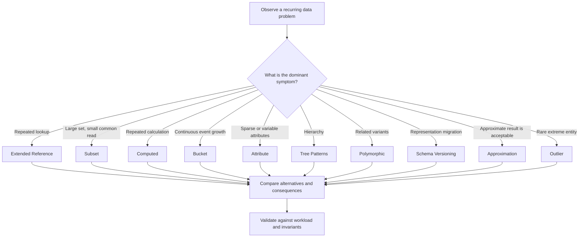

# Design Patterns for Data Modelling

## Table of Contents

- [1. Pattern giải quyết vấn đề gì](#1-pattern-giải-quyết-vấn-đề-gì)
- [2. Anatomy của một pattern](#2-anatomy-của-một-pattern)
- [3. Nhóm pattern theo vấn đề](#3-nhóm-pattern-theo-vấn-đề)
- [4. Cách chọn pattern](#4-cách-chọn-pattern)
- [5. Pattern không phải công thức áp dụng máy móc](#5-pattern-không-phải-công-thức-áp-dụng-máy-móc)
- [6. Pattern Decision Record](#6-pattern-decision-record)
- [Related](#related)

---

## 1. Pattern giải quyết vấn đề gì

Trong data modelling, một số vấn đề xuất hiện lặp lại: dữ liệu lớn hơn nhu cầu truy cập thường ngày, truy vấn phải kết hợp nhiều nguồn, phép tính bị lặp đi lặp lại, event tăng liên tục, entity có nhiều biến thể hoặc cấu trúc thay đổi theo thời gian.

**Design Pattern** là một đơn vị tri thức tái sử dụng, mô tả một vấn đề thường gặp, bối cảnh xuất hiện và một cách tổ chức dữ liệu đã được chứng minh là hữu ích trong những điều kiện nhất định.

Pattern không phải full solution. Nó không thay thế domain analysis, workload analysis, relationship modelling hay business rules. Một pattern chỉ giải quyết một phần của bài toán và luôn đi kèm trade-off.

Pattern tạo ra ba giá trị chính:

- **Shared vocabulary:** team có thể mô tả cùng một ý tưởng bằng tên gọi thống nhất.
- **Repeatable reasoning:** quyết định được xây dựng từ bối cảnh, không chỉ từ kinh nghiệm cá nhân.
- **Explicit trade-offs:** lợi ích, chi phí và điều kiện áp dụng được thảo luận rõ ràng.

---

## 2. Anatomy của một pattern

Khi học hoặc đề xuất một pattern, dùng cấu trúc sau:

| Thành phần | Nội dung cần mô tả |
| :--- | :--- |
| **Problem** | Vấn đề nào lặp lại hoặc gây chi phí đáng kể? |
| **Context** | Workload, cardinality, lifecycle và constraints nào đang tồn tại? |
| **Intent** | Pattern muốn cải thiện điều gì? |
| **Structure** | Dữ liệu được tổ chức lại theo nguyên tắc nào? |
| **Consequences** | Read/write complexity, duplication, consistency hoặc operations thay đổi ra sao? |
| **Failure Modes** | Dùng sai khi nào, có thể tạo anti-pattern gì? |
| **Validation** | Đo hoặc kiểm chứng bằng tiêu chí nào? |

Một pattern chỉ nên được áp dụng khi context của vấn đề khớp với context mà pattern giải quyết.

---

## 3. Nhóm pattern theo vấn đề

Các tên dưới đây được lấy từ bộ tài liệu môn học và diễn giải ở mức khái niệm độc lập với DBMS.

| Nhóm vấn đề | Pattern | Ý tưởng cốt lõi |
| :--- | :--- | :--- |
| Truy vấn lặp lại qua nhiều entity | **Extended Reference** | Sao chép một tập field chọn lọc đến nơi thường cần dùng |
| Tập dữ liệu lớn nhưng chỉ đọc một phần | **Subset** | Tách phần thường truy cập khỏi toàn bộ dữ liệu |
| Tính toán lặp lại | **Computed** | Lưu trước kết quả dẫn xuất để tránh tính lại liên tục |
| Nhiều event nhỏ theo thời gian | **Bucket** | Nhóm các event theo một cửa sổ hoặc đơn vị logic |
| Nhiều thuộc tính biến đổi hoặc không đồng đều | **Attribute** | Chuẩn hóa nhóm thuộc tính theo cặp key-value có ngữ nghĩa rõ |
| Cấu trúc dữ liệu thay đổi theo phiên bản | **Schema Versioning** | Cho phép nhiều phiên bản representation cùng tồn tại trong giai đoạn chuyển đổi |
| Cấu trúc phân cấp | **Tree Patterns** | Chọn cách biểu diễn quan hệ cha-con theo loại truy vấn |
| Nhiều biến thể cùng chia sẻ phần lõi | **Polymorphic** | Quản lý các subtype có điểm chung và khác biệt có kiểm soát |
| Phép tính gần đúng là đủ | **Approximation** | Dùng kết quả ước lượng khi chi phí chính xác không đáng giá |
| Một số entity có hành vi ngoại lệ | **Outlier** | Xử lý riêng các trường hợp cực trị mà không làm phức tạp đường đi phổ biến |

Các pattern này không phải danh sách đầy đủ của ngành. Chúng là tập pattern được tổng hợp và mở rộng từ tài liệu khóa học làm nền tảng học tập.

Một vấn đề có thể phù hợp với nhiều pattern hoặc không cần pattern nào. Sơ đồ chỉ giúp định hướng candidate; quyết định vẫn phải dựa trên evidence và trade-off.

---

## 4. Cách chọn pattern

Bắt đầu từ vấn đề quan sát được, không bắt đầu từ tên pattern.

1. Xác định operation hoặc business requirement bị ảnh hưởng.
2. Mô tả data shape và access pattern hiện tại.
3. Định lượng frequency, cardinality, growth và mức độ ảnh hưởng.
4. Xác định consistency, freshness, ownership và retention requirements.
5. Chọn một pattern có intent phù hợp.
6. Ghi trade-off và failure mode.
7. Kiểm chứng bằng workload đại diện trước khi mở rộng.

### Ma trận câu hỏi gợi ý

| Triệu chứng | Câu hỏi đầu tiên | Pattern có thể xem xét |
| :--- | :--- | :--- |
| Một query thường xuyên phải lấy thêm vài field từ entity khác | Những field đó có ổn định và có thực sự cần mọi lần không? | Extended Reference |
| Entity chứa nhiều phần tử nhưng consumer chỉ dùng vài phần tử gần đây | Consumer cần subset nào và khi nào cần full data? | Subset |
| Dashboard tính đi tính lại cùng một aggregate | Kết quả có thể precompute và chấp nhận trễ bao lâu? | Computed |
| Một device phát sinh event liên tục | Có thể gom event theo cửa sổ thời gian nào? | Bucket |
| Nhiều thuộc tính hiếm hoặc thay đổi theo loại | Những field nào dùng chung query semantics? | Attribute / Polymorphic |
| Có migration cấu trúc kéo dài | Có thể đọc cả shape cũ và mới trong giai đoạn chuyển đổi không? | Schema Versioning |
| Cây có truy vấn descendants thường xuyên | Truy vấn quan trọng nhất là ancestor, child hay path? | Tree Patterns |

---

## 5. Pattern không phải công thức áp dụng máy móc

Pattern thường tối ưu một chiều và làm tăng chi phí ở chiều khác.

Ví dụ:

- **Extended Reference** giảm lookup nhưng làm tăng số nơi cần đồng bộ khi field thay đổi.
- **Subset** giảm dữ liệu phải đọc thường xuyên nhưng cần định nghĩa rõ cách lấy phần dữ liệu đầy đủ.
- **Computed** giảm repeated calculation nhưng tạo nguy cơ dữ liệu dẫn xuất bị stale.
- **Bucket** giảm số đơn vị dữ liệu nhỏ nhưng làm phức tạp truy vấn theo event, cập nhật và xóa từng phần tử.
- **Schema Versioning** cho phép migration linh hoạt nhưng tăng số shape mà application phải hiểu trong giai đoạn chuyển tiếp.
- **Polymorphic** hỗ trợ một view chung nhưng có thể biến thành một model mơ hồ nếu các subtype không thực sự cùng domain semantics.

Pattern tốt không phải pattern có ít query nhất hoặc ít record nhất. Pattern tốt là pattern làm giảm tổng chi phí của workload quan trọng trong khi vẫn giữ business invariants và lifecycle đúng.

---

## 6. Pattern Decision Record

Ghi lại quyết định bằng mẫu ngắn:

| Trường | Nội dung |
| :--- | :--- |
| Problem | Mô tả vấn đề và tác động |
| Workload evidence | Operation, frequency, peak, latency hoặc volume liên quan |
| Domain constraints | Cardinality, ownership, lifecycle, consistency |
| Candidate pattern | Pattern được cân nhắc |
| Alternatives | Các phương án khác đã xem xét |
| Decision | Cách mô hình hóa được chọn |
| Trade-offs | Duplication, staleness, extra writes, complexity |
| Validation | Metric hoặc scenario để kiểm chứng |
| Revisit when | Điều kiện khiến quyết định cần xem lại |

Pattern phải được xem lại khi workload thay đổi đáng kể. Một lựa chọn hợp lý lúc lượng dữ liệu nhỏ có thể trở thành điểm nghẽn khi cardinality hoặc query mix thay đổi.

---

## Related

- [Read Optimization Patterns](./06_read_optimization_patterns.md) — các pattern này hiện thực hóa những cách giảm công việc lặp lại ở read path.
- [End-to-End Modelling Workflow](./08_end_to_end_modelling.md) — **Pattern Decision Record** nối pattern với workload evidence và validation.

---
[← Back to README](README.md)
