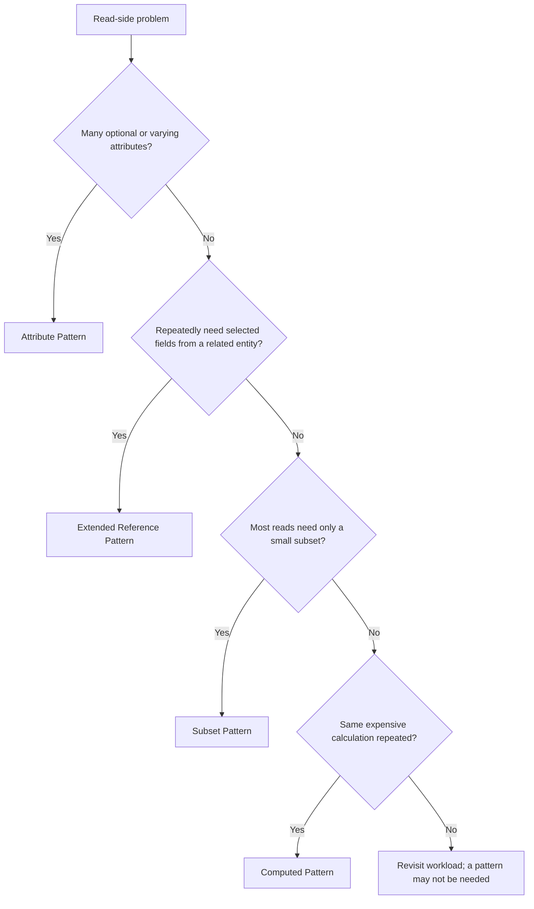

# Read Optimization Patterns

## Table of Contents

- [1. Attribute Pattern](#1-attribute-pattern)
- [2. Extended Reference Pattern](#2-extended-reference-pattern)
- [3. Subset Pattern](#3-subset-pattern)
- [4. Computed Pattern](#4-computed-pattern)
- [5. Fan-out on Read và Fan-out on Write](#5-fan-out-on-read-và-fan-out-on-write)
- [6. Khi nào pattern không phù hợp](#6-khi-nào-pattern-không-phù-hợp)
- [7. Pattern Review Checklist](#7-pattern-review-checklist)
- [Related](#related)

---

## 1. Attribute Pattern

### Problem

Một loại entity có nhiều thuộc tính cùng nhóm nhưng không phải entity nào cũng có đủ các thuộc tính đó. Các field đặc thù có thể xuất hiện không đồng đều, thay đổi theo loại sản phẩm hoặc có số lượng mở rộng khó dự đoán.

Ví dụ Product có thể gồm:

- Laptop: CPU, RAM, screen size.
- Phone: screen size, camera count, battery capacity.
- Coffee: origin, roast level, grind size.

Nếu mọi thuộc tính được trải phẳng thành một tập field rất rộng, nhiều giá trị sẽ vắng mặt và việc quản lý nhóm thuộc tính có thể khó mở rộng.

### Intent và Structure

**Attribute Pattern** tổ chức các thuộc tính động hoặc cùng nhóm theo một cấu trúc có quy tắc, thường theo cặp attribute-name/value và có thể kèm unit, type hoặc metadata.

Ví dụ ở mức logical:

| Product | Attribute entries |
| :--- | :--- |
| Laptop A | `cpu = ...`, `ram = ...`, `screen_size = ...` |
| Coffee B | `origin = ...`, `roast_level = ...`, `grind_size = ...` |

### Khi nên cân nhắc

- Một entity type có các thuộc tính không đồng nhất giữa các subtype.
- Người dùng cần filter/search theo cùng một nhóm thuộc tính.
- Tập thuộc tính có thể mở rộng theo domain.
- Nhiều field có chung metadata như unit, source hoặc measurement time.

### Trade-off và Failure Modes

- Giảm việc phải thay đổi cấu trúc mỗi khi thêm thuộc tính, nhưng application phải hiểu semantics của từng attribute.
- Cặp key-value quá tự do dễ tạo sai chính tả, sai unit hoặc nhiều cách biểu diễn cùng ý nghĩa.
- Query theo attribute cần quy ước type, normalization và validation thống nhất.
- Không nên đưa mọi field vào dạng key-value nếu phần lớn entity có tập thuộc tính ổn định và được truy vấn độc lập.

**Rule:** Attribute Pattern cần một vocabulary có kiểm soát (danh sách attribute hợp lệ, type, unit, validation và khả năng tìm kiếm).

Các câu hỏi trong sơ đồ đại diện cho những triệu chứng khác nhau, không phải điều kiện loại trừ tuyệt đối. Một hệ thống có thể kết hợp nhiều pattern cho các access pattern riêng biệt.

---

## 2. Extended Reference Pattern

### Problem

Một workload thường xuyên cần vài thông tin từ entity liên quan, nhưng việc kết hợp nguồn dữ liệu mỗi lần gây thêm latency hoặc complexity. Mặt khác, tách riêng toàn bộ entity vẫn có giá trị vì nó có lifecycle hoặc ownership riêng.

Ví dụ một Order thường cần hiển thị customer name và shipping address. Customer là entity độc lập, nhưng thông tin giao dịch phải giữ đúng giá trị tại thời điểm đặt hàng.

### Intent và Structure

**Extended Reference Pattern** giữ relationship tới entity nguồn nhưng sao chép một số field thường cần sang phía tiêu thụ. Đây là controlled duplication, không phải sao chép toàn bộ entity.

Có thể sao chép:

- Identifier của nguồn.
- Những field ổn định và được dùng thường xuyên.
- Snapshot field có semantics tại thời điểm giao dịch.

### Khi nên cân nhắc

- Workload thường xuyên truy vấn entity ở phía “many” và cần vài field của phía “one”.
- Những field được sao chép ít thay đổi hoặc snapshot semantics là chủ ý nghiệp vụ.
- Chi phí lookup lặp lại cao hơn chi phí quản lý bản sao.

### Quản lý duplication

Trước khi áp dụng, phải lập danh sách field:

| Field type | Chính sách |
| :--- | :--- |
| **Immutable / rarely changed** | Có thể sao chép với chính sách cập nhật đơn giản |
| **Snapshot by meaning** | Không đồng bộ theo source hiện tại; giữ giá trị của thời điểm nghiệp vụ |
| **Frequently changing** | Cân nhắc không sao chép hoặc phải xác định freshness contract rõ |
| **Sensitive** | Không sao chép nếu việc đó vi phạm access boundary hoặc privacy policy |

### Trade-off và Failure Modes

- Read path đơn giản hơn nhưng write path có thể phát sinh update fan-out.
- Bản sao có thể stale nếu source thay đổi.
- Không rõ authoritative source sẽ khiến nhóm không biết phải sửa dữ liệu ở đâu.
- Sao chép quá nhiều field làm hai entity dính chặt vào nhau.

---

## 3. Subset Pattern

### Problem

Một entity hoặc tập dữ liệu có kích thước lớn, nhưng phần lớn truy vấn thường chỉ cần một tập con nhỏ. Đọc toàn bộ dữ liệu cho mọi operation tạo chi phí không cần thiết.

Ví dụ trang sản phẩm cần hiển thị 5 review mới nhất hoặc nổi bật nhất, trong khi toàn bộ review có thể lên đến hàng triệu.

### Intent và Structure

**Subset Pattern** tách phần dữ liệu thường dùng thành một representation nhỏ, đồng thời duy trì khả năng truy cập tập dữ liệu đầy đủ khi có nhu cầu.

Tập con có thể được chọn theo:

- Recency: mới nhất.
- Popularity: được quan tâm nhiều nhất.
- Priority: quan trọng nhất.
- Status: đang hoạt động.
- Window: nằm trong một khoảng thời gian.

### Khi nên cân nhắc

- Consumer phổ biến chỉ cần phần dữ liệu giới hạn.
- Dữ liệu đầy đủ lớn hoặc tăng liên tục.
- Có tiêu chí ổn định để xác định subset.
- Có thể chấp nhận duy trì một representation bổ sung.

### Trade-off và Failure Modes

- Read path phổ biến nhẹ hơn nhưng subset có thể không phản ánh đầy đủ dataset.
- Cần xác định lúc nào thêm, loại bỏ hoặc thay thế phần tử trong subset.
- Nếu tiêu chí chọn subset thay đổi, dữ liệu cũ cần được tái tính toán.
- Không được khiến consumer nhầm subset là tập dữ liệu đầy đủ.

**Rule:** tên field hoặc API cần thể hiện rõ semantics như `recent_reviews` hoặc `top_comments`, thay vì gọi chung là `reviews` nếu nó chỉ chứa một phần.

---

## 4. Computed Pattern

### Problem

Một phép tính được thực hiện lặp lại trên tập dữ liệu lớn hoặc trong một query có frequency cao. Ví dụ tổng doanh thu, số lượt xem, average rating hoặc số đơn đang hoạt động.

### Intent và Structure

**Computed Pattern** lưu kết quả được tính từ dữ liệu nguồn để consumer có thể đọc trực tiếp thay vì tính lại mọi lần.

Các kiểu computed data:

- **Running Total:** tổng được cập nhật khi phát sinh event.
- **Periodic Aggregate:** tổng hợp theo giờ, ngày, tuần hoặc kỳ nghiệp vụ.
- **Precomputed Metric:** lưu một số metric thường cần cho dashboard.
- **Materialized Projection:** representation đã chuẩn bị cho một nhóm truy vấn.

### Các chiến lược cập nhật

| Strategy | Đặc điểm | Phù hợp khi |
| :--- | :--- | :--- |
| **Recompute on Read** | Tính lại lúc đọc | Dataset nhỏ hoặc query ít xảy ra |
| **Incremental Update** | Cập nhật kết quả theo mỗi thay đổi | Event rõ ràng, volume có thể kiểm soát |
| **Batch Recalculation** | Tính lại theo chu kỳ | Chấp nhận freshness window và có thể quét dữ liệu theo lô |
| **Event-driven Projection** | Consumer nhận event và cập nhật view | Có event history hoặc cơ chế retry/rebuild |

### Trade-off và Failure Modes

- Giảm repeated calculation nhưng tăng complexity của write/update path.
- Incremental update dễ sai khi duplicate event, event đến sai thứ tự hoặc bị mất.
- Kết quả dẫn xuất có thể stale.
- Cần có công thức và source rõ ràng để rebuild khi phát hiện sai lệch.

**Invariant cần giữ:** computed result phải có thể giải thích từ nguồn dữ liệu, công thức, time window và quy tắc xử lý event.

---

## 5. Fan-out on Read và Fan-out on Write

Đây là hai cách phân bổ công việc khi một thay đổi cần tác động đến nhiều representation hoặc một query cần kết hợp nhiều nguồn.

- **Fan-out on Read:** giữ dữ liệu nguồn độc lập, rồi kết hợp hoặc tổng hợp khi consumer đọc.
- **Fan-out on Write:** khi dữ liệu thay đổi, chủ động cập nhật nhiều projection hoặc bản sao để lần đọc sau đơn giản hơn.

| Tiêu chí | Fan-out on Read | Fan-out on Write |
| :--- | :--- | :--- |
| Chi phí chính | Được trả ở thời điểm đọc | Được trả khi ghi hoặc đồng bộ |
| Freshness | Có thể phản ánh source mới nhất nếu đọc trực tiếp | Có thể stale trong thời gian projection cập nhật |
| Read path | Linh hoạt nhưng có thể phức tạp | Đơn giản, có thể tối ưu theo consumer |
| Write path | Ít cập nhật bản sao hơn | Có thể tăng số lần cập nhật |
| Phù hợp | Read ít, cần dữ liệu mới nhất | Read thường xuyên, query ổn định, chấp nhận consistency model rõ ràng |

Không có lựa chọn đúng cho tất cả. Hãy so sánh frequency và criticality của hai phía, không chỉ đếm số operation.

---

## 6. Khi nào pattern không phù hợp

- Attribute Pattern không phù hợp khi field cố định, có semantics mạnh và không cần mô hình động.
- Extended Reference không phù hợp khi field thay đổi liên tục, freshness phải tuyệt đối và không có cơ chế đồng bộ đáng tin cậy.
- Subset không phù hợp khi hầu hết consumer đều cần toàn bộ dữ liệu hoặc không có tiêu chí chọn subset ổn định.
- Computed không phù hợp khi phép tính rẻ, hiếm được dùng hoặc kết quả bắt buộc phản ánh tức thời mà không thể quản lý đồng bộ.
- Fan-out on Write không phù hợp khi một thay đổi phải cập nhật hàng triệu view ngay lập tức mà không có workflow kiểm soát.

---

## 7. Pattern Review Checklist

- [ ] Problem và workload evidence được mô tả cụ thể.
- [ ] Subset/field nào được copy hoặc precompute đã có semantics rõ.
- [ ] Authoritative source được xác định.
- [ ] Freshness window và consistency requirement được ghi lại.
- [ ] Retry, duplicate event và failure handling đã được cân nhắc.
- [ ] Có cách reconcile hoặc rebuild dữ liệu dẫn xuất.
- [ ] Privacy và access boundaries không bị phá vỡ bởi duplication.
- [ ] Đã so sánh chi phí read với chi phí write và vận hành.

---

## Related

- [Design Patterns for Data Modelling](./05_design_patterns_overview.md) — **Problem → Context → Consequences** là khung để đánh giá từng pattern đọc.
- [Data Placement and Consistency](./04_data_placement_and_consistency.md) — **Snapshot**, **Projection** và **Staleness** là các quyết định cốt lõi khi tạo bản sao dữ liệu.
- [Time, Hierarchy and Evolution Patterns](./07_time_hierarchy_and_evolution_patterns.md) — các pattern theo thời gian và cấu trúc cũng cần cân nhắc write/read distribution.

---
[← Back to README](README.md)
