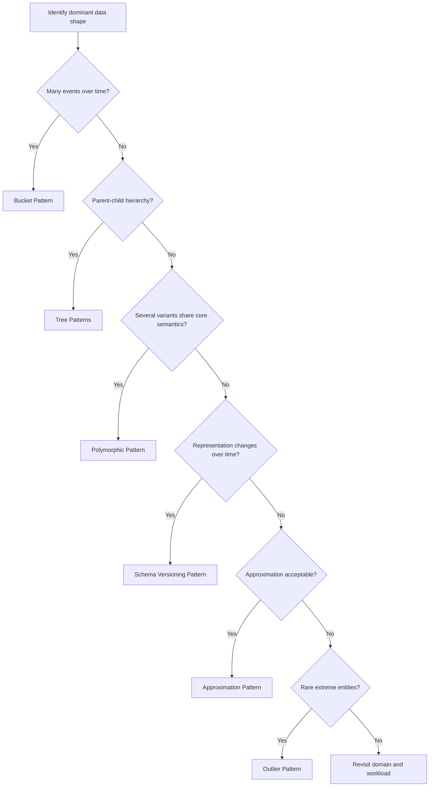
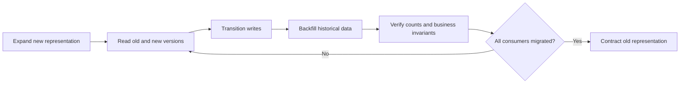

# Time, Hierarchy and Evolution Patterns

## Table of Contents

- [1. Bucket Pattern](#1-bucket-pattern)
- [2. Tree Patterns](#2-tree-patterns)
- [3. Polymorphic Pattern](#3-polymorphic-pattern)
- [4. Schema Versioning Pattern](#4-schema-versioning-pattern)
- [5. Approximation Pattern](#5-approximation-pattern)
- [6. Outlier Pattern](#6-outlier-pattern)
- [7. Chọn pattern theo dạng vấn đề](#7-chọn-pattern-theo-dạng-vấn-đề)
- [Related](#related)

---

## 1. Bucket Pattern

### Problem

Một hệ thống ghi nhận lượng lớn event hoặc measurement nhỏ theo thời gian. Một event có thể ít giá trị khi đứng riêng lẻ, trong khi workload thường đọc theo khoảng thời gian hoặc theo nhóm thiết bị, tài khoản hay đối tượng.

Ví dụ Device gửi telemetry liên tục. Consumer thường cần xem xu hướng theo giờ, không phải lúc nào cũng cần truy cập từng điểm đo riêng lẻ.

### Intent và Structure

**Bucket Pattern** gom nhiều event có quan hệ gần nhau theo một tiêu chí logic như:

- Cùng device hoặc source.
- Cùng một khoảng thời gian.
- Cùng một business process hoặc session.
- Cùng một nhóm event type.

Bucket có thể mang metadata về group key, time range, số lượng event và summary. Việc chọn bucket size phải dựa trên query window, event rate, retention và khả năng cập nhật từng event.

### Khi nên cân nhắc

- Event có volume lớn và phát sinh liên tục.
- Truy vấn thường theo time window hoặc theo nhóm.
- Có thể tổng hợp một phần thông tin trong bucket.
- Retention hoặc archival có thể áp dụng theo bucket.

### Trade-off và Failure Modes

- Quản lý nhiều event hiệu quả hơn nhưng đọc hoặc sửa một event riêng lẻ có thể phức tạp hơn.
- Bucket quá nhỏ không giảm được overhead; quá lớn làm tăng lượng dữ liệu không cần thiết mỗi lần truy cập.
- Late-arriving event, event correction hoặc duplicate event cần quy tắc rõ.
- Xóa hoặc archive một phần dữ liệu bên trong bucket có thể khó hơn quản lý theo từng event.

Không chọn kích thước bucket từ giới hạn của một DBMS trong tài liệu nền tảng này. Hãy bắt đầu từ thời gian truy vấn, event frequency, retention và đơn vị nghiệp vụ.

Dùng sơ đồ để khoanh vùng pattern candidate. Với dữ liệu phân cấp, cần đọc thêm phần truy vấn ancestors/descendants; với dữ liệu thời gian, cần kiểm tra late events, correction và retention trước khi chốt grouping window.

---

## 2. Tree Patterns

### Problem

Một domain có cấu trúc phân cấp. Cách biểu diễn phải phục vụ các truy vấn như tìm parent, direct children, toàn bộ descendants, ancestors hoặc đường dẫn từ root đến node.

### Các cách biểu diễn phổ biến

| Strategy | Ý tưởng | Điểm mạnh | Trade-off |
| :--- | :--- | :--- | :--- |
| **Parent Reference** | Mỗi node giữ identity của parent trực tiếp | Thêm hoặc di chuyển node đơn giản; tìm parent trực tiếp rõ | Tìm toàn bộ descendants/ancestors cần traversal hoặc xử lý nhiều bước |
| **Child References** | Parent giữ danh sách child identity | Lấy direct children thuận tiện | Parent list tăng theo số child; di chuyển node cần cập nhật parent |
| **Ancestor List** | Node giữ danh sách ancestors | Hỗ trợ query theo tổ tiên hoặc nhánh nhanh hơn trong một số workload | Di chuyển node có thể phải cập nhật nhiều descendants |
| **Materialized Path** | Lưu đường dẫn từ root đến node | Có thể lọc theo prefix/path để lấy nhánh | Đổi vị trí node có thể cần thay đổi path của cả subtree; path cần canonicalization |

### Cách lựa chọn

Trước hết xác định truy vấn chính:

- Nếu chủ yếu cần parent trực tiếp: Parent Reference có thể đủ.
- Nếu thường lấy direct children: Child References có thể hữu ích.
- Nếu thường lấy ancestors hoặc kiểm tra node thuộc nhánh nào: Ancestor List hoặc Materialized Path đáng cân nhắc.
- Nếu subtree thường xuyên di chuyển: đánh giá kỹ chi phí update lan rộng.

Không nên chọn tree representation chỉ vì nó làm một query dễ hơn. Hãy lấy workload tổng thể và tần suất thay đổi hierarchy làm tiêu chí.

### Invariants cần bảo vệ

- Một node không được trở thành ancestor của chính nó.
- Không tạo cycle nếu domain yêu cầu cây không vòng lặp.
- Quy tắc root, parent optionality và depth phải rõ.
- Khi move node, toàn bộ path/ancestor projection liên quan phải được cập nhật nhất quán.

---

## 3. Polymorphic Pattern

### Problem

Nhiều entity có phần lõi chung nhưng mỗi loại còn có các thuộc tính riêng. Ví dụ Vehicle có Car, Motorcycle và Truck; Product có Laptop, Phone và Coffee.

### Intent và Structure

**Polymorphic Pattern** biểu diễn các variant có cùng domain identity hoặc cùng hành vi chung trong một model thống nhất, đồng thời giữ phần khác biệt theo subtype.

Ví dụ:

| Shared fields | Variant-specific fields |
| :--- | :--- |
| product_id, name, brand, status | Laptop: CPU, RAM; Phone: camera, battery; Coffee: origin, roast |

### Khi nên cân nhắc

- Các loại có cùng ý nghĩa ở cấp abstraction chung.
- Nhiều use case cần truy vấn hoặc hiển thị chúng trong một view.
- Phần thuộc tính chung đủ quan trọng để chia sẻ.
- Khác biệt theo subtype được xác định rõ và có validation riêng.

### Trade-off và Failure Modes

- Unified view dễ xây dựng nhưng model có thể chứa nhiều field không áp dụng.
- Logic conditional theo subtype có thể tăng.
- Nếu hai subtype chỉ giống nhau về tên field nhưng khác semantics, gom chúng có thể gây sai nghĩa.
- Khi subtype có lifecycle, permission hoặc ownership khác hẳn, nên xem xét model riêng.

---

## 4. Schema Versioning Pattern

### Problem

Nghiệp vụ và ứng dụng thay đổi theo thời gian. Một field mới xuất hiện, một field cũ đổi ý nghĩa, hoặc một cấu trúc cần được tách. Không phải lúc nào toàn bộ dữ liệu và consumer cũng được chuyển đổi cùng một lúc.

### Intent

**Schema Versioning Pattern** cho phép hệ thống nhận diện và xử lý nhiều phiên bản representation trong một giai đoạn chuyển đổi, thay vì giả định tất cả record luôn có cùng shape.

### Quy trình evolution an toàn

1. **Expand:** thêm representation mới theo cách vẫn tương thích với consumer hiện tại.
2. **Read-compatible:** consumer có thể đọc cả phiên bản cũ và mới.
3. **Write transition:** xác định thời điểm bắt đầu ghi phiên bản mới hoặc dual-write nếu thật sự cần.
4. **Backfill:** chuyển đổi dữ liệu cũ theo batch có thể retry.
5. **Verify:** so sánh số lượng, nội dung và business invariants giữa dữ liệu cũ/mới.
6. **Contract:** loại bỏ khả năng đọc/ghi phiên bản cũ sau khi chắc chắn không còn consumer phụ thuộc.

Điểm kiểm soát quan trọng là chỉ contract khi consumer đã chuyển đổi và dữ liệu mới đã được xác minh. Backfill nên có thể retry và theo dõi tiến độ.

### Trade-off và Failure Modes

- Tăng khả năng migration từng bước nhưng tạm thời làm tăng số nhánh xử lý.
- Không nên duy trì vô hạn các version cũ.
- Thay đổi semantics phải được phân biệt với thay đổi tên hoặc cấu trúc field.
- Backfill cần idempotency, progress tracking và rollback/recovery plan.

---

## 5. Approximation Pattern

### Problem

Một phép tính chính xác tốn kém trong khi consumer không cần độ chính xác tuyệt đối. Ví dụ số lượt xem, số lượng tương tác hoặc metric xu hướng có thể chấp nhận sai số nhỏ trong một khoảng thời gian.

### Intent

**Approximation Pattern** dùng kết quả ước lượng để giảm chi phí tính toán hoặc cập nhật, nhưng phải định nghĩa rõ sai số chấp nhận được.

### Khi nên cân nhắc

- Kết quả chủ yếu phục vụ xu hướng hoặc ranking.
- Một sai số giới hạn không gây hậu quả nghiệp vụ nghiêm trọng.
- Có thể kiểm tra/hiệu chỉnh định kỳ.
- Consumer không dùng giá trị ước lượng để quyết định giao dịch nhạy cảm.

### Trade-off và Failure Modes

- Giảm chi phí nhưng không thích hợp cho số dư tài chính, tồn kho chốt đơn hoặc dữ liệu pháp lý cần chính xác.
- Phải công bố sai số, freshness và phạm vi sử dụng.
- Ước lượng không có cách hiệu chỉnh có thể drift theo thời gian.

---

## 6. Outlier Pattern

### Problem

Một số entity có đặc tính cực trị khác xa trường hợp thông thường, ví dụ một nội dung có lượng tương tác cao hơn phần còn lại nhiều bậc. Nếu thiết kế cho outlier, hệ thống có thể làm phức tạp toàn bộ đường đi phổ biến; nếu bỏ qua outlier, một vài entity có thể gây bất thường.

### Intent

**Outlier Pattern** giữ model phổ biến đơn giản và xử lý riêng các trường hợp vượt ngưỡng bằng một cơ chế bổ sung.

### Khi nên cân nhắc

- Phần lớn entity tuân theo một profile khá ổn định.
- Một số entity hiếm có cardinality hoặc activity bất thường.
- Có cách nhận diện outlier bằng threshold hoặc signal rõ.
- Có thể route các thao tác đặc biệt sang đường xử lý khác.

### Trade-off và Failure Modes

- Cải thiện đường đi phổ biến nhưng tăng complexity cho outlier.
- Threshold không phù hợp có thể khiến entity liên tục chuyển qua lại giữa hai cách xử lý.
- Cần đảm bảo consumer vẫn nhìn thấy một logical view nhất quán.

---

## 7. Chọn pattern theo dạng vấn đề

| Dạng vấn đề | Pattern nên xem xét | Điều cần xác nhận trước |
| :--- | :--- | :--- |
| Rất nhiều measurement/event theo thời gian | Bucket | Event rate, time window, late events, retention |
| Truy vấn phân cấp | Tree Patterns | Ancestor/descendant queries, move frequency, cycle rules |
| Nhiều variant chung phần lõi | Polymorphic | Shared semantics, subtype lifecycle, validation |
| Representation đổi theo thời gian | Schema Versioning | Compatibility window, backfill, version retirement |
| Metric chấp nhận sai số | Approximation | Error budget và phạm vi sử dụng |
| Một số entity vượt xa phân bố thông thường | Outlier | Threshold, routing và unified view |

---

## Related

- [Relationships and Cardinality](./03_relationships_and_cardinality.md) — **Tree** và **Polymorphic** patterns chỉ hợp lý khi domain relationship và subtype semantics đã rõ.
- [Read Optimization Patterns](./06_read_optimization_patterns.md) — **Bucket** và **Computed** thường phối hợp khi workload truy vấn dữ liệu thời gian.

---
[← Back to README](README.md)
