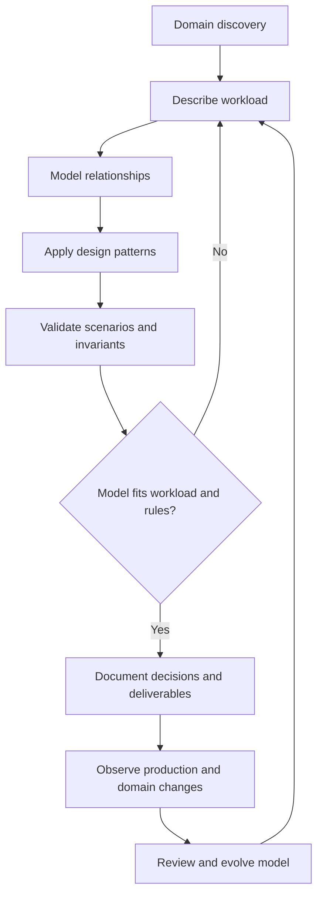

# End-to-End Data Modelling Workflow

## Table of Contents

- [1. Tổng quan quy trình](#1-tổng-quan-quy-trình)
- [2. Step 0: Domain Discovery](#2-step-0-domain-discovery)
- [3. Step 1: Describe the Workload](#3-step-1-describe-the-workload)
- [4. Step 2: Model the Relationships](#4-step-2-model-the-relationships)
- [5. Step 3: Apply Design Patterns](#5-step-3-apply-design-patterns)
- [6. Validation](#6-validation)
- [7. Evolution và Review](#7-evolution-và-review)
- [8. Deliverables](#8-deliverables)
- [9. Review Checklist](#9-review-checklist)
- [Related](#related)

---

## 1. Tổng quan quy trình

Một quy trình data modelling hiệu quả không bắt đầu bằng việc chọn cấu trúc lưu trữ. Nó bắt đầu bằng việc hiểu domain, sau đó mô tả workload, xác định relationships và cuối cùng mới dùng pattern để giải quyết các vấn đề cụ thể.

Trục chính của bộ tài liệu là:

**Workload → Relationships → Patterns**

Trước trục này cần một bước domain discovery để xác định vocabulary, entity và business rules. Sau trục này phải có validation để chứng minh model đáp ứng yêu cầu và một cơ chế evolution để model theo kịp thay đổi.

Đây là vòng lặp có chủ đích, không phải quy trình một chiều. Validation thất bại có thể buộc quay lại workload hoặc relationship; telemetry và thay đổi nghiệp vụ cũng có thể mở lại quyết định cũ.

---

## 2. Step 0: Domain Discovery

### Mục tiêu

Xác định domain boundary và ý nghĩa nghiệp vụ của dữ liệu trước khi bàn đến cách biểu diễn.

### Hoạt động

1. Xác định actor, stakeholder và mục tiêu kinh doanh.
2. Thu thập business scenarios, user stories và quy trình hiện tại.
3. Trích xuất domain concepts, entity, event và value object.
4. Chuẩn hóa vocabulary (cùng một khái niệm dùng cùng một tên).
5. Ghi business rules, identity, status và lifecycle.
6. Đánh dấu dữ liệu nhạy cảm, dữ liệu có retention hoặc audit requirement.

### Kết quả

- Domain glossary.
- Conceptual model.
- Danh sách business rules và invariant.
- Danh sách entity/event cùng identity và lifecycle sơ bộ.

Không cần mô hình hóa toàn bộ domain ngay từ đầu. Ưu tiên phạm vi nghiệp vụ mà hệ thống đang giải quyết.

---

## 3. Step 1: Describe the Workload

### Mục tiêu

Hiểu dữ liệu được tạo, đọc, thay đổi và khai thác ra sao trong các scenario quan trọng.

### Hoạt động

1. Liệt kê actor và operation.
2. Ghi data touched cho mỗi operation.
3. Ước lượng frequency, average, peak, concurrency và priority.
4. Định lượng population, cardinality, growth và retention.
5. Xác định latency, freshness, durability, consistency và failure requirements.
6. Xây dựng Workload Table và đánh dấu các giả định chưa được xác minh.

### Kết quả

Một workload specification có thể trả lời được operation nào quan trọng, operation nào xuất hiện thường xuyên, và constraints nào chi phối model.

---

## 4. Step 2: Model the Relationships

### Mục tiêu

Biến domain concepts thành một logical model có quan hệ và ownership rõ ràng.

### Hoạt động

1. Xác định relationship giữa các entity.
2. Ghi cardinality và optionality ở cả hai phía.
3. Định lượng min, typical và max.
4. Xác định query direction quan trọng.
5. Xác định shared data, ownership và lifecycle dependency.
6. Kiểm tra relationship có attribute/state riêng để trở thành Association Entity hay không.
7. Xác định snapshot, history, reference và deletion semantics.

### Kết quả

Một relationship model có thể giải thích vì sao hai entity liên quan, quan hệ tồn tại bao lâu và ai chịu trách nhiệm về tính đúng đắn.

---

## 5. Step 3: Apply Design Patterns

### Mục tiêu

Giải quyết các vấn đề lặp lại của workload mà không phá vỡ business semantics.

### Hoạt động

1. Chỉ ra vấn đề cụ thể (repeated lookup, large collection, repeated calculation, time-series growth, schema evolution...).
2. So sánh vấn đề với intent của pattern.
3. Ghi pattern, alternatives và trade-offs.
4. Xác định authoritative source, duplication policy và freshness contract.
5. Xác định cách xử lý failure, retry, reconciliation và rebuild.
6. Lập tiêu chí validation trước khi triển khai.

### Kết quả

Pattern Decision Record cho mỗi lựa chọn có ảnh hưởng lớn đến data model.

---

## 6. Validation

Một model không được xem là hoàn tất chỉ vì entity và relationship đã được vẽ. Cần kiểm chứng model bằng các scenario thực tế.

### 6.1 Scenario walkthrough

Với từng operation Critical/High, mô phỏng:

- Tạo mới entity.
- Đọc dữ liệu cho màn hình hoặc quy trình.
- Cập nhật trạng thái.
- Hủy hoặc xóa.
- Retry cùng một request/event.
- Hai thay đổi đồng thời.
- Một bước trong workflow thất bại.
- Dữ liệu đến trễ hoặc không đúng thứ tự.
- Thay đổi business rule.

### 6.2 Kiểm tra invariant

Ví dụ:

- Một Order phải có ít nhất một Order Line.
- Một Order không thể chuyển từ Cancelled sang Shipped nếu domain không cho phép.
- Một Reader không được vượt quá giới hạn Borrowing đang hoạt động.
- Tổng tiền Order phải giải thích được từ snapshot giá và quy tắc discount/tax.
- Một node trong Tree không thể là ancestor của chính nó.

### 6.3 Workload validation

Đánh giá bằng workload đại diện:

- Query quan trọng có lấy được đúng data không?
- Read path có nhiều bước phối hợp không cần thiết không?
- Update có tạo ra fan-out quá lớn không?
- Dữ liệu tăng trưởng có phá vỡ cardinality assumptions không?
- Projection có đáp ứng freshness window không?
- Có cách đo staleness và consistency drift không?

### 6.4 Evolution validation

Thử một thay đổi giả định:

- Thêm loại entity hoặc subtype mới.
- Thêm field hoặc đổi semantics.
- Tăng số child lên 10 lần.
- Thay đổi query phổ biến.
- Rút ngắn hoặc kéo dài retention.
- Thay đổi cách tính một metric.

Nếu model không có đường tiến hóa an toàn, cần ghi nhận đó là design risk.

---

## 7. Evolution và Review

Data model cần được xem là một phần tiến hóa cùng domain và workload, không phải bản vẽ bất biến.

Review khi:

- Product feature hoặc business rule thay đổi.
- Tần suất operation hoặc peak thay đổi đáng kể.
- Một entity bắt đầu có cardinality lớn hơn dự kiến.
- Support thường xuyên gặp lỗi duplicate hoặc stale data.
- Report/dashboard tạo thêm tải lên đường giao dịch.
- Retention, privacy hoặc compliance requirement thay đổi.

Dùng **ADR** hoặc Pattern Decision Record để lưu context, lựa chọn và hệ quả. Khi xem lại, so sánh workload hiện tại với giả định lúc model được tạo.

---

## 8. Deliverables

| Artifact | Nội dung | Mục đích |
| :--- | :--- | :--- |
| Domain Glossary | Thuật ngữ và ý nghĩa | Tránh semantic mismatch |
| Conceptual Model | Domain concepts và relationship chính | Thống nhất phạm vi |
| Business Rules | Invariants, constraints, state transitions | Bảo vệ correctness |
| Workload Table | Actor, operation, data touched, frequency, priority | Cơ sở thiết kế |
| Workload Specification | Volume, growth, peak, freshness, durability, retention | Ghi binding conditions |
| Logical Data Model | Entity, attribute, relationship, cardinality | Mô tả cấu trúc logic |
| Lifecycle & Ownership Matrix | Owner, create/update/delete/archive rules | Phân định trách nhiệm |
| Pattern Decision Records | Problem, context, pattern, trade-offs | Giải thích lựa chọn |
| Validation Scenarios | Test cases và expected invariants | Chứng minh model phù hợp |

---

## 9. Review Checklist

- [ ] Domain concepts được định nghĩa bằng vocabulary nhất quán.
- [ ] Identity, business rules và lifecycle của entity quan trọng đã rõ.
- [ ] Workload bao gồm actor, action, data touched, frequency và priority.
- [ ] Average, peak, growth, cardinality và retention có ước lượng.
- [ ] Binding conditions được phân biệt rõ với giả định.
- [ ] Relationship có cardinality, optionality, ownership và query direction.
- [ ] Data duplication có semantics và sync policy.
- [ ] Mỗi pattern gắn với problem evidence cụ thể.
- [ ] Có failure handling, reconciliation và rebuild strategy.
- [ ] Đã walkthrough các critical scenarios.
- [ ] Đã kiểm tra khả năng evolution khi workload hoặc business rules thay đổi.

---

## Related

- [Data Placement and Consistency](./04_data_placement_and_consistency.md) — quyết định placement cần được kiểm chứng cùng workload và business invariants.
- [Design Patterns for Data Modelling](./05_design_patterns_overview.md) — **Pattern Decision Record** chuyển pattern thành lựa chọn có rationale và validation.
- [Coffee Franchise Case Study](./09_case_study_coffee_franchise.md) — case study minh họa cách đi từ actor và operation đến các quyết định mô hình hóa.

---
[← Back to README](README.md)
