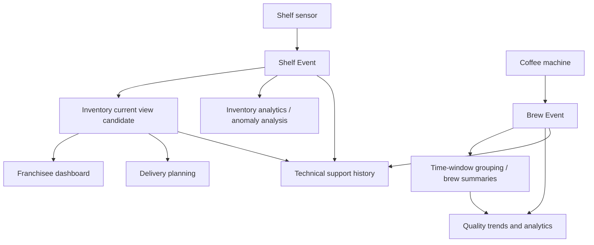

# Case Study: Coffee Shop Franchise

## Table of Contents

- [1. Bối cảnh nghiệp vụ](#1-bối-cảnh-nghiệp-vụ)
- [2. Actors và mục tiêu](#2-actors-và-mục-tiêu)
- [3. Workload Inventory](#3-workload-inventory)
- [4. Định lượng và giả định](#4-định-lượng-và-giả-định)
- [5. Binding Conditions](#5-binding-conditions)
- [6. Domain Model](#6-domain-model)
- [7. Relationship Decisions](#7-relationship-decisions)
- [8. Pattern Candidates](#8-pattern-candidates)
- [9. Điều cần kiểm chứng](#9-điều-cần-kiểm-chứng)
- [10. Bài học từ case study](#10-bài-học-từ-case-study)

---

## 1. Bối cảnh nghiệp vụ

**Beyond the Stars Coffee** là chuỗi cửa hàng cà phê giả định có mục tiêu mở rộng lên 10.000 cửa hàng ở Bắc Mỹ, sau đó mở rộng toàn cầu. Mục tiêu công nghệ của case study là sử dụng máy pha cà phê thông minh, kệ hàng thông minh và dữ liệu vận hành để hỗ trợ chất lượng sản phẩm, tồn kho, logistics, analytics và technical support.

Trong phạm vi bài tập này, không thiết kế MongoDB hay bất kỳ database nào. Ta chỉ phân tích domain, workload, relationship và pattern candidate.

---

## 2. Actors và mục tiêu

| Actor | Hành động chính | Mục tiêu nghiệp vụ |
| :--- | :--- | :--- |
| **Intelligent Shelf** | Gửi thay đổi trọng lượng khi thêm/bớt túi cà phê | Theo dõi tồn kho theo thời gian |
| **Coffee Machine** | Gửi brew event mỗi khi pha một ly | Theo dõi điều kiện pha và chất lượng |
| **Operations / Logistics** | Đọc tồn kho và nhu cầu dự kiến | Quyết định lượng cà phê cần chuyển đến cửa hàng |
| **Data Scientists** | Phân tích event và metric lịch sử | Phát hiện anomaly và xu hướng chất lượng |
| **Technical Support / Franchisees** | Tra cứu dữ liệu gần đây và trạng thái cửa hàng | Chẩn đoán lỗi, hỗ trợ vận hành |
| **Franchisee Dashboard** | Xem trạng thái mới nhất của store | Theo dõi tồn kho và tình trạng máy |

---

## 3. Workload Inventory

| Action | Type | Data touched | Frequency (ước lượng từ case) | Priority |
| :--- | :--- | :--- | :--- | :--- |
| Shelf weight change | Write | store, shelf, weight, timestamp, bag count | Khoảng 1 event/s trên toàn hệ thống | High / Critical |
| Coffee delivery planning | Read / analytical | store, shelf levels, projected demand | 1 lần/ngày mỗi planning cycle | High |
| Detect inventory anomalies | Analytical read | shelf events, store, time range, metrics | Khoảng 24 lần/ngày | Medium |
| Record brew event | Write | machine, store, temperature, weight, duration, timestamp | Khoảng 10 triệu event/ngày; peak khoảng 833 event/s | Medium theo giả định case |
| Analyze cup quality and trends | Analytical read | brew metrics, store, time range | Khoảng 24 lần/ngày | Low |
| Technical support queries | Read | store, machine, recent events | Khoảng 1.000 lần/ngày | Medium |
| Aggregate shelf data | Derived write | store, shelf, aggregated metrics | 1–24 lần/giờ/store | Medium |
| Franchisee dashboard | Read | store, current levels, machine status | On demand / continuous | High |

Lưu ý: frequency là giả định của case study, không phải production telemetry. Khi vận hành thực tế, cần thay thế bằng log và số đo thật.

`Inventory current view` là representation cần có cho dashboard và logistics, nhưng nguồn chuẩn của nó vẫn là câu hỏi mở: trạng thái đo trực tiếp từ shelf hay trạng thái được suy ra từ chuỗi Shelf Event. Không nên xem sơ đồ candidate này là quyết định đã chốt.

---

## 4. Định lượng và giả định

### 4.1 Số lượng thành phần

Case study giả định:

- 10.000 cửa hàng.
- Khoảng 5 smart shelves mỗi cửa hàng.
- Khoảng 3 coffee machines mỗi cửa hàng.
- Khoảng 1.000 ly cà phê mỗi cửa hàng mỗi ngày.

Suy ra toàn hệ thống có khoảng:

- 50.000 smart shelves.
- 30.000 coffee machines.
- 10.000.000 brew events mỗi ngày.

### 4.2 Ước lượng peak brew event

Giả định 30% lượng pha trong ngày diễn ra trong một giờ cao điểm:

- Peak-hour events = 10.000.000 × 30% = 3.000.000 events.
- Average trong peak hour = 3.000.000 / 3.600 ≈ 833 events/giây.

Đây là cách ước lượng workload từ một giả định được nêu trong case. Cần kiểm tra xem 30% có hợp lý với giờ cao điểm, múi giờ và phân bố cửa hàng hay không.

### 4.3 Điều quan trọng hơn con số trung bình

- Shelf chỉ gửi event khi trọng lượng thay đổi, không gửi liên tục theo mỗi giây.
- Brew event có volume rất cao nhưng case xếp priority thấp hơn shelf inventory.
- Dashboard có thể là workload read thường xuyên và cần xem trạng thái gần nhất.
- Analytics có thể đọc theo time range lớn, nhưng không nhất thiết cần nằm trên critical path của vận hành.

---

## 5. Binding Conditions

| Data/Operation | Requirement | Ý nghĩa đối với model |
| :--- | :--- | :--- |
| Shelf inventory | Gần realtime; sai tồn kho ảnh hưởng logistics | Cần định nghĩa current state và cách đối chiếu event |
| Brew event | Volume cao; từng event riêng lẻ ít critical hơn theo giả định | Cần thiết kế cho write flow và retention rõ ràng |
| Delivery planning | Một lần mỗi ngày; cần dữ liệu đủ mới trước planning cycle | Có thể dùng summary hoặc projection đã tổng hợp |
| Analytics | Truy vấn theo thời gian, có thể chấp nhận trễ | Tách analytical view khỏi operational view |
| Technical support | Cần truy cập lịch sử gần đây và thông tin theo store/machine | Cần traceability và query theo entity/time window |
| Dashboard | Cần trạng thái mới nhất của cửa hàng | Cần một current-state representation và freshness contract |

Case study nêu retention mặc định một năm và có thể cần mười năm cho một số loại dữ liệu. Không nên áp một retention policy duy nhất cho tất cả dữ liệu. Cần phân biệt operational state, raw event, aggregate, support evidence và audit data.

---

## 6. Domain Model

Các khái niệm chính có thể xác định như sau:

| Entity / Concept | Ý nghĩa | Thuộc tính hoặc trách nhiệm quan trọng |
| :--- | :--- | :--- |
| **Store** | Một cửa hàng franchise | Store identity, location, operational status |
| **Shelf** | Một kệ theo dõi tồn kho | Shelf identity, store, current weight/quantity |
| **Machine** | Máy pha cà phê | Machine identity, store, status, model/type |
| **Shelf Event** | Sự kiện thay đổi trọng lượng/tồn kho | Observed weight, delta, timestamp, source |
| **Brew Event** | Một lần pha cà phê | Temperature, coffee weight, duration, timestamp |
| **Inventory Snapshot** | Trạng thái tồn kho tại một thời điểm | Store/shelf, quantity, measured_at |
| **Operational Alert** | Cảnh báo anomaly hoặc machine issue | Type, severity, detected_at, status |
| **Store Summary** | Thông tin tổng hợp để vận hành/dashboard | Inventory summary, machine health, generated_at |

Cần phân biệt `Shelf Event` với `Inventory Snapshot`. Event ghi lại điều gì đã xảy ra; Snapshot mô tả trạng thái được quan sát hoặc tính toán ở một thời điểm. Hai khái niệm không nên bị gộp nếu hệ thống cần audit hoặc replay.

---

## 7. Relationship Decisions

| Relationship | Cardinality | Ownership / Lifecycle | Nhận định |
| :--- | :--- | :--- | :--- |
| Store → Shelf | 1:Few | Shelf thuộc một Store; số lượng nhỏ theo cấu hình | Có thể xem trong cùng operational context; cần giữ Shelf identity riêng nếu quản lý độc lập |
| Store → Machine | 1:Few | Machine được gán cho Store nhưng có thể thay thế/di chuyển | Machine cần identity và lifecycle riêng |
| Shelf → Shelf Event | 1:Zillion theo thời gian | Event có retention riêng | Không quản lý toàn bộ event như danh sách con không giới hạn |
| Machine → Brew Event | 1:Zillion | Brew event là lịch sử phát sinh liên tục | Event là đơn vị nghiệp vụ độc lập, truy vấn theo time range |
| Store → Inventory Snapshot | 1:Many theo thời gian | Snapshot đại diện thời điểm đo/tổng hợp | Cần phân biệt current snapshot và historical snapshots |
| Store → Store Summary | 1:1 cho current view, 1:Many nếu lưu lịch sử | Summary là derived data | Cần freshness và rebuild policy |

Một điểm cần làm rõ với stakeholder: Shelf có thể được chuyển giữa các Store hay không. Nếu có, relationship không đơn giản là thuộc về một Store trong toàn bộ lifecycle; cần ghi nhận assignment history.

---

## 8. Pattern Candidates

| Quan sát | Pattern candidate | Vì sao |
| :--- | :--- | :--- |
| Shelf/Machine phát sinh nhiều event theo thời gian | **Bucket** | Nhóm event theo device và time window, thuận tiện truy vấn time range |
| Dashboard chỉ cần trạng thái mới nhất | **Computed / Projection** | Chuẩn bị current operational view thay vì tổng hợp toàn bộ event mỗi lần đọc |
| Delivery planning cần số tổng hợp theo store | **Computed** | Tái sử dụng summary theo giờ/ngày |
| Support cần một tập event gần đây | **Subset** | Giữ recent events riêng với full history |
| Brew Event cần machine/store metadata thường xuyên | **Extended Reference** | Chỉ copy field cần thiết, nếu freshness và update policy cho phép |
| Một machine có variant khác nhau | **Polymorphic** | Dùng model chung nếu semantics và lifecycle vẫn tương thích |

Các candidate này chưa phải final design. Cần bổ sung access frequency chính xác, correction behavior, event duplication, offline buffering và retention theo từng loại dữ liệu.

---

## 9. Điều cần kiểm chứng

1. Shelf gửi event theo change threshold nào? Có thể gửi nhiều event cho một thao tác thêm/bớt túi không?
2. Làm sao xử lý event trùng hoặc đến sai thứ tự?
3. Current inventory được tính từ event hay được xem là authoritative observation?
4. Khi sensor mất kết nối, hệ thống có backfill dữ liệu hay không?
5. Machine có thể di chuyển giữa cửa hàng không? Cần assignment history đến mức nào?
6. Brew event có cần lưu lâu như inventory event không?
7. Dashboard freshness window là bao lâu?
8. Analytics cần raw event hay phần lớn chỉ cần aggregate?
9. Khi summary sai, có thể rebuild từ raw events không?
10. Những dữ liệu nào được phép xóa, anonymize hoặc giữ cho audit?

---

## 10. Bài học từ case study

- Volume cao không đồng nghĩa priority cao.
- Một actor có thể tạo nhiều workload khác nhau: machine write event, support read history, analytics scan history.
- Raw event, current state và aggregate là ba semantics khác nhau.
- 1:Few và 1:Zillion dẫn đến các quyết định relationship khác nhau.
- Summary và projection có ích khi workload đọc lặp lại, nhưng cần freshness và rebuild policy.
- Tất cả con số đều phải được xem là giả định cho đến khi có telemetry thực tế.

---

## Related

- [Workload Analysis](./02_workload_analysis.md) — case này áp dụng **Workload Table**, định lượng frequency và phân biệt priority với volume.
- [End-to-End Modelling Workflow](./08_end_to_end_modelling.md) — case minh họa các bước từ domain discovery đến validation.

---
[← Back to README](README.md)
